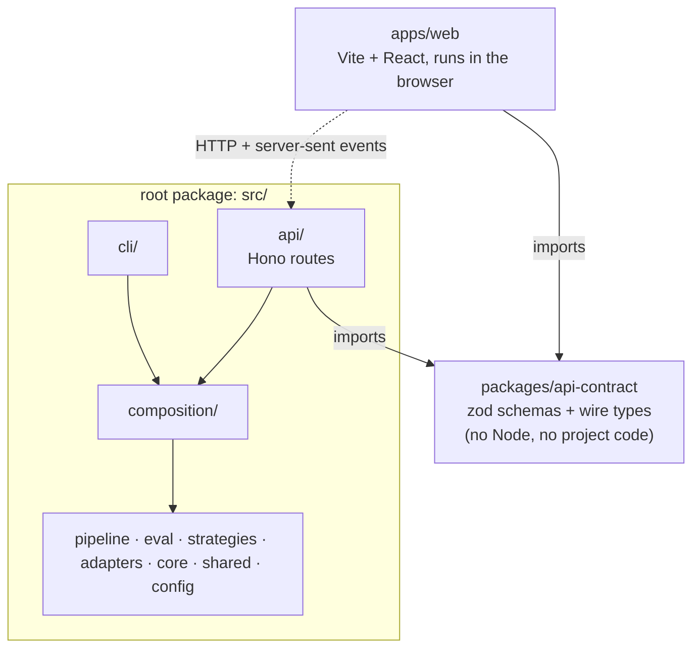

# ADR-0006: Web stack and workspace layout

- **Status**: Accepted
- **Date**: 2026-10-22

## Context

Milestone M10 turns the command-line pipeline into a "live book": read the PDF in a browser, ask
questions beside the text, click a citation to jump to the page and see the passage highlighted
(RAG-101 to RAG-106). Three things have to be decided before any of that is built, because each is
expensive to change once code depends on it:

1. **The API framework**: what serves the pipeline over HTTP.
2. **The UI stack**: what renders the book and the chat in the browser.
3. **The repository layout**: whether the library, the command line and the web app stay in one
   package or become several.

What the choice has to respect:

- **The library stays free of frameworks.** [ADR-0001](0001-ports-and-adapters.md) keeps the RAG
  logic behind ports. An HTTP framework is another outside world, so it belongs at the edge with
  the command line, not inside the pipeline.
- **The pipeline already streams.** `RagPipeline.ask` returns the retrieval results first and an
  async stream of tokens after (RAG-072). The API has to pass that on as it happens, then send the
  citations and the trace (RAG-101).
- **The browser cannot run the library.** The library reads files, loads `onnxruntime-node` and talks
  to local model servers. A browser bundle that imported it by accident would either fail to build or
  ship megabytes of Node code. The two sides must be unable to import each other's internals.
- **Work is happening in parallel.** At the time of writing six feature branches (RAG-083 to RAG-092)
  are open against `src/`. A layout change that moves files costs every one of them a conflict.
- **It is a local, single-user tool.** There is no login, no database server and no deployment target
  yet. Choices that pay off only at that scale are not worth their weight.

## Options

### Layout

#### Option A: keep one package, add `src/api/` and `web/` beside it

- Pros: nothing moves. The existing layer rules and scripts keep working.
- Cons: nothing stops the web code importing `src/`. The browser app shares one `package.json` with
  the Node library, so React and the library's native dependencies sit together and one tool config
  has to serve both.

#### Option B: full split into `packages/core`, `apps/cli` and `apps/web` (the ticket's example)

- Pros: package boundaries enforce the layering. Each app has its own dependencies and scripts.
- Cons: every file under `src/` moves and every import path or workspace name changes, so all open
  branches conflict. The library is not a product with several consumers: apart from the web app
  there is one, the command line, and the layers inside it are already enforced by dependency-cruiser.
  A package boundary around code that is only used from one place adds ceremony and no safety.

#### Option C: a pnpm workspace around the library, not through it

The root package stays exactly where it is and keeps `src/` (library, command line and, new, the API
server). Two new workspace members are added: `apps/web` (the browser app) and `packages/api-contract`
(the shapes that cross the HTTP boundary).

- Pros: nothing moves, so no conflicts. The only boundary that is actually dangerous, browser versus
  Node, becomes a real package boundary with its own dependencies. Both sides agree on the wire
  format through one small package instead of by importing each other.
- Cons: two places to look for TypeScript config and scripts. The wire types are written out once
  more instead of reusing the domain types (see Consequences).

### API framework

#### Option 1: Hono

- Pros: built on web-standard `Request` and `Response`, so a route can be tested by calling
  `app.request(...)` with no socket. Has a server-sent-events helper (`streamSSE`) and a zod
  validator, and the project already uses zod. Small, typed, no plugin system to learn.
- Cons: a younger ecosystem than Express or Fastify. Node needs the small `@hono/node-server`
  adapter.

#### Option 2: Fastify

- Pros: mature, fast, good plugin and schema support.
- Cons: its own request and reply objects and a plugin lifecycle for what is four routes. Validation
  would be JSON Schema next to zod, or an extra bridge to keep them the same.

#### Option 3: Express

- Pros: everyone knows it.
- Cons: no first-class TypeScript or streaming story, and async errors need care. It would be chosen
  for familiarity, not for fit.

#### Option 4: plain `node:http`

- Pros: no dependency.
- Cons: routing, body parsing, validation errors and CORS are all hand written for no gain.

### UI stack

#### Option I: Vite + React + TypeScript

- Pros: a plain single-page app, which is all that is needed: the page talks to a local API. Vite gives
  a fast dev server and shares Vitest with the rest of the repository. `pdfjs-dist` (the PDF renderer
  the reader needs) is used directly in React.
- Cons: React is more than the app strictly needs.

#### Option II: Next.js (or another full-stack framework)

- Pros: routing, server rendering and an API layer in one.
- Cons: its server would compete with the API as the thing that owns the composition root. Server
  rendering has nothing to offer a local tool that is not indexed by anyone.

#### Option III: Svelte or plain TypeScript

- Pros: lighter.
- Cons: a smaller pool of examples for the two hardest parts (a PDF viewer with text highlighting and a
  streaming chat), and nothing that the task needs is easier.

## Decision

1. **Layout: Option C.** Keep the root package and `src/` where they are. Add `apps/web` and
   `packages/api-contract` as pnpm workspace members. Do not split the library: the ticket allows it
   "if needed", and it is not needed.
2. **API: Hono**, in `src/api/`, as a new entry point beside `src/cli/`. It parses a request, calls
   the composition root and writes a response. It holds no pipeline logic.
3. **UI: Vite + React + TypeScript** in `apps/web`. Styling and state libraries are left to RAG-102,
   which builds the first screens and can choose with something real in front of it.
4. **One wire contract**, `packages/api-contract`: zod schemas for requests and the TypeScript types of
   responses and stream events. It depends on zod and nothing else, so a browser can load it. The API
   and the web app both import it; neither imports the other.

### The layout

### What this ADR changes in the repository

- `pnpm-workspace.yaml` lists `apps/*` and `packages/*`.
- `apps/web/` and `packages/api-contract/` exist with a README that says what belongs there and what
  may not be imported. No application code yet: that is RAG-101 and RAG-102.
- `.dependency-cruiser.mjs` gains the rules below, and `pnpm deps:check` covers `apps` and `packages`
  as well as `src`.
- `docs/architecture.md` shows the new entry point and the workspace.

### The rules

| Rule                                | Says                                                                                               | Why                                                                                   |
| ----------------------------------- | -------------------------------------------------------------------------------------------------- | ------------------------------------------------------------------------------------- |
| `web-never-imports-the-library`     | Code in `apps/web` may not import from `src/`                                                      | The browser bundle must not pull in Node code. Types it needs come from the contract. |
| `web-and-contract-are-browser-code` | `apps/web` (apart from its build config) and `packages/api-contract` may not import Node built-ins | If it would not run in a browser, it must not be in these folders.                    |
| `contract-imports-nothing`          | `packages/api-contract` may not import from `src/` or `apps/`                                      | Both sides depend on it, so it can depend on neither.                                 |
| `library-never-imports-apps`        | `src/` may not import from `apps/`                                                                 | Apps depend on the library, never the reverse.                                        |
| `only-the-api-uses-the-contract`    | Within `src/`, only `src/api/` may import `packages/api-contract`                                  | The domain types stay independent of the wire format.                                 |
| `entry-points-are-leaves`           | Nothing imports `src/api/` or `src/cli/` except themselves                                         | An entry point calls the library; the library never calls an entry point.             |

The existing layer rules already cover `src/api/`: it is not `composition`, so it may not import a
concrete adapter or strategy, and it reaches the pipeline only through the composition root.

## Consequences

**Easier**

- The API and the web app can be built and tested separately. `app.request(...)` tests a route with no
  server, and the contract package is the one place a change to the wire format is made.
- The domain types can change without breaking the web app. `Citation` and the others are mapped
  to the contract's types at the API boundary, so a refactor behind it cannot leak into the browser by
  accident.
- No open branch is disturbed, and the library keeps one `package.json`, one test run and one set of
  layer rules.

**Harder**

- The wire types repeat some fields of the domain types (a citation has a page and a character span in
  both). That is deliberate, but it is two things to update when a citation gains a field, and a
  mapping function to test at the boundary.
- Tooling has two homes. `apps/web` has its own `tsconfig`, scripts and ESLint environment (DOM
  types, JSX). RAG-101 and RAG-102 wire them into the root `typecheck`, `lint` and `test` scripts
  when there is code to check.
- `EventSource` only does GET, so `POST /ask` is read with `fetch` and a stream reader, and the
  server-sent-event frames are parsed by a small function in the contract package.

**Not decided here**

- How the reader gets the PDF file itself (the API serving it read-only, most likely). RAG-101
  and RAG-102 decide it. The processed document only holds text, and pdf.js renders pages from the file.
- Styling and client state libraries (RAG-102), and authentication. The API binds to `127.0.0.1`
  and has none: it is a local tool. Putting it on a network is a new decision with its own ADR.

**Reversing it**

- If the library gains a second consumer that needs it as a package (a desktop app, a published
  library), it can be moved to `packages/core` then, with the layer rules already written for the
  folders inside it. Nothing here makes that harder than it is today: it is a move plus changing
  imports, which `pnpm deps:check` verifies.
- If Hono turns out to be a poor fit, only `src/api/` changes: the contract and the web app do not
  know which framework serves them.

**To verify when RAG-101 adds the first workspace import**: that dependency-cruiser resolves
`@rag-book/api-contract` to `packages/api-contract` (a pnpm symlink) so the rules above see the
import. They are written for both the real path and the package name.
