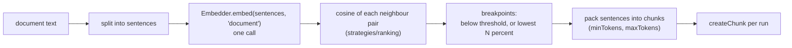

# RAG-026 design: Semantic chunker

**Ticket:** M3, feature, 3 points. Depends on RAG-020 (chunker contract) and RAG-031 (embedder).
**Status:** **built** (2026-10-11).

## 1. What this ticket delivers

A chunker that breaks where the **topic shifts**, measured by embedding similarity, instead of at a
fixed size or a separator.

| Piece                               | Where                                                |
| ----------------------------------- | ---------------------------------------------------- |
| `SemanticChunker`                   | `src/strategies/chunking/semantic-chunker.ts`        |
| Break rules (pure functions)        | `src/strategies/chunking/semantic-breakpoints.ts`    |
| Simple sentence splitter (stand-in) | `src/strategies/chunking/basic-sentence-splitter.ts` |

**Not in this ticket:** registering it in the `ChunkerRegistry` and reading its options from
`rag.config.json` (composition root, later); the full sentence splitter (RAG-023, unmerged), which
replaces the simple one through the `splitSentences` option.

| Acceptance criterion                                                                             | Met by                                               |
| ------------------------------------------------------------------------------------------------ | ---------------------------------------------------- |
| Embeds sentences; breaks where neighbour cosine similarity drops below a threshold or percentile | `BreakRule`, `findBreakpoints`                       |
| Threshold configurable; number of breaks logged                                                  | `breakRule` option; the `semantic chunking done` log |
| Receives an Embedder through its constructor                                                     | `SemanticChunkerOptions.embedder`                    |

## 2. How it works

1. Split the text into sentences and embed them all in one call.
2. `neighbourSimilarities`: sentence `i` against `i + 1`, `n` sentences giving `n - 1` values.
3. `findBreakpoints` (pure): a **threshold** rule breaks where similarity is below a value; a
   **percentile** rule breaks at the lowest N percent of the document's own similarities, so it
   adapts to the model and the book. Percentile 0 means no breaks.
4. Walk the sentences. A topic shift is ignored until the chunk has `minTokens` (so a one-line
   sentence does not become a chunk). A chunk is closed early if the next sentence would exceed
   `maxTokens`. A single sentence longer than `maxTokens` stays whole.
5. Each run of sentences becomes a chunk with `createChunk`, so chunks follow the document in order
   with only whitespace between them (the chunk contract).

## 3. Decisions

| #   | Decision                                               | Why                                                                                                                           |
| --- | ------------------------------------------------------ | ----------------------------------------------------------------------------------------------------------------------------- |
| D1  | The embedder is constructor-injected                   | It is the only chunker that depends on another port. Tests use a fake whose "topics" are unit vectors, so no model is needed. |
| D2  | Break rules are pure functions on numbers              | Tuning a threshold needs the rule testable without an embedder or a document.                                                 |
| D3  | Reuses `cosine` from `strategies/ranking` (RAG-033)    | One implementation of the similarity maths.                                                                                   |
| D4  | Sizes come from the `Tokenizer` port                   | Same unit as every other chunker.                                                                                             |
| D5  | `maxTokens` forces a break; `minTokens` suppresses one | Topic similarity alone can give one huge chunk or many tiny ones. Both limits make the output usable.                         |
| D6  | Breaks are logged with their cause                     | `topicBreaks` vs `sizeBreaks` shows whether the threshold or the size limit is doing the work, which is what tuning needs.    |
| D7  | `splitSentences` is injectable, with a simple default  | RAG-023's splitter is not merged yet. Swapping it in is a one-line change at the composition root.                            |
| D8  | Embed every sentence in a single call                  | The embedder batches internally (RAG-031); the chunker does not need to know the batch size.                                  |

## 4. Testing

Unit tests for the break rules and the chunker (breaks at topic change, percentile, `minTokens`,
`maxTokens`, an over-long sentence, spans and ids, empty documents, wrong number of vectors from
the embedder, the log record, option checks), and the shared chunker contract from RAG-020.
