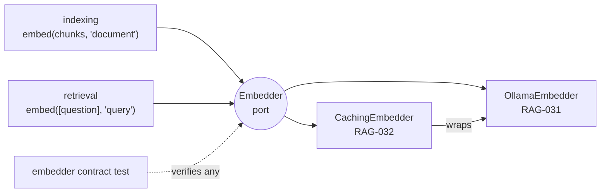

# RAG-030 design: Embedder port

**Ticket:** M3, architecture, 1 point. Depends on RAG-007 (types).
**Status:** **built** (2026-10-11).

## 1. What this ticket delivers

RAG-030 builds **no embedding model**. It builds the contract that every embedder has to follow, and
a shared test that checks the contract.

| Piece                    | Where                                      |
| ------------------------ | ------------------------------------------ |
| `Embedder` port          | `src/core/ports/embedder.ts`               |
| Shared **contract test** | `src/testing/embedder-contract.testing.ts` |
| Test of the contract     | `src/testing/embedder-contract.test.ts`    |

**Not in this ticket:** the Ollama adapter (RAG-031), the caching decorator (RAG-032), model
profiles and prefixes (RAG-090), the vector store, and any config change.

| Acceptance criterion                                                    | Met by               |
| ----------------------------------------------------------------------- | -------------------- |
| `Embedder` interface with `modelId`, `dimensions`, `embed(texts, kind)` | `embedder.ts`        |
| `kind` is `'query'` or `'document'`                                     | the `EmbedKind` type |
| TSDoc states that vectors are returned L2-normalised                    | the TSDoc on `embed` |

## 2. The contract

```ts
type EmbedKind = "query" | "document";

interface Embedder {
  readonly modelId: string; // "ollama:all-minilm": part of every cache key
  readonly dimensions: number; // length of every vector
  embed(texts: readonly string[], kind: EmbedKind): Promise<readonly Float32Array[]>;
}
```



## 3. Decisions

| #   | Decision                                   | Why                                                                                                                                                                              |
| --- | ------------------------------------------ | -------------------------------------------------------------------------------------------------------------------------------------------------------------------------------- |
| D1  | `kind` is required, not optional           | Some models need a different prefix for a question than for a passage (RAG-090). A required argument makes a caller that forgets it a compile error. Symmetric models ignore it. |
| D2  | Vectors are L2-normalised                  | The dot product is then the cosine similarity, so every store and scorer can use the cheaper dot product. Adapters normalise; callers never have to.                             |
| D3  | One batch call, results in input order     | Batching is where the speed is (RAG-031). Order lets callers zip texts and vectors without ids.                                                                                  |
| D4  | Empty input gives empty output             | Callers need no special case for "nothing to embed".                                                                                                                             |
| D5  | `Float32Array`, not `number[]`             | Half the memory of doubles, and it is what vector stores want. The result is `readonly`.                                                                                         |
| D6  | `dimensions` is a property, not discovered | Stores need it before the first call to size their index. An adapter that cannot know it up front checks it on the first call (RAG-031).                                         |
| D7  | The port is types only, in `core`          | `core` has no runtime code. Adapters import the interface, and nothing depends on a model.                                                                                       |

## 4. The contract test

`describeEmbedderContract(name, makeEmbedder)` is called from each embedder's own test, as the
chunker contract is. It checks, for both kinds:

- one vector per text, and none for an empty input
- every vector has `dimensions` entries, all finite, with length 1 (within 1e-4)
- order: a text embedded alone gives the same vector as inside a batch
- the same input twice gives the same vectors

The checks return their violations as data (`checkEmbedder`), so `embedder-contract.test.ts` can
feed them deliberately broken embedders and confirm each break is caught.

RAG-031 (Ollama, with its HTTP calls stubbed) and RAG-032 (caching) add one
`describeEmbedderContract` line each.
