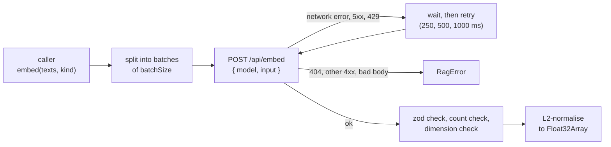

# RAG-031 design: Ollama embedder (all-minilm)

**Ticket:** M3, feature, 3 points. Depends on RAG-030 (Embedder port) and RAG-010 (Ollama host).
**Status:** **built** (2026-10-11).

## 1. What this ticket delivers

The first real `Embedder`: it gets vectors from a local Sentence-BERT model (`all-minilm`, 384
dimensions) through Ollama's `POST /api/embed`.

| Piece                  | Where                                            |
| ---------------------- | ------------------------------------------------ |
| `OllamaEmbedder`       | `src/adapters/embedders/ollama-embedder.ts`      |
| Unit tests, fake fetch | `src/adapters/embedders/ollama-embedder.test.ts` |
| Integration test       | `tests/integration/ollama-embedder.test.ts`      |

**Not in this ticket:** the caching decorator (RAG-032), reading the embedder from config and
choosing it by name (composition root, later), model prefixes for asymmetric models (RAG-090).

| Acceptance criterion                                                       | Met by                                              |
| -------------------------------------------------------------------------- | --------------------------------------------------- |
| Calls `/api/embed` with batched input; batch size and timeout configurable | `batchSize`, `timeoutMs` options                    |
| Retries with backoff on network errors                                     | `maxRetries`, `retryDelayMs` (doubles each attempt) |
| Validates the response with zod and checks dimensions                      | `embedResponse` schema; every vector length checked |
| Returns normalised `Float32Array` vectors                                  | `#toUnitVector`                                     |
| Integration test, skipped when Ollama is not running                       | `tests/integration/ollama-embedder.test.ts`         |

## 2. How it works

## 3. Decisions

| #   | Decision                                                       | Why                                                                                                                                                             |
| --- | -------------------------------------------------------------- | --------------------------------------------------------------------------------------------------------------------------------------------------------------- |
| D1  | An adapter: only this file knows Ollama's request format       | Swapping the model host later touches one file.                                                                                                                 |
| D2  | `address`, `fetch` and `sleep` are passed in                   | The same pattern as `OllamaHost`. Tests need no server and no real waiting, and `OLLAMA_HOST` is resolved in one place (`normalizeOllamaHost`).                 |
| D3  | `dimensions` is a constructor value, checked on every reply    | The port needs it before the first call (RAG-030 D6). Checking every vector, not only the first, costs nothing and catches a model swapped under the same name. |
| D4  | Batches are sent one after another                             | A local server gains little from parallel requests and can run out of memory. Keeps the order trivial.                                                          |
| D5  | Retry network errors, 5xx and 429; fail at once on 404/4xx     | A missing model or a bad request will not fix itself. A 404 says how to fix it: `ollama pull <model>`.                                                          |
| D6  | The adapter normalises, and rejects zero or non-finite vectors | The port promises unit length (RAG-030 D2). Failing loudly beats storing NaN in the index.                                                                      |
| D7  | `embed` ignores `kind`                                         | all-minilm treats a query and a passage alike. The method simply declares no second parameter.                                                                  |
| D8  | Errors are `PROVIDER_UNAVAILABLE`, except a wrong `dimensions` | A wrong dimension is a configuration mistake (`CONFIG_INVALID`), not an outage.                                                                                 |

## 4. Testing

- The shared `describeEmbedderContract` runs against a fake `fetch` that answers like Ollama (with
  vectors that are _not_ unit length, so normalisation is really exercised).
- Unit tests cover batching and order, the empty input, each retry rule (including the doubling
  wait), the 404 message, every kind of bad answer, and the constructor checks.
- The integration test runs the same contract against a real Ollama, and also checks that two
  sentences about cats are closer than a cat and a tax sentence. It is skipped unless Ollama is
  reachable and `all-minilm` is installed (`ollama pull all-minilm`).
