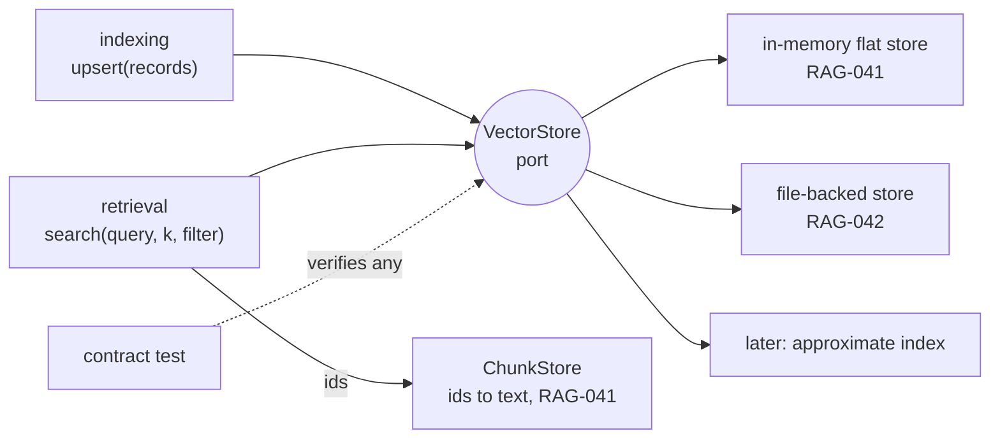

# RAG-040 design: VectorStore port and filters

**Ticket:** M4, architecture, 2 points. Depends on RAG-007 (types).
**Status:** **built** (2026-10-16).

## 1. What this ticket delivers

RAG-040 builds **no store**. It builds the contract every vector store has to follow, the filter
language, and a shared test that checks the contract.

| Piece                    | Where                                          |
| ------------------------ | ---------------------------------------------- |
| `VectorStore` port       | `src/core/ports/vector-store.ts`               |
| `MetadataFilter` types   | `src/core/types/filter.ts`                     |
| Shared **contract test** | `src/testing/vector-store-contract.testing.ts` |
| Test of the contract     | `src/testing/vector-store-contract.test.ts`    |

`VectorRecord` and `ScoredId` already existed in `core/types/retrieval.ts` (RAG-007).

**Not in this ticket:** the in-memory store and `ChunkStore` (RAG-041), saving to disk (RAG-042),
using filters in retrieval (RAG-043), approximate indexes, and any config change.

| Acceptance criterion                                         | Met by                                             |
| ------------------------------------------------------------ | -------------------------------------------------- |
| `upsert`, `search`, `delete`, `count`                        | `VectorStore`                                      |
| `MetadataFilter`: equals, in, numeric range (pages)          | `FilterClause`: `equals`, `in`, `pageRange`        |
| `search` returns ids and scores only; text in a `ChunkStore` | `search` returns `ScoredId[]`; no text in the port |
| Shared contract test suite for all stores                    | `describeVectorStoreContract`                      |

## 2. The contract

```ts
interface VectorStore {
  readonly dimensions: number;
  upsert(records: readonly VectorRecord[]): Promise<void>;
  search(query: Float32Array, k: number, filter?: MetadataFilter): Promise<readonly ScoredId[]>;
  delete(ids: readonly ChunkId[]): Promise<void>;
  count(): Promise<number>;
}

type MetadataFilter = readonly FilterClause[]; // every clause must hold
type FilterClause =
  | { kind: "equals"; field: "docId" | "strategy"; value: string }
  | { kind: "in"; field: "docId" | "strategy"; values: readonly string[] }
  | { kind: "pageRange"; from?: number; to?: number }; // the chunk touches a page in [from, to]
```



## 3. Decisions

| #   | Decision                                                                    | Why                                                                                                                                                               |
| --- | --------------------------------------------------------------------------- | ----------------------------------------------------------------------------------------------------------------------------------------------------------------- |
| D1  | The store holds vectors and metadata, never text                            | Stores stay small and swappable. A `ChunkStore` turns ids into chunks.                                                                                            |
| D2  | `dimensions` is a property, as on `Embedder`                                | The composition root can check `embedder.dimensions === store.dimensions` once, before anything is indexed. A mismatch is otherwise found at the first upsert.    |
| D3  | The score is cosine similarity, higher is better                            | One meaning of "score" for every store. For the unit vectors an `Embedder` returns it equals the dot product (RAG-033).                                           |
| D4  | Equal scores are ordered by id                                              | The same query must give the same hits on every store and every run, or the A/B comparisons and tests are not repeatable.                                         |
| D5  | A filter is a list of clauses that must all hold                            | Covers every use planned (one book, one strategy, a page range) without a query language. `in` gives "or" on one field. No nesting means no recursive evaluation. |
| D6  | `pageRange` matches chunks that **touch** the range                         | A chunk on pages 4 to 6 belongs to a search of page 5. Requiring the chunk to lie inside the range would hide chunks that cross a page break.                     |
| D7  | Only `docId` and `strategy` can be tested for equality                      | They are the fields filters need now. Others (section path) are added with RAG-043 if needed; adding a clause kind is additive.                                   |
| D8  | `k` counts hits that pass the filter                                        | Filtering after taking `k` would return too few results. The contract has a check for it.                                                                         |
| D9  | `upsert` replaces by id and is all or nothing                               | Chunk ids are content hashes, so re-indexing the same chunk is a replace. A half-stored batch would leave an index nobody can reason about.                       |
| D10 | `delete` ignores unknown ids                                                | Deleting is then idempotent, and callers need not check first.                                                                                                    |
| D11 | Bad input is `INVALID_ARGUMENT` (wrong length, `k` below 1, bad page range) | The same code for every store, so callers and tests branch on it, not on message text.                                                                            |
| D12 | No delete by filter, no `count(filter)` yet                                 | The acceptance criteria do not ask for them. Re-indexing a document is served by namespaced indexes (RAG-034). Both are additive if a ticket needs them.          |

## 4. The contract test

`describeVectorStoreContract(name, make)` is called from each store's own test, as the chunker and
embedder contracts are. `make(dimensions)` returns a fresh, empty store. It checks:

- an empty store: count 0, no hits
- search against a **brute-force answer written in the test file** (not taken from any store or from
  `strategies/ranking`): ids, scores within 1e-5, order, at most `k`, ties by id
- ten filters: each clause kind, several clauses, an empty `in`, a range with one open end, a range
  inside a multi-page chunk, nothing matching, and "k counts filtered hits"
- `upsert` replacing both the vector and the metadata of an existing id
- `delete` of one id, an unknown id and an empty list
- the same search twice gives the same hits
- rejected input: a record or query of the wrong length, `k` of 0, -1, 1.5 or NaN, and bad page
  ranges; and a batch with one bad record stores nothing

The checks return their violations as data (`checkVectorStore`), so `vector-store-contract.test.ts`
can feed them a correct reference store and thirteen deliberately broken ones, and confirm that each
break is caught under the right code.

RAG-041 adds one `describeVectorStoreContract` line for the in-memory store; RAG-042 adds one for the
file-backed store.

## 5. Open points for later tickets

- **Evaluating filters.** Resolved in RAG-041: `matchesFilter` in `strategies/in-memory-index` is the one
  shared pure function, and RAG-043 reuses it. The contract keeps its own matcher on purpose.
- **Approximate indexes** return approximately the best hits. The exact-match contract would need a
  recall threshold for them. Decide when one exists.
