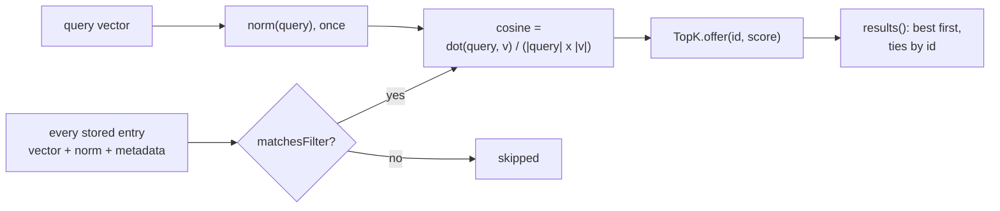

# RAG-041 design: In-memory flat store and ChunkStore

**Ticket:** M4, feature, 3 points. Depends on RAG-040 (VectorStore port) and RAG-033 (vector math).
**Status:** **built** (2026-10-16).

## 1. What this ticket delivers

The reference vector store: **exact** search by comparing the query with every stored vector. Every
faster store built later is checked against this one. Plus the `ChunkStore` that turns the ids a
search returns back into chunks.

| Piece                 | Where                                                     |
| --------------------- | --------------------------------------------------------- |
| `ChunkStore` port     | `src/core/ports/chunk-store.ts`                           |
| `FlatVectorStore`     | `src/strategies/in-memory-index/flat-vector-store.ts`     |
| `TopK` (bounded heap) | `src/strategies/in-memory-index/top-k.ts`                 |
| `matchesFilter`       | `src/strategies/in-memory-index/metadata-filter.ts`       |
| `InMemoryChunkStore`  | `src/strategies/in-memory-index/in-memory-chunk-store.ts` |

**Not in this ticket:** saving to disk (RAG-042), building stores from `rag.config.json` in the
composition root (with the indexing pipeline, RAG-034), filtering as a retrieval feature (RAG-043).

| Acceptance criterion                                     | Met by                                                 |
| -------------------------------------------------------- | ------------------------------------------------------ |
| Brute-force cosine search over all vectors               | `FlatVectorStore.search`                               |
| Top-k with a bounded heap rather than sorting everything | `TopK`: a min-heap that never holds more than `k` hits |
| ChunkStore maps id to chunk                              | `ChunkStore` port, `InMemoryChunkStore`                |
| Passes the VectorStore contract tests                    | `describeVectorStoreContract("FlatVectorStore", ...)`  |

## 2. How a search works

**The heap.** `TopK` is a min-heap whose root is the **worst** of the `k` hits kept so far. A new hit
has to beat the root to get in; then it replaces the root and sinks to its place. That is O(log k) per
vector, O(n log k) for the search, instead of sorting all `n` scores, O(n log n). With 100,000 vectors
and `k = 5` the heap holds 5 hits all along.

**The score.** Cosine similarity, as the port requires. The length of each stored vector is worked out
once, when it is stored, so a comparison costs one dot product and one division. It is right for
vectors of any length, and a vector with no length scores 0 (never NaN).

## 3. Decisions

| #   | Decision                                                               | Why                                                                                                                                                                                                                                                                                                                                      |
| --- | ---------------------------------------------------------------------- | ---------------------------------------------------------------------------------------------------------------------------------------------------------------------------------------------------------------------------------------------------------------------------------------------------------------------------------------- |
| D1  | The store lives in `strategies/`, not `adapters/`                      | The layer rules let an adapter import only core, shared and other adapters, so an adapter could not use `dot` and `norm` from `strategies/ranking`. This store is a pure in-memory algorithm with no I/O, which is what `strategies/` is for. The empty `adapters/vector-stores` folder stays for stores that talk to the outside world. |
| D2  | Persistence (RAG-042) will wrap a `VectorStore`, not extend this class | An adapter that takes a `VectorStore` through its constructor depends only on the port, so it satisfies the layer rules and works with any store.                                                                                                                                                                                        |
| D3  | Cosine with cached norms, not a bare dot product                       | A bare dot product is the same ranking only for unit vectors. Cosine is what the port promises, and caching the norms makes it nearly as cheap.                                                                                                                                                                                          |
| D4  | `upsert` checks the whole batch first, then stores copies              | All or nothing, and a caller who later changes its array cannot damage the index. Vectors holding NaN or Infinity are rejected, because one NaN would corrupt every ranking.                                                                                                                                                             |
| D5  | `matchesFilter` is one shared pure function                            | RAG-040 noted that 041 and 043 should not each write their own. 043 reuses this. The contract test keeps its own matcher on purpose, so it stays independent.                                                                                                                                                                            |
| D6  | `ChunkStore.get(ids)` returns one entry per id, `undefined` if missing | Callers can zip search hits with chunks. Whether a missing chunk is an error is the retriever's decision, not the store's.                                                                                                                                                                                                               |
| D7  | `ChunkStore` is a separate port from `VectorStore`                     | Parents of the parent-child strategy (RAG-027) must be stored without being indexed.                                                                                                                                                                                                                                                     |
| D8  | `InMemoryChunkStore` sits next to the flat store                       | Both are the "everything in memory" index; one folder, one swap when RAG-042 arrives.                                                                                                                                                                                                                                                    |

## 4. A fix to the contract found by this ticket

Running the shared contract on a second implementation exposed that it compared ids exactly. One
fixture query makes two records (c03 and c04) tie mathematically; the contract's arithmetic and the
store's arithmetic round differently, so they put the two in different orders. Both were correct.

`vector-store-contract.testing.ts` now compares through `agrees`: two records whose true scores differ
by less than the tolerance (1e-5) may swap places, but a hit that does not belong or a score that is
clearly wrong is still caught. Without this the contract would reject any correct store whose
arithmetic differs (a database, an approximate index). **Exact ties are still enforced:** records with
identical vectors must be ordered by id, which has its own check. `vector-store-contract.test.ts` has
a test for each: a rounding-level swap passes, a wrong order for identical vectors fails.

## 5. Testing

- The shared `describeVectorStoreContract` on `FlatVectorStore`.
- `TopK` against sorting everything, on 400 random hits with many ties, for five values of `k`; the
  heap never exceeds `k`.
- `FlatVectorStore` against a hand-written score-and-sort of 500 random 16-dimensional vectors;
  non-unit vectors, zero vectors, NaN and Infinity, copying, and a rejected batch storing nothing.
- `matchesFilter` for each clause kind, a page range touching a multi-page chunk, and the page-range
  validation.
- `InMemoryChunkStore`, including a parent that is stored but never indexed.
