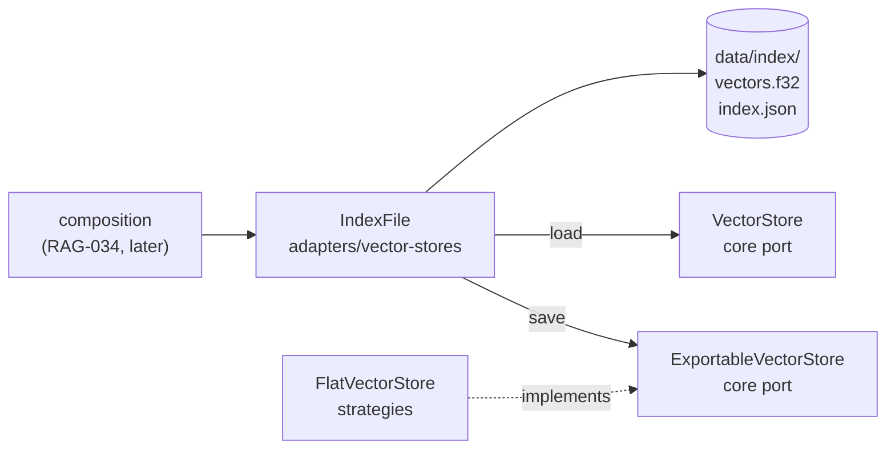

# RAG-042 design: Persist the index to disk

**Ticket:** M4, feature, 2 points. Depends on RAG-041 (flat vector store).
**Status:** **built** (2026-10-19).

## 1. What this ticket delivers

Save a vector index to a folder and load it back, so a book is embedded once and not on every start.

| Piece                       | Where                                                 |
| --------------------------- | ----------------------------------------------------- |
| `IndexFile` (save, load)    | `src/adapters/vector-stores/index-file.ts`            |
| `ExportableVectorStore`     | `src/core/ports/vector-store.ts`                      |
| `FlatVectorStore.records()` | `src/strategies/in-memory-index/flat-vector-store.ts` |
| `INDEX_CORRUPT` code        | `src/shared/errors.ts`                                |

**Not in this ticket:** saving chunks (the text). The ticket asks for vectors plus metadata, so a saved
index finds ids and scores; turning them into text needs a `ChunkStore`, whose persistence belongs
with the indexing pipeline (RAG-034). Also not here: reading `vectorStore.dir` from `rag.config.json`
and building the stores in the composition root (RAG-034), and any change to search.

| Acceptance criterion                                      | Met by                                                                        |
| --------------------------------------------------------- | ----------------------------------------------------------------------------- |
| Vectors saved as a binary Float32 file plus JSON metadata | `vectors.f32` + `index.json`                                                  |
| Load time logged                                          | `IndexFile.load` logs `index loaded` with `count`, `dimensions`, `durationMs` |
| Clear errors for corrupted files or mismatched dimensions | `INDEX_CORRUPT` for damage; `INVALID_ARGUMENT` for another dimension count    |

## 2. The shape



`IndexFile` imports only core and shared, so it satisfies the layer rules and works with any store:
it saves anything that can list its records and loads into anything that can be upserted into.

## 3. The files

`vectors.f32` is every vector as raw little-endian 32-bit floats, row after row, with no header. A
vector is 4 bytes per number. Loading is one `readFile` and a view over the bytes. A JSON array of
floats is the opposite: every number is about ten characters, the whole text is read, and `JSON.parse`
turns it into numbers one at a time.

`index.json`:

```json
{
  "formatVersion": 1,
  "dimensions": 384,
  "count": 2,
  "vectorsSha256": "…64 hex characters…",
  "entries": [
    { "id": "…", "metadata": { "docId": "…", "pageStart": 3, "…": "…" } },
    { "id": "…", "metadata": { "…": "…" } }
  ]
}
```

Entry `n` describes row `n` of `vectors.f32`. Vectors and metadata are in separate files on purpose:
the big, fast-to-read part never goes through a JSON parser.

## 4. Decisions

| #   | Decision                                                             | Why                                                                                                                                                                                                                                                                           |
| --- | -------------------------------------------------------------------- | ----------------------------------------------------------------------------------------------------------------------------------------------------------------------------------------------------------------------------------------------------------------------------- |
| D1  | Persistence is a separate adapter, not a method on `FlatVectorStore` | RAG-041 D2. The store stays a pure in-memory algorithm; files are an outside-world concern.                                                                                                                                                                                   |
| D2  | A small new port, `ExportableVectorStore { records() }`              | `VectorStore` cannot list its contents, so nothing could save it. The alternative, a wrapper mirroring every `upsert` and `delete`, keeps every vector in memory twice. The port is separate so a store that cannot list itself (a remote database) is still a `VectorStore`. |
| D3  | `IndexFile.load(into)` fills a store the caller made                 | The caller picks the store type and dimensions; the loader works with any `VectorStore`. A mismatch between file and store is then a plain comparison.                                                                                                                        |
| D4  | Two error codes: `INDEX_CORRUPT` and `INVALID_ARGUMENT`              | Callers branch on codes. Damage means "rebuild the index"; a dimension mismatch means "the embedding model changed, rebuild" with a different message; a missing index means "ingest first". `INDEX_CORRUPT` is new; the others already existed.                              |
| D5  | A checksum (SHA-256) of the vectors in `index.json`                  | A size check catches a cut-short file but not a flipped byte. One bad float would silently skew results, and the cost is one hash while loading.                                                                                                                              |
| D6  | `index.json` is written last, each file by temporary name + rename   | It is the file a load reads first. A crash part way through leaves the old index, or none, never a half-written one that looks whole. Same approach as `FileEmbeddingCache`.                                                                                                  |
| D7  | The format is little-endian and checked, with a `formatVersion`      | The file is portable between machines. A later layout bumps the version, and an older program refuses it with a clear message instead of misreading it.                                                                                                                       |
| D8  | The version is checked before the shape                              | A newer file would fail the shape check with a confusing message. "Format version 2, this program reads 1" is the useful one.                                                                                                                                                 |
| D9  | `load` stores nothing unless every check passes                      | All the checks run before one `upsert` of the whole batch, which the store already treats as all or nothing. A damaged index never leaves a half-filled store.                                                                                                                |

## 5. Failure cases, and what the caller sees

| Situation                                    | Code               | Message says                                                       |
| -------------------------------------------- | ------------------ | ------------------------------------------------------------------ |
| No `index.json` in the folder                | `INVALID_ARGUMENT` | there is no saved index; ingest a book first                       |
| Index has other dimensions than the store    | `INVALID_ARGUMENT` | 3-dimensional vs 4; the embedding model probably changed           |
| `vectors.f32` missing                        | `INDEX_CORRUPT`    | the file is missing                                                |
| `vectors.f32` the wrong size                 | `INDEX_CORRUPT`    | its size and the size `count × dimensions` needs                   |
| `vectors.f32` the right size but changed     | `INDEX_CORRUPT`    | does not match its checksum                                        |
| `index.json` not JSON, or the wrong shape    | `INDEX_CORRUPT`    | not valid JSON / unexpected shape (the parse error is the `cause`) |
| Unknown `formatVersion`                      | `INDEX_CORRUPT`    | the version found and the one this program reads                   |
| `count` and entries disagree, or an id twice | `INDEX_CORRUPT`    | what disagrees                                                     |

## 6. Testing

- **Adapter (`index-file.test.ts`), with a minimal fake store** because adapters may not import
  strategies: bit-exact round trip of vectors, ids, metadata and order; raw-float layout (4 bytes
  each, no header); an empty store; replacing an older index; no temporary files left; `exists`;
  the logged load time; and one test for every row of the table above, each also checking that the
  target store stayed empty.
- **Round trip through the real store (`composition/index-persistence.test.ts`):** 300 random
  vectors saved from a `FlatVectorStore` and loaded into another give the same top-7 for 20 queries,
  and the same filtered results, so metadata survived.
- **`FlatVectorStore.records()`:** insertion order, a replaced id keeps its place, a deleted id is gone.
