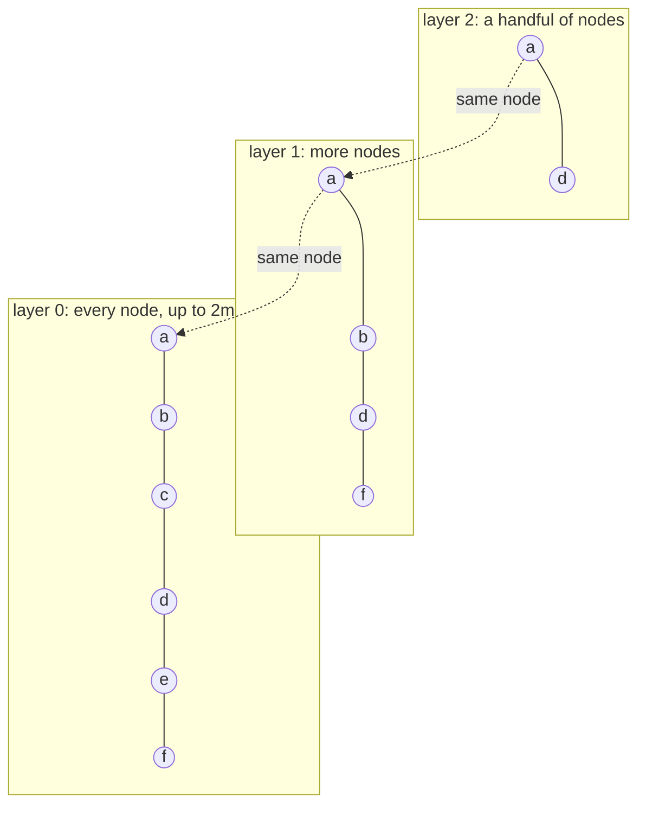

# RAG-044 design: Approximate search with HNSW (spike)

**Ticket:** M4, spike, 5 points. Depends on RAG-041 (flat store).
**Status:** **built** (2026-10-19). Findings are in [ADR-0004](../adr/0004-approximate-search-hnsw.md).

## 1. What this ticket delivers

| Piece                       | Where                                                 |
| --------------------------- | ----------------------------------------------------- |
| `HnswVectorStore`           | `src/strategies/in-memory-index/hnsw-vector-store.ts` |
| `BinaryHeap` (two-way heap) | `src/strategies/in-memory-index/binary-heap.ts`       |
| Recall / latency benchmark  | `scripts/bench-hnsw.ts`, `pnpm bench:hnsw`            |
| The findings                | `docs/adr/0004-approximate-search-hnsw.md`            |

| Acceptance criterion                                  | Met by                                                        |
| ----------------------------------------------------- | ------------------------------------------------------------- |
| Simplified HNSW by hand, behind `VectorStore`         | `HnswVectorStore implements VectorStore`; passes the contract |
| Measure recall@10 against the flat store, and latency | `pnpm bench:hnsw`; a recall test against `FlatVectorStore`    |
| Findings recorded in an ADR                           | ADR-0004                                                      |

**Not in this ticket:** saving the graph to disk, selecting the store from `rag.config.json`, and
a run on real embeddings of the book.

## 2. How HNSW works

Every vector is a node linked to a few near neighbours. A few nodes also appear on higher layers,
which are sparser; each layer up is about `m` times rarer, like express stops on a railway line.

**Search.** Start at the entry node on the top layer. On each layer above 0, hop to whichever
neighbour is closer to the query until none is closer, then drop a layer from there. On layer 0, do
the same walk but keep the best `efSearch` nodes found, and stop when the best unexplored node is
worse than the worst kept. Return the best `k`. It compares the query with a few hundred vectors
instead of all of them, and it can miss a true neighbour, so **the answer is approximate**.

**Insert.** Give the new node a random top layer. Descend as in a search to find its place, then on
each layer from its top down to 0 find the `efConstruction` nearest nodes and link to the best `m`
(`2m` on layer 0). Each neighbour gets a link back, and if that pushes it over its limit it keeps its
best-spread links.

**Choosing links (the heuristic).** Taking the plain nearest `m` wastes links on one tight cluster.
Instead walk the candidates nearest first and skip one that is closer to an already chosen neighbour
than to the new node: the chosen neighbour already leads there. This spreads links in different
directions, which is what lets the walk cross between clusters. If room is left, skipped ones fill it.

## 3. Decisions

| #   | Decision                                                     | Why                                                                                                                                                   |
| --- | ------------------------------------------------------------ | ----------------------------------------------------------------------------------------------------------------------------------------------------- |
| D1  | Hand-written, not `hnswlib-node`                             | A native addon is a build problem on Windows and hides the algorithm, which is the point of a spike. The ADR compares both options.                   |
| D2  | In `strategies/in-memory-index/`, not `adapters/`            | It is pure in-memory computation and uses `dot`, `normalise` and `matchesFilter`, which the layer rules do not allow an adapter to import.            |
| D3  | Vectors are normalised on insert; score is the dot product   | For unit vectors the dot product is the cosine similarity the port promises, and each comparison is cheaper. A zero vector stays zero and scores 0.   |
| D4  | Layers come from a seeded PRNG                               | The port requires the same store and query to give the same hits. The same inserts build the same graph.                                              |
| D5  | Tie-break by id inside the walk, not only at the end         | Results are ordered by the same `ranksAbove` rule as `TopK`, so ordering agrees with the contract.                                                    |
| D6  | Delete and replace leave a dead node; rebuild past 50% dead  | Unlinking a node breaks the paths that run through it. Dead nodes still guide searches but never appear in results. A rebuild restores a clean graph. |
| D7  | A filter is applied during the walk                          | Only matching nodes enter the result set, so `k` hits come back if `k` match. Post-filtering would return fewer. A rare filter degrades to a scan.    |
| D8  | `efSearch` is a settable property; `comparisons` is readable | The benchmark sweeps `efSearch` on one built graph and reports how many vectors a query touched, which is the real saving.                            |
| D9  | `BinaryHeap` is separate from `TopK`                         | The walk needs a best-first heap and a worst-first heap with a comparator; `TopK` is a fixed-purpose bounded heap and stays as it is.                 |

## 4. Testing

- The shared `describeVectorStoreContract` on `HnswVectorStore`.
- Against `FlatVectorStore` on 1,500 random 24-dimensional vectors: recall@10 of at least 0.95, with
  and without a filter; the exact answer for a filter that 2% of chunks satisfy; returned scores
  equal the exact cosine; raising `efSearch` never lowers recall; fewer than half the vectors
  compared with a narrow `efSearch`; the same hits from two builds.
- Deleting more than half the records (forces a rebuild) then comparing with the flat store;
  replacing an id; emptying and reusing; a rejected batch storing nothing; a zero vector; option
  validation.
- `BinaryHeap` against sorting.
