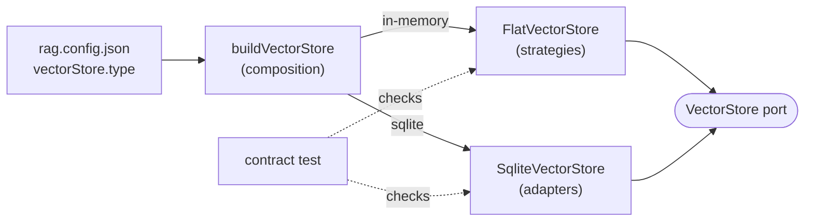

# RAG-045 design: Second vector store adapter (SQLite + sqlite-vec)

**Ticket:** M4, stretch, 3 points. Depends on RAG-040 (VectorStore port).
**Status:** **built** (2026-10-19).

## 1. What this ticket delivers

A second `VectorStore`, backed by a real database, to prove the port is not shaped around the
in-memory store. It passes the same contract test as `FlatVectorStore` without a single change to
the port or the contract.

| Piece                | Where                                                    |
| -------------------- | -------------------------------------------------------- |
| `SqliteVectorStore`  | `src/adapters/vector-stores/sqlite-vector-store.ts`      |
| `buildVectorStore`   | `src/composition/build-vector-store.ts`                  |
| Contract + own tests | `src/adapters/vector-stores/sqlite-vector-store.test.ts` |

| Acceptance criterion                                | Met by                                                                   |
| --------------------------------------------------- | ------------------------------------------------------------------------ |
| sqlite-vec or LanceDB adapter                       | `SqliteVectorStore`, search by sqlite-vec's `vec_distance_cosine`        |
| Passes the same contract tests as the in-memory one | `describeVectorStoreContract("SqliteVectorStore", ...)`                  |
| Selectable from config                              | `vectorStore.type: "sqlite"`, file at `<vectorStore.dir>/vectors.sqlite` |



## 2. How a search works

One SQL statement. The filter becomes a `WHERE` clause, so it runs **before** scoring (pre-filtering,
the same behaviour the port demands):

```sql
SELECT id, COALESCE(1.0 - vec_distance_cosine(vector, ?), 0.0) AS score
FROM records WHERE <filter clauses> ORDER BY score DESC, id ASC LIMIT ?
```

The search is **exact**, like the flat store's: SQLite scores every row that passes the filter.

## 3. Decisions

| #   | Decision                                                  | Why                                                                                                                                                                            |
| --- | --------------------------------------------------------- | ------------------------------------------------------------------------------------------------------------------------------------------------------------------------------ |
| D1  | sqlite-vec rather than LanceDB                            | One file, no server, and SQL gives metadata filtering for free. LanceDB is a heavier native dependency for a book that fits in memory.                                         |
| D2  | Scalar function `vec_distance_cosine`, not a `vec0` table | `vec0` ranks by distance alone, so equal scores could not be ordered by id (port rule 3). Its index also earns nothing at this size; approximate search is RAG-044's question. |
| D3  | Node's built-in `node:sqlite`                             | No native module to compile on Windows. Needs Node 22.13+ (unflagged); it prints an ExperimentalWarning. sqlite-vec loads into it with `allowExtension: true`.                 |
| D4  | Adapter lives in `adapters/`, owns its filter-to-SQL code | Layer rules let adapters import only core and shared, so it cannot reuse `matchesFilter`. The contract test is what keeps the two filter implementations in agreement.         |
| D5  | Dimension is stored in the file                           | Opening an index built with another embedding model fails with a clear message instead of returning garbage.                                                                   |
| D6  | Only filterable metadata is stored                        | The port returns ids and scores, never metadata; text and the rest live in `ChunkStore`.                                                                                       |
| D7  | `upsert` and `delete` run in a transaction                | Port rule 2: all or nothing. Validation also happens before the transaction starts.                                                                                            |
| D8  | A zero vector scores 0                                    | `vec_distance_cosine` gives NULL for it; `COALESCE` matches `FlatVectorStore` and avoids NaN.                                                                                  |

## 4. Not in this ticket

- Wiring the chosen store into the indexing pipeline and CLIs (they take a `VectorStore` already).
- Saving the in-memory store to disk (RAG-042) and filtering as a retrieval feature (RAG-043).
- Approximate search (RAG-044).

## 5. Testing

- The shared contract on `SqliteVectorStore`: dimensions, atomic upsert, ordering, ties, filters.
- Own tests: non-unit vectors, zero vectors, NaN, vector views into a bigger buffer, hostile filter
  strings (values are bound, never concatenated), empty `in`, open-ended page ranges, reopening a file,
  dimension mismatch on reopen.
- `buildVectorStore`: both names, files under `dir`, `CONFIG_INVALID` for an unknown name.
