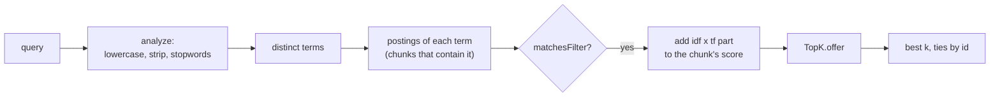

# RAG-051 design: BM25, written by hand

**Ticket:** M5, feature, 5 points. Depends on RAG-020 (chunk contract).
**Status:** **built** (2026-10-19).

## 1. What this ticket delivers

Keyword search: rank chunks by the words of a question, with no library. It is the "exact words"
half of hybrid retrieval (RAG-052); the dense retriever (RAG-050) is the "meaning" half.

| Piece                  | Where                                                   |
| ---------------------- | ------------------------------------------------------- |
| `KeywordIndex` port    | `src/core/ports/keyword-index.ts`                       |
| `analyze` (the terms)  | `src/strategies/keyword/analyzer.ts`                    |
| `Bm25Index`            | `src/strategies/keyword/bm25-index.ts`                  |
| `keyword.json` on disk | `src/adapters/index-writers/file-index-writer.ts`       |
| Keyword step in build  | `src/pipeline/build-index.ts`, wired in `build-indexer` |

**Not in this ticket:** the `Bm25Retriever` class. The `Retriever` port belongs to RAG-050. A
retriever is `KeywordIndex.search` plus a `ChunkStore` lookup, so it is a few lines once 050 merges
(see section 6). Also not here: reading `k1` and `b` from `rag.config.json` (they are constructor
options, defaults 1.2 and 0.75), and stemming.

| Acceptance criterion                                            | Met by                                                             |
| --------------------------------------------------------------- | ------------------------------------------------------------------ |
| Tokeniser: lowercase, punctuation stripping, optional stopwords | `analyze`, `ENGLISH_STOPWORDS`, `Bm25Options.stopwords`            |
| Inverted index with document frequencies                        | `Bm25Index`: term -> (chunk, count) lists; df is the list length   |
| BM25 scoring with configurable k1 (1.2) and b (0.75)            | `Bm25Index.search`, `Bm25Options`                                  |
| Test against a 3-document example computed by hand              | `bm25-index.test.ts`, "the hand-worked example"                    |
| Index persisted alongside the vector index                      | `keyword.json` in `data/index/<namespace>/`, written with the rest |

## 2. The formula

For a query term `t` and a chunk `d`, the chunk's score is the sum over the distinct terms of the query of:

```
score(d, t) = idf(t) * tf * (k1 + 1) / (tf + k1 * (1 - b + b * len(d) / avglen))
idf(t)      = ln(1 + (N - df + 0.5) / (df + 0.5))
```

| Symbol   | Meaning                                             |
| -------- | --------------------------------------------------- |
| `tf`     | how often `t` occurs in `d`                         |
| `df`     | how many chunks contain `t`                         |
| `N`      | how many chunks there are                           |
| `len(d)` | number of terms in `d`; `avglen` is the average     |
| `k1`     | saturation: how fast repeating a term stops helping |
| `b`      | length normalisation: 0 none, 1 full                |

The three ideas, one per part:

- **TF with saturation.** The 3rd occurrence of a word adds less than the 2nd. `k1 = 0` counts a word
  once however often it occurs; a large `k1` approaches raw counting.
- **IDF.** A word in few chunks says more than a word in most. "cherry" in 2 of 3 chunks counts 0.47,
  "apple" in 1 of 3 counts 0.98.
- **Length normalisation.** A match in a short chunk is stronger than the same match in a long one.
  `b = 0` turns this off, `b = 1` makes it proportional.

**The worked example** (also the test). `d1 = "apple banana apple"`, `d2 = "banana cherry"`,
`d3 = "cherry cherry cherry date"`, so `N = 3`, `avglen = 3`, query "apple cherry":

| Chunk | Term   | tf  | len | length factor | term score          | Chunk score |
| ----- | ------ | --- | --- | ------------- | ------------------- | ----------- |
| d1    | apple  | 2   | 3   | 1.00          | 0.980829 x 1.375000 | **1.34864** |
| d3    | cherry | 3   | 4   | 1.25          | 0.470004 x 1.466667 | **0.68934** |
| d2    | cherry | 1   | 2   | 0.75          | 0.470004 x 1.157895 | **0.54421** |

d3 has three "cherry" but scores only 1.27 times d2's one, which is saturation, and d1's single rare
word beats both, which is IDF.

## 3. How a search works



Only the chunks that contain a query term are visited, not every chunk. That is the point of an
inverted index: a one-word question touches that word's list and nothing else. The best `k` are kept
with the `TopK` heap from RAG-041, so the order matches the vector store's: highest score first,
equal scores by id.

## 4. On disk

`data/index/<namespace>/keyword.json` sits next to `manifest.json`, `chunks.jsonl` and `vectors.bin`.
`FileIndexWriter` already writes the whole folder under a temporary name, renames it into place and
writes the manifest last; the keyword file goes into that same folder, so the vector files and the
keyword file are complete or absent **together**. A crash cannot leave vectors without their
keyword index.

```json
{
  "formatVersion": 1,
  "type": "bm25",
  "k1": 1.2,
  "b": 0.75,
  "stopwords": [],
  "docs": [{ "id": "…", "length": 3, "metadata": { "…": "…" } }],
  "terms": [
    ["apple", [0, 2]],
    ["banana", [0, 1, 1, 1]]
  ]
}
```

`terms` is a list of `[term, [chunk number, count, chunk number, count, ...]]`, sorted by term, so the
same index always serializes to the same text. It is a list of pairs and not an object so a term such
as `constructor` can never collide with a property name. The settings (`k1`, `b`, stopwords) are
saved with the index, because queries must be analyzed exactly as the chunks were.

## 5. Decisions

| #   | Decision                                                               | Why                                                                                                                                                                                                                |
| --- | ---------------------------------------------------------------------- | ------------------------------------------------------------------------------------------------------------------------------------------------------------------------------------------------------------------ |
| D1  | Lucene-style IDF, `ln(1 + ...)`                                        | The classic `ln((N - df + 0.5) / (df + 0.5))` goes negative for a word in more than half the chunks, so a match could lower a score. This form is never negative, and everything else is the standard formula.     |
| D2  | `N`, `df` and `avglen` come from the whole index, not the filtered set | A chunk's score then does not depend on which filter was used; filtering only removes chunks. A test checks it.                                                                                                    |
| D3  | The query's distinct terms are counted once                            | "apple apple apple" asks about apple, not three times as strongly. Textbook BM25 has an optional query-frequency factor; leaving it out keeps the formula to what the ticket describes.                            |
| D4  | Index `embedText` when a chunk has one, else `text`                    | The same text the embedder sees, so the structure-aware chunker's headings ("Chapter 3 > Weather") help keyword search too. Only the searchable chunks are indexed, not the parents of parent-child.               |
| D5  | `analyze` is not the model `Tokenizer`                                 | That port counts model tokens (subwords) for chunk sizes. Search needs whole words. Different job, so a small separate function in `strategies/keyword`.                                                           |
| D6  | No stemming; hyphens and dots split; apostrophes join                  | Each rule is simple to explain and to test. "embeddings" will not match "embedding"; stemming is a possible later option, and the settings saved with the index would carry it.                                    |
| D7  | A new `KeywordIndex` port in core                                      | `pipeline/` may only use ports, so `buildIndex` could not create a `Bm25Index` itself. The port is small (`add`, `search`, `count`, `serialize`) and any later keyword index fits it.                              |
| D8  | The writer stores the keyword index as opaque text                     | `IndexContents.keywordIndex` is a string. The strategy owns its format, version and validation (`INDEX_CORRUPT`); the writer stays ignorant of BM25 and the manifest version does not change.                      |
| D9  | An index built before this ticket is rebuilt, not skipped              | The fingerprint only describes chunker, embedder and documents. Without a check, `pnpm index` would say "up to date" for an index that has no `keyword.json`. Rebuilding is cheap: embeddings come from the cache. |
| D10 | `INDEX_CORRUPT` for a damaged keyword index                            | Reuses the code from RAG-042. Loading checks the version, the shape, that no term points at a missing chunk, and that each chunk's length equals the sum of its term counts.                                       |

## 6. How the retriever will plug in (after RAG-050)

```ts
class Bm25Retriever implements Retriever {
  readonly name = "bm25";
  constructor(index: KeywordIndex, chunks: ChunkStore) {}
  async retrieve(query, { k, filter }) {
    const hits = await this.index.search(query.text, k, filter);
    // look the chunks up, rank from 1, retriever: "bm25"
  }
}
```

It is the same shape as `DenseRetriever`: ids and scores from an index, text from the `ChunkStore`.
Nothing in `Bm25Index` has to change.

## 7. Testing

- **The hand-worked example**: all three scores, the order, `k`, and a single term.
- **Parameters**: `b = 0` and `b = 1`, `k1 = 0`, a larger `k1`, stopwords (also given in capitals),
  `embedText`, and invalid `k1` / `b`.
- **Rules**: ties by id, a filter changes membership but not scores, invalid `k` and filters,
  a repeated or reused id adds nothing, empty queries.
- **Against the textbook formula**: 120 random chunks and 25 random queries, compared with a
  plain array implementation of the same formula (no inverted index, no heap).
- **Serialization**: identical answers after a round trip, deterministic text, an empty index,
  `constructor` as a term, and each kind of damage (not JSON, unknown version, wrong shape,
  a dangling term, a bad pair list, a wrong length, a repeated term or id).
- **Pipeline and writer**: the keyword index is filled with the searchable chunks only, handed to the
  writer, skipped when up to date, rebuilt when the old index lacks it, and `keyword.json` lands in
  the same folder and is removed when a later build has none. `tests/integration/index.test.ts` checks
  the real folder.
