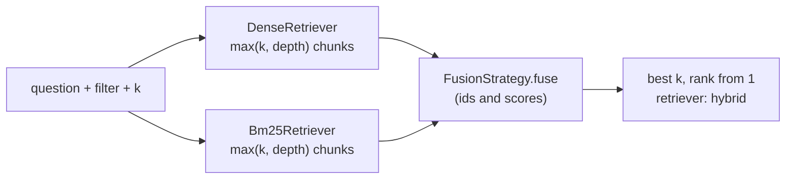

# RAG-052 design: Hybrid retriever, RRF and weighted fusion

**Ticket:** M5, feature, 3 points. Depends on RAG-050 (retriever port, dense retriever) and RAG-051 (BM25).

## 1. What this ticket delivers

Combine keyword and meaning-based rankings into one. Dense search finds a passage that says the
same thing in other words; BM25 finds the exact term or name. Each misses what the other finds.

| Piece                                            | Where                                           |
| ------------------------------------------------ | ----------------------------------------------- |
| `FusionStrategy` port, `RankedList`              | `src/core/ports/fusion.ts`                      |
| `RrfFusion`                                      | `src/strategies/retrieval/rrf-fusion.ts`        |
| `WeightedFusion`                                 | `src/strategies/retrieval/weighted-fusion.ts`   |
| `HybridRetriever`                                | `src/strategies/retrieval/hybrid-retriever.ts`  |
| `Bm25Retriever`                                  | `src/strategies/retrieval/bm25-retriever.ts`    |
| Shared helpers (request check, id-to-chunk step) | `src/strategies/retrieval/retrieval-helpers.ts` |

| Acceptance criterion                              | Met by                                                              |
| ------------------------------------------------- | ------------------------------------------------------------------- |
| Fusion strategy interface                         | `FusionStrategy`                                                    |
| RRF (k = 60) and min-max-normalised weighted sum  | `RrfFusion` (default `k = 60`), `WeightedFusion`                    |
| `HybridRetriever` composes any list of retrievers | `HybridRetriever({ retrievers, fusion, depth? })`                   |
| Tests with fixed input rankings                   | `fusion.test.ts`: the same two rankings, results worked out by hand |

**Not in this ticket:** building retrievers from `rag.config.json` (`retrieval.strategy`,
`retrieval.fusion`) and loading a saved index to feed them. As with RAG-050, that belongs with the
search command (RAG-055). Weights have no config key yet.

## 2. Why scores cannot just be added

A cosine similarity lies between -1 and 1. A BM25 score has no upper limit: 1.35 for the worked
example of RAG-051, 15 for a long question with rare words. Adding them lets BM25 decide everything.
The test `is not what adding the raw scores gives` shows it on fixed numbers:

|     | dense (cosine) | BM25 | raw sum | weighted 0.7 / 0.3 |
| --- | -------------- | ---- | ------- | ------------------ |
| a   | 0.9            | 0    | 0.9     | **0.70**           |
| b   | 0.5            | 12   | 12.5    | 0.65               |
| d   | -              | 6    | 6       | 0.15               |
| c   | 0.1            | -    | 0.1     | 0.00               |

The raw sum ranks b, d, a, c, because BM25's scale swamps the cosine. The weighted fusion ranks a, b, d, c.

## 3. The two strategies

**Reciprocal Rank Fusion** ignores scores and uses only places:

```
score(chunk) = sum over the lists that contain it of   1 / (k + rank)        k = 60, rank from 1
```

A chunk 2nd in one list and 1st in another scores 1/62 + 1/61; one that tops a single list scores
1/61. No list needs rescaling, so it works whatever the retrievers' scales are. `k` softens the top:
rank 1 is worth 1/61 and rank 2 1/62, so first place is hardly better than second.

**Weighted sum** rescales each list, then weighs it:

```
normalised = (score - min) / (max - min)         within one list: its best is 1, its worst 0
score(chunk) = sum over the lists of  weight / (sum of weights) * normalised     (0 if not in a list)
```

It keeps some information about _how much_ better a hit is, which RRF throws away, and costs two
gotchas that the class documents and tests: the worst hit of every list scores 0 (a list is only the
top results, not the whole index), and a list with all scores equal or a single hit has no spread, so
its hits count as 1.

## 4. The hybrid retriever



It is a `Retriever` made of `Retriever`s (the Composite pattern), so it can be used wherever one is,
and can even be one of another hybrid's retrievers. The retrievers run at the same time. Chunks come
with their results, so it needs no chunk store.

## 5. Decisions

| #   | Decision                                                            | Why                                                                                                                                                                                                                                 |
| --- | ------------------------------------------------------------------- | ----------------------------------------------------------------------------------------------------------------------------------------------------------------------------------------------------------------------------------- |
| D1  | Fusion works on ids and scores: `fuse(RankedList[]) -> ScoredId[]`  | A pure function with no chunks in it is easy to test with fixed rankings, and it is the same shape as what vector stores and keyword indexes return.                                                                                |
| D2  | Weights are keyed by retriever name and given to the constructor    | `{ dense: 0.7, bm25: 0.3 }` cannot be mixed up if the order of retrievers changes. RRF has no weights, so the interface carries none. This is why the hybrid retriever (and `fuse`) require unique names.                           |
| D3  | Each retriever is asked for `max(k, depth)`, `depth` defaults to 50 | RRF can only use a chunk it is shown. A chunk that is 2nd in both lists wins over the first of each (tested), but only if the 2nd place is fetched. The filter goes to every retriever.                                             |
| D4  | If one retriever fails, the whole query fails                       | A result that quietly lost half of the hybrid would look fine and be worse. The error is passed on unchanged.                                                                                                                       |
| D5  | A bad request is rejected before any retriever is called            | `k` below 1 or a blank question costs no model call and no search. The check is shared with the other retrievers in `retrieval-helpers.ts`.                                                                                         |
| D6  | The fused score is only comparable within one result                | RRF scores are around 0.03, weighted ones lie between 0 and 1. Nothing should compare them with a cosine score; the port says so.                                                                                                   |
| D7  | `Bm25Retriever` is added here                                       | RAG-051 left it out until the `Retriever` port existed (its design, section 6). Without it a hybrid has only one real retriever. It is `KeywordIndex.search` plus the id-to-chunk step, with the same missing-chunk error as dense. |
| D8  | The dense retriever now uses the shared helpers                     | The request check and the id-to-chunk step were the same code in two places. The behaviour and the messages are unchanged; the existing tests pass untouched.                                                                       |
| D9  | Equal fused scores are ordered by id                                | As everywhere in the retrieval code, so the same lists always give the same result. A test uses two chunks that tie exactly, given in both orders.                                                                                  |

## 6. Testing

- **Fusion, with fixed rankings** (`dense: a 0.9, b 0.5, c 0.1`, `bm25: b 12, d 6, a 0`): each score of
  RRF and of the weighted sum worked out by hand; a different `k`; RRF unchanged when a retriever's
  scores are rescaled, and so is the weighted sum; weights as proportions; the raw-sum comparison;
  all-equal and single-hit lists; bad and missing weights. Rules for both strategies: every id once,
  ties by id in either order, input untouched, empty input, one list passed through, duplicates rejected.
- **Hybrid**: the fused order worked out by hand for a dense and a BM25 ranking that differ; chunks
  found by one retriever only; `k`; weighted fusion; a single retriever; the filter reaching every
  retriever; the number asked for (50, `depth`, `k`); the second-in-both case with and without depth;
  one failing retriever; no retriever call for bad input; constructor errors; a hybrid inside a hybrid.
- **The shared retriever contract** (RAG-050) on `Bm25Retriever` and on `HybridRetriever` with each strategy.
