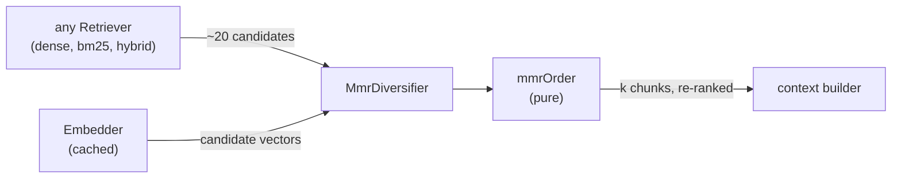

# RAG-053 design: MMR diversification

**Ticket:** M5, feature, 2 points. Depends on RAG-050 (Retriever port).
**Status:** **built** (2026-10-19).

## 1. What this ticket delivers

A step that picks the chunks to keep from a retriever's candidates so they do not repeat each other.
A book says the same thing in the introduction, the chapter and the summary; the five best chunks for
a question can be five near-copies, and the context budget is wasted on one idea.

| Piece                     | Where                                       |
| ------------------------- | ------------------------------------------- |
| `Diversifier` port        | `src/core/ports/diversifier.ts`             |
| `mmrOrder`, `minMaxScale` | `src/strategies/ranking/mmr.ts`             |
| `MmrDiversifier`          | `src/strategies/ranking/mmr-diversifier.ts` |

**Not in this ticket:** wiring it into the search pipeline and the config (a `diversify` section in
`rag.config.json`, a `--lambda` flag). That belongs with the search CLI and composition work
(RAG-055), the same way RAG-050 left wiring to later. Today `lambda` is a constructor option.

| Acceptance criterion                            | Met by                                                                                                 |
| ----------------------------------------------- | ------------------------------------------------------------------------------------------------------ |
| Maximal Marginal Relevance, configurable λ      | `mmrOrder`, `MmrDiversifier({ lambda })`, default 0.5                                                  |
| Test with deliberately duplicated chunks        | `mmr-diversifier.test.ts` (three near-copies), `diversified-retrieval.test.ts` (with `DenseRetriever`) |
| A post-processing step behind a small interface | `Diversifier`: one method, `diversify(candidates, k)`                                                  |

## 2. The idea

MMR picks chunks one at a time. Each time it takes the one that maximises

```
lambda * relevance(i)  -  (1 - lambda) * (highest similarity of i to a chunk already picked)
```

- The first pick has nothing to be similar to, so it is the most relevant chunk.
- `lambda = 1` ignores similarity: the retriever's order, unchanged.
- `lambda = 0` ignores relevance: after the first pick it only adds what is least like what it has.
- In between, a chunk has to be relevant **and** add something. A near-copy of a chunk already picked
  pays almost the full penalty, so a less relevant but different chunk overtakes it.

## 3. The shape



`mmrOrder` is a pure function: it gets relevance numbers and a similarity function and returns the
indices in the order picked. All the I/O (embedding) is in `MmrDiversifier`. That keeps the
algorithm exactly testable with numbers worked out by hand.

**Cost.** Picking `k` of `n` candidates compares each remaining candidate with the one just picked:
about `k * n` similarity calls, at most once per pair. For 20 candidates that is a few hundred dot
products.

## 4. Decisions

| #   | Decision                                                                   | Why                                                                                                                                                                                                                                                                                                                       |
| --- | -------------------------------------------------------------------------- | ------------------------------------------------------------------------------------------------------------------------------------------------------------------------------------------------------------------------------------------------------------------------------------------------------------------------- |
| D1  | Vectors come from embedding the candidates again                           | `RetrievedChunk` has no vector and `VectorStore` cannot return one. Adding a lookup to the store port would touch every store (flat, HNSW, SQLite) while they are changing in other branches. Embedding about 20 texts is one call, and a `CachingEmbedder` (RAG-032) makes repeats free. It also works for BM25 results. |
| D2  | The text embedded is `embedText ?? text`                                   | The text that was embedded when indexing, so "alike" means what it meant there.                                                                                                                                                                                                                                           |
| D3  | Relevance is the retriever's score, min-max scaled to 0..1                 | Keeps what the retriever knew (a hybrid fusion, BM25 term weights), needs no query embedding, and `lambda = 1` gives back the input order exactly. Scores from different retrievers are on different scales, so they are put on one before being weighed against similarity.                                              |
| D4  | Similarity below 0 counts as 0                                             | "Opposite" is no more a duplicate than "unrelated" is. Left negative, the penalty would turn into a reward for opposite chunks.                                                                                                                                                                                           |
| D5  | The result keeps each chunk's `score` and `retriever`; only `rank` changes | A report can still show where a chunk came from and how the retriever scored it. The consequence, stated in the port rules: after diversifying, scores need not descend.                                                                                                                                                  |
| D6  | `Diversifier` is its own port, not a `Retriever`                           | It takes candidates, not a question. Reranking (RAG-060) will be a sibling step. A decorator that wraps a retriever with MMR can be built on top later if wanted.                                                                                                                                                         |
| D7  | Default `lambda` is 0.5                                                    | At 0.7 a near-copy still wins: with relevance scaled 0..1, a copy of the first pick scores 0.7*0.95 - 0.3*0.99 = 0.37 against 0.09 for a different chunk (a test shows it). 0.5 removes the copies in the case this ticket is about. 0.7 is a milder setting for when variety matters less.                               |
| D8  | Equal values are decided by the earlier-ranked candidate                   | Deterministic, and a tie favours the chunk the retriever liked more.                                                                                                                                                                                                                                                      |

## 5. A property worth knowing: min-max needs spread

Min-max scaling stretches the candidates' scores over 0..1, whatever they were. If all candidates
are about equally relevant, the differences are blown up; if one chunk is far better than the rest, the
rest are squeezed towards 0 and variety can no longer pay for their small relevance. The integration
test showed it: with only copies, dogs and fish as candidates, the copy stayed in, because dogs
scaled to 0. With a clearly irrelevant chunk among the candidates (as a real top-20 has), dogs and fish
scale to about 0.9 and win their places.

So MMR works best on a **generous candidate list** (the board suggests 20) and a `k` of 5 or so.
Handing it exactly `k` candidates gives it nothing to choose from.

## 6. Testing

- **`mmrOrder`, hand-worked:** four items, with the arithmetic in the test, for `lambda` 0.5 (the copy
  is pushed behind a different item), 1 (relevance order) and 0 (pure variety). Plus ties, empty input,
  `k` larger than the list, each pair asked at most once, and invalid `lambda` / `k`.
- **`minMaxScale`:** proportions, equal scores, one score, none.
- **`MmrDiversifier`, duplicated chunks:** three near-copies, one dogs chunk, one fish chunk. `lambda` 1
  keeps the three copies; 0.5 keeps one and adds dogs and fish; 0.7 lets a second copy in.
- **Contract rules:** at most `k`, each once, only from the candidates, ranks 1..n, chunk / score /
  retriever unchanged, input not modified, same result twice, opposite vectors treated as unrelated.
- **The embedder:** called once, as `document`, with `embedText` when present; not called for no
  candidates; a wrong vector count is reported; a repeated chunk is rejected before embedding.
- **With a real `DenseRetriever`** (`composition/diversified-retrieval.test.ts`): plain retrieval
  returns the three copies first; after MMR one copy, dogs and fish.
