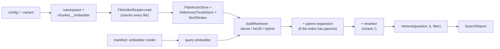

# RAG-055 design: Search CLI with retrieval trace

**Ticket:** M5, feature, 2 points. Depends on RAG-052 (hybrid retriever).

## 1. What this ticket delivers

`pnpm search "question"` shows exactly how retrieval behaved, before any LLM is involved: what each
retriever found with ranks and scores, the final list the pipeline would use, and how long each step
took. When an answer is wrong, this is the first place to look.

```sh
pnpm search "What is cosine similarity?"                  # config defaults (hybrid, rrf)
pnpm search "cosine similarity" --variant bm25            # words only, no Ollama needed
pnpm search "cosine similarity" --k 8 --chapter "Chapter 3" --json
pnpm search "embeddings" --chunker fixed-size --embedder ollama:all-minilm
```

| Piece                                        | Where                                                    |
| -------------------------------------------- | -------------------------------------------------------- |
| `IndexReader` port                           | `src/core/ports/index-reader.ts`                         |
| `FileIndexReader`, shared folder format      | `src/adapters/index-writers/`                            |
| `ObservedRetriever`                          | `src/strategies/retrieval/observed-retriever.ts`         |
| `loadIndex`, `openIndex`                     | `src/composition/load-index.ts`                          |
| `buildRetriever` (strategy, fusion, parents) | `src/composition/build-retriever.ts`                     |
| `buildSearcher`, `SearchReport`              | `src/composition/build-searcher.ts`                      |
| `describeSearch`, `searchToJson`             | `src/composition/search-summary.ts`                      |
| Variants                                     | `src/composition/variants.ts`, `configs/variants/*.json` |
| The command                                  | `src/cli/search.ts`, `src/cli/search-args.ts`            |

| Acceptance criterion                                                     | Met by                                                                                 |
| ------------------------------------------------------------------------ | -------------------------------------------------------------------------------------- |
| Each retriever's top-k with ranks and scores, the fused list and latency | `SearchReport.retrievers` (one list per retriever), `results`, `durationMs`, `totalMs` |
| `--json` output for tests and scripts                                    | `searchToJson`: the whole report, and only that, on standard output                    |
| `--variant` selects a config                                             | `resolveVariant`: `configs/variants/<name>.json`, or a path                            |
| Built on the Trace from RAG-009                                          | `ObservedRetriever` records each retriever as a `Trace` stage                          |

## 2. How a search runs



Each base retriever (dense, bm25) is wrapped in an `ObservedRetriever` before it goes into the
hybrid. The hybrid runs unchanged; as each wrapped retriever finishes it reports its own results,
and the trace records when it started and how long it took. A hybrid asks its retrievers at the same
time, so their stages overlap in the trace, which the report shows (`startMs`).

## 3. Decisions

| #   | Decision                                                        | Why                                                                                                                                                                                                                                                                                                                                                                                                                                                                                       |
| --- | --------------------------------------------------------------- | ----------------------------------------------------------------------------------------------------------------------------------------------------------------------------------------------------------------------------------------------------------------------------------------------------------------------------------------------------------------------------------------------------------------------------------------------------------------------------------------- |
| D1  | Loading an index is part of this ticket                         | `pnpm index` wrote a folder that nothing could read back (the gap noted in RAG-050 and RAG-052). `FileIndexReader` is the inverse of `FileIndexWriter`; both import one `index-format.ts` (file names, manifest schema, chunk-line schema) so they cannot drift apart.                                                                                                                                                                                                                    |
| D2  | The reader checks the files against each other                  | Line count against the manifest's chunk count, searchable lines against its vector count, `vectors.bin` byte length against vectors times dimensions, duplicate ids, JSON and shape per line. Any failure is `INDEX_CORRUPT`, naming the line or file and saying `pnpm index --force`.                                                                                                                                                                                                    |
| D3  | The question is embedded with the model in the manifest         | Not with `embedding.*` from the config. The index records which model made its vectors, so a changed config cannot make a question land in a different vector space. The config's chunker and embedder only choose which namespace to open (as in `pnpm index`).                                                                                                                                                                                                                          |
| D4  | `ObservedRetriever` decorator, `HybridRetriever` untouched      | The hybrid's job is fusing. Reporting what its parts found is observation, which a decorator does for any retriever, and the `Retriever` contract stays as it was.                                                                                                                                                                                                                                                                                                                        |
| D5  | `--variant` is a small config file                              | `defaults.ts` already says a variant can be a three-line file. A bare name means `configs/variants/<name>.json`; a path (a folder in it, or `.json`) is used as it is. A variant also decides which index is searched, through its chunker and embedder. Three ship: `dense`, `bm25`, `hybrid-weighted`. `--variant` and `--config` together is an error.                                                                                                                                 |
| D6  | Retriever stack: base, then parents, then reranking             | `retrieval.strategy` (`dense`, `bm25`, `hybrid`) and `retrieval.fusion` (`rrf`, `weighted`) choose the base. Parent expansion is added only when the index has parents (so its name stays `dense`, not `dense+parents`, for an ordinary index). `buildRetriever` stops there, because the pipeline (RAG-072) reranks in a stage of its own; the search command adds reranking itself with `buildRerankingRetriever`, always wrapped as RAG-060 designed, so nothing branches on the flag. |
| D7  | `weighted` fusion has equal weights                             | Config has no key for weights yet. A variant cannot express them until it has one.                                                                                                                                                                                                                                                                                                                                                                                                        |
| D8  | MMR is not wired                                                | There is no config key for it, and the diversifier would change the list `pnpm search` is meant to show faithfully. A follow-up once config has one.                                                                                                                                                                                                                                                                                                                                      |
| D9  | Keyword search on an index without `keyword.json` fails clearly | `CONFIG_INVALID`, saying to rebuild with `pnpm index --force`. Dense search on the same index still works.                                                                                                                                                                                                                                                                                                                                                                                |
| D10 | `--json` keeps standard output clean                            | Progress logs (`index loaded`, embedding cache hits) go to standard error. `totalMs` is the time of the search itself; the index load is reported separately as `loadMs`.                                                                                                                                                                                                                                                                                                                 |
| D11 | Filters reuse `parseFilterArgs` (RAG-043)                       | `--doc`, `--strategy` (a chunk's chunking strategy; `--chunker` picks the index), `--chapter`, `--section`, `--pages`. The filter reaches every retriever, and the report records it.                                                                                                                                                                                                                                                                                                     |

## 4. The report

`SearchReport` (also the `--json` output): `question`, `k`, `filter`, `settings` (strategy, fusion,
rerank), `index` (namespace, location, embedder, chunker, counts, git commit, build time, `loadMs`),
`retrievers` (each: `name`, `startMs`, `durationMs`, `results` as ranked chunks with scores),
`retriever` and `results` (the final list), `totalMs`, and `stages` (the raw trace).

The text form prints the same: one ranked list per retriever (rank, score, page, section, the start
of the text), then the final list, then a time line.

## 5. Not in this ticket

Wiring MMR (D8), config keys for fusion weights (D7), searching several indexes at once (the
experiment runner, RAG-083), and a loader for the SQLite store: `pnpm search` reads the folders
`pnpm index` writes.

## 6. Testing

- **Reader**: a round trip with the writer (parents, `parentId`, `embedText`, keyword index kept),
  a missing index, bad namespaces, and eight kinds of damage, each with the message it must give.
- **`ObservedRetriever`**: same results and name, same arguments, the stage recorded with its time
  and count, an error recorded and rethrown.
- **`loadIndex` and `openIndex`**: the stores are filled and searchable, parents only in the chunk
  store, no keyword index, an unknown vector store; `openIndex` reads by namespace, says where the
  index came from, logs the load time, and reports a missing and a damaged index.
- **`buildRetriever`**: every strategy and fusion, wrapping only the base retrievers, parents only
  when present, `buildRerankingRetriever` wrapping what it builds, and each error.
- **Variants, args, summary**: name and path resolution, the listing in the error, the shipped
  variants; every flag and error of `parseSearchArgs`; the text and JSON forms.
- **End to end** (`tests/integration/search.test.ts`): an index on disk searched with a fake Ollama,
  the dense and bm25 lists and the fused list worked out for fixed vectors, the filter reaching every
  retriever, `k` from config, the three variants (bm25 makes no Ollama call), and the real command
  with and without `--json`, with a usage error and a missing index.
