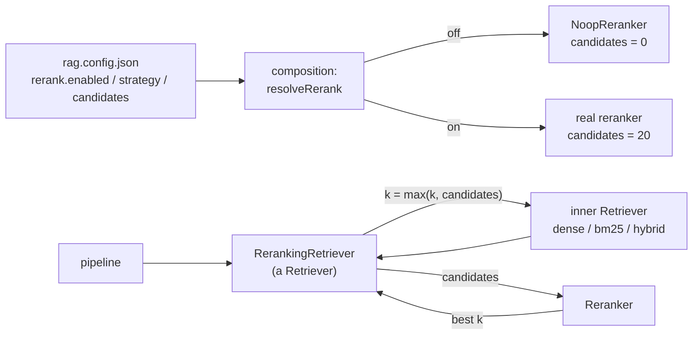

# RAG-060 design: Reranker port, no-op reranker and flag wiring

**Ticket:** M6, architecture, 2 points. Depends on RAG-050 (retriever port) and RAG-008 (config).
**Status:** **built** (2026-10-19).

## 1. What this ticket delivers

Reranking switchable with one flag and **no branches in the pipeline**. It builds the contract,
the "off" implementation, and the wiring. It builds no real reranker (RAG-061, RAG-062).

| Piece                                   | Where                                             |
| --------------------------------------- | ------------------------------------------------- |
| `Reranker` port                         | `src/core/ports/reranker.ts`                      |
| `NoopReranker`                          | `src/strategies/reranking/noop-reranker.ts`       |
| `RerankingRetriever` (decorator)        | `src/strategies/retrieval/reranking-retriever.ts` |
| Picking the reranker from config        | `src/composition/build-reranker.ts`               |
| Shared **contract test**                | `src/testing/reranker-contract.testing.ts`        |
| Test that the flag is read in one place | `src/composition/build-reranker.test.ts`          |

| Acceptance criterion                                                | Met by                                                      |
| ------------------------------------------------------------------- | ----------------------------------------------------------- |
| `Reranker` interface in core/ports                                  | `reranker.ts`                                               |
| `NoopReranker` returns candidates unchanged                         | same order, scores and objects; only cut to `k`             |
| Composition root picks it from `rerank.enabled` / `rerank.strategy` | `resolveRerank`, `buildReranker`, `buildRerankingRetriever` |
| grep shows no rerank flag checks outside `composition/`             | a test greps `src/` and fails if one appears elsewhere      |

**Not in this ticket:** the LLM reranker (061), the cross-encoder (062), the on/off trace comparison
(063), and the search CLI (055), which will call `buildRerankingRetriever`.

## 2. How it fits

The pipeline holds one `Retriever` and calls `retrieve(query, { k })`. Whether that retriever
reranks is decided once, where it is built.

## 3. Decisions

| #   | Decision                                                            | Why                                                                                                                                                    |
| --- | ------------------------------------------------------------------- | ------------------------------------------------------------------------------------------------------------------------------------------------------ |
| D1  | A reranker takes `RetrievedChunk[]` and returns `RetrievedChunk[]`  | Same shape in and out, so it can sit anywhere after a retriever and the trace can show before and after.                                               |
| D2  | It returns the best `k`, not the whole reordered list               | The caller wants `k` and the candidate pool is larger. Both on and off give the caller `k` chunks, with no slicing in the pipeline.                    |
| D3  | Results keep their `retriever`; ranks and scores are the reranker's | `retriever` says where a chunk was found. The reranker's own name is in logs. Scores are only comparable within one list, which the new list is.       |
| D4  | `NoopReranker` validates `k` and the question like a real one       | Switching reranking on must not turn a working call into an error, or the reverse.                                                                     |
| D5  | The decorator `RerankingRetriever` is part of this ticket           | Without it, something in the pipeline would have to fetch `candidates` instead of `k` when reranking is on. That is the flag check the ticket forbids. |
| D6  | The decorator keeps the wrapped retriever's `name`                  | It satisfies the `Retriever` contract unchanged: results still name the retriever that found them.                                                     |
| D7  | Off means `candidates = 0`, so exactly `k` are fetched              | Nothing is fetched for a reranker that will not use it.                                                                                                |
| D8  | Off ignores `rerank.strategy`                                       | The default config names `"llm"` while reranking is off. A strategy only has to exist when it will be used.                                            |
| D9  | Unknown strategy when on is `CONFIG_INVALID` listing what exists    | Until 061 and 062 land, `enabled: true` with `"llm"` fails early with a clear message instead of silently not reranking.                               |
| D10 | A test enforces "no flag reads outside composition/"                | The acceptance criterion was a one-time grep. As a test it stays true. `config/` is allowed too: it defines and validates the settings.                |

## 4. Adding a reranker later

RAG-061 and RAG-062 each add one class under `strategies/reranking/` or `adapters/`, one line to the
map in `build-reranker.ts`, and one `describeRerankerContract` call in their test. The map's factory
will then take what that reranker needs (the LLM provider), which is a change inside composition only.

## 5. Testing

- The shared `describeRerankerContract` on `NoopReranker`; `checkReranked` tested with a broken
  result for each violation code.
- `RerankingRetriever`: fetches `max(k, candidates)`, passes the filter down, returns the reranker's
  order, keeps names, rejects a bad `k` even with a large candidate count; also run through the
  shared **retriever** contract.
- Composition: default config gives the no-op reranker, unknown strategy off vs on, candidate counts.
- The architecture test: no `rerank.enabled`, `.strategy` or `.candidates` read outside
  `composition/` and `config/`.
