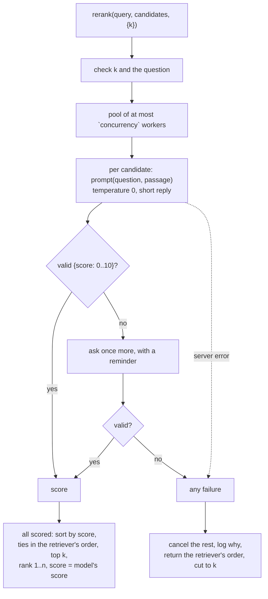

# RAG-061 design: LLM reranker via Ollama

**Ticket:** M6, feature, 3 points. Depends on RAG-060 (Reranker port) and RAG-070 (LlmProvider port).
**Status:** **built** (2026-10-19).

## 1. What this ticket delivers

A reranker that asks a language model how well each candidate chunk answers the question, and keeps
the best `k`. The retriever's score only says "this vector is close to the question's vector"; a
model that reads the question and the passage together can tell "close" from "answers it".

| Piece                  | Where                                                 |
| ---------------------- | ----------------------------------------------------- |
| `LlmReranker`          | `src/strategies/reranking/llm-reranker.ts`            |
| `parseScoreReply`      | `src/strategies/reranking/score-reply.ts`             |
| `runLimited`           | `src/strategies/reranking/run-limited.ts`             |
| Prompt file and loader | `prompts/rerank-relevance.v1.txt`, `rerank-prompt.ts` |
| `"llm"` in the builder | `src/composition/build-reranker.ts`                   |
| `rerank.concurrency`   | `src/config/` and `rag.config.json`                   |

| Acceptance criterion                                    | Met by                                                                       |
| ------------------------------------------------------- | ---------------------------------------------------------------------------- |
| Pointwise relevance score 0-10 returned as JSON         | one request per candidate, reply `{"score": n}`                              |
| Output validated with zod; invalid answers retried once | `parseScoreReply` (zod schema); `LlmReranker.#score` asks a second time      |
| Concurrency limit configurable                          | `rerank.concurrency` (default 4) -> `runLimited`                             |
| Falls back to original order on failure, and logs it    | `rerank` returns `candidates.slice(0, k)` and logs a warning with the reason |
| Depends on the LlmProvider port, not on Ollama          | `LlmReranker` imports only `core`; `composition` chooses the provider        |

**Not in this ticket:** the cross-encoder reranker (RAG-062), the on/off comparison (RAG-063), and a
separate model for reranking (it reuses the generation model, see D1).

## 2. How a rerank works

**Pointwise, not listwise.** One small request per candidate, not one request that shows the model all
twenty. Each judgement is independent of how many candidates there are and of their order, the prompt
is short enough for a small local model, and the requests can run side by side. The cost is more
requests: 20 candidates is 20 calls (about 500 tokens in, 10 out each), so the concurrency limit and a
fast model matter. RAG-063 measures what it buys.

## 3. The prompt

`prompts/rerank-relevance.v1.txt`: a versioned file like the answer prompt. It defines the scale (0
unrelated, 5 same topic but no answer, 10 answers fully), says the passage is quoted material and not
instructions, and asks for only `{"score": 7}`. The version goes into the log, so a result can name
the prompt that produced it. `parseRerankPrompt` checks the file name (`<id>.v<N>.txt`) and that
`{{question}}` and `{{passage}}` each occur exactly once; `fillRerankPrompt` fills both in a single
pass, so a passage that contains the text `{{question}}` or a `$&` is inserted as it is.

## 4. Decisions

| #   | Decision                                                | Why                                                                                                                                                                                                                                      |
| --- | ------------------------------------------------------- | ---------------------------------------------------------------------------------------------------------------------------------------------------------------------------------------------------------------------------------------- |
| D1  | The judge is the `generation` model                     | No new setting and no second model to pull and keep loaded. `buildReranker` takes the `generation` settings (or a ready `LlmProvider`) in its context. A separate `rerank.model` is a later, additive change if an experiment wants it.  |
| D2  | A failure falls back for the **whole** list             | A list that is half judged and half not cannot be compared fairly: a 7 from the model and a 0.83 from the retriever mean different things. "Never worse than not reranking" is a rule that is easy to state and to test.                 |
| D3  | A server failure cancels the requests still running     | A server that is down would otherwise cost one timeout for each of the twenty candidates. The first error is remembered before the others are aborted, so the log names the real cause, not an `AbortError`.                             |
| D4  | Strict reply parsing, found anywhere in the reply       | Models add a sentence or a code fence, so the reply is searched for a flat `{...}` that passes the schema. A score of 11, `"7"` as text, or no score is invalid: an answer that cannot be trusted is retried, not repaired.              |
| D5  | The returned `score` is the model's 0-10 score          | The `Reranker` contract says scores never increase down the list, and the retriever's old scores would not descend along the new order. It also stops anyone comparing a model score with a cosine. Ties keep the retriever's order.     |
| D6  | Temperature 0 and a 60-token reply limit, per call      | The answer is one short JSON object; a model that needs more is not following the prompt. Temperature 0 makes the same input give (as far as the model allows) the same score. These override the generation settings for this use only. |
| D7  | The pool is written by hand (`runLimited`)              | About 25 lines, exact limit, stops handing out work after the first error, results in input order. No dependency for a loop.                                                                                                             |
| D8  | `rerank.concurrency` is a config key                    | The ticket asks for it to be configurable. Default 4: enough to overlap requests, few enough not to queue a single local server.                                                                                                         |
| D9  | The `"llm"` reranker is built only when reranking is on | `resolveRerank` still never looks at `rerank.strategy` when `rerank.enabled` is false, so the default config (strategy `"llm"`, enabled `false`) needs no model and no prompt file.                                                      |

## 5. Things to know

- **Prompt injection.** The passage is text from a book, so the prompt marks it as quoted material and
  the reply must be a number. The worst a hostile passage can do here is raise its own score; it cannot
  change what the model is asked or what is retrieved. Rank manipulation is still possible, which is
  why this is a reranker for your own books and not for untrusted documents.
- **Latency.** Reranking 20 candidates is 20 requests. With a 3B model on a laptop that is seconds per
  query, not milliseconds. The flag exists so this cost is a choice (`rerank.enabled`).
- **Determinism.** The contract asks for the same result for the same input. Temperature 0 gets close,
  but a model may still vary between runs or after a restart; the tests use a scripted model.

## 6. Testing

- **`parseScoreReply`:** bare, fenced and chatty replies; the first valid object wins; extra fields; scores
  out of range, as text, `null`, missing; unterminated and non-JSON replies.
- **`LlmReranker`** with a scripted model:
  - the shared `Reranker` contract from RAG-060;
  - ordering by score (decimals included), `k`, ties in the retriever's order, chunks and `retriever`
    untouched;
  - the request: one per candidate, temperature 0, short reply, an abort signal, the question and
    passage in the prompt;
  - the concurrency limit (never above it, and using all of it; default 4);
  - the retry: the second request shows the model its own reply and the format; two invalid answers fall back;
  - the fallback: original order and scores, one warning with model, prompt version, count and reason;
  - a failing server: no new requests, the running ones cancelled, the first error in the log;
  - no requests for no candidates or for invalid arguments.
- **`runLimited`:** order, the limit, short and empty input, first error and no new work after it.
- **Prompt:** file name, placeholders, `$` and `{{...}}` inside a passage, and the real file in `prompts/`.
- **Composition:** `"llm"` is known; it is built from the generation settings or a given provider; it
  names what is missing; a missing prompt file is a `CONFIG_INVALID` naming the path; off needs nothing;
  and through a real `OllamaProvider` with a fake `fetch`: the model, host, options and prompt reach the
  request, the chunks come back in the model's order, `RerankingRetriever` fetches `rerank.candidates`,
  and an unreachable server gives the retriever's order.
