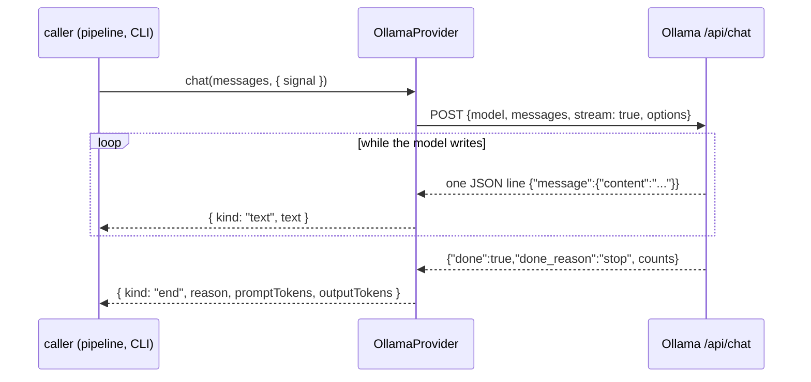

# RAG-070 design: LLM provider port and Ollama provider

**Ticket:** M7, feature, 3 points. Depends on RAG-007 and RAG-010 (config, errors).
**Status:** **built** (2026-10-19).

## 1. What this ticket delivers

The generation side of the system gets its first piece: a port for "a language model that answers a
conversation", and an adapter that talks to Ollama. The context assembler (071) and the pipeline
(072) will call the port and never learn which model is behind it.

| Piece                                                  | Where                                   |
| ------------------------------------------------------ | --------------------------------------- |
| `LlmProvider` port                                     | `src/core/ports/llm-provider.ts`        |
| `ChatMessage`, `ChatDelta`, `ChatOptions`              | `src/core/types/chat.ts`                |
| `OllamaProvider`                                       | `src/adapters/llm/ollama-provider.ts`   |
| `buildLlmProvider` (provider chosen from config)       | `src/composition/build-llm-provider.ts` |
| `generation.temperature`, `generation.maxOutputTokens` | `src/config/`                           |

| Acceptance criterion                                | Met by                                                     |
| --------------------------------------------------- | ---------------------------------------------------------- |
| `LlmProvider` returning an async iterable of deltas | `chat(messages, options): AsyncIterable<ChatDelta>`        |
| Calls `/api/chat` with streaming and parses NDJSON  | `OllamaProvider`: stream decoder, line splitter, zod check |
| Cancellable with `AbortSignal`                      | `ChatOptions.signal`, checked before, during and after     |
| Model and options from config                       | `generation.model/temperature/maxOutputTokens` -> builder  |

## 2. The shape of a reply

A reply is any number of `text` events and exactly one `end`. Callers that want the whole answer
join the text; callers that want a live display print each piece as it comes.

## 3. Decisions

| #   | Decision                                                              | Why                                                                                                                                                                          |
| --- | --------------------------------------------------------------------- | ---------------------------------------------------------------------------------------------------------------------------------------------------------------------------- |
| D1  | Streaming is the only mode                                            | The board's rule: adding it later would break every caller. A non-streaming call is a loop that joins text, so nothing is lost.                                              |
| D2  | Events are a tagged union (`text` / `end`), not bare strings          | The finish reason ("length" means the answer was cut off) and token counts arrive at the end. Guardrails (075) and traces need them, and a bare string has no room for them. |
| D3  | Abort throws the signal's reason (an `AbortError`)                    | It is what `fetch` and the platform do, so callers can treat a cancel like any other cancel. It is not a `RagError`: a cancel is not a provider failure.                     |
| D4  | No retries                                                            | By the time a failure shows up, text may already have reached the caller; a retry would repeat it. The caller decides whether to ask again.                                  |
| D5  | An idle timeout, not a total timeout                                  | A long answer may take minutes while the connection is healthy; a server that goes silent is what must be caught. The default is 2 minutes because loading a model is slow.  |
| D6  | Bytes are decoded as a stream and cut into lines by hand              | Network chunks split lines, and even a single character, anywhere. Tests cut the reply one character at a time and in the middle of a two-byte letter.                       |
| D7  | The abort signal is checked after every read                          | A body that does not fail by itself on abort (a test double, a proxy) must still stop the loop. Found by a test that never ended.                                            |
| D8  | A line `{"error": ...}` becomes PROVIDER_UNAVAILABLE                  | Ollama reports a failure in the middle of a reply this way; the text before it has already been passed on.                                                                   |
| D9  | The provider is chosen by a registry in `composition/`, as the others | `generation.provider` names it; an unknown name is CONFIG_INVALID listing the known ones.                                                                                    |
| D10 | `temperature` and `maxOutputTokens` live in `generation`              | The ticket asks for options from config. A call can still override them through `ChatOptions`.                                                                               |

## 4. Not in this ticket

- Prompt building (RAG-071), the pipeline that calls the provider (072), the CLI (073).
- The LLM reranker (RAG-061), which will reuse this port.
- Providers other than Ollama: one new class and one registry line.
- A shared contract test for the port. A real contract would need a live model; the Ollama adapter is
  tested against scripted streams instead. Worth revisiting when a second provider exists.

## 5. Testing

- Streaming: events in order, finish reasons and token counts, lines cut at any byte, multi-byte
  characters cut in two, a last line with no newline.
- Request: URL, JSON body, per-call options overriding config, nothing sent for an empty conversation.
- Failures: unreachable host (cause kept), missing model (hint to `ollama pull`), HTTP errors, error
  line mid-reply, not JSON, wrong shape, stream closed early, idle timeout.
- Cancelling: already-aborted signal makes no request, abort mid-reply throws `AbortError` and closes
  the connection, `break` out of the loop closes the connection.
- `buildLlmProvider`: default config, host and options reach the request, unknown provider.
