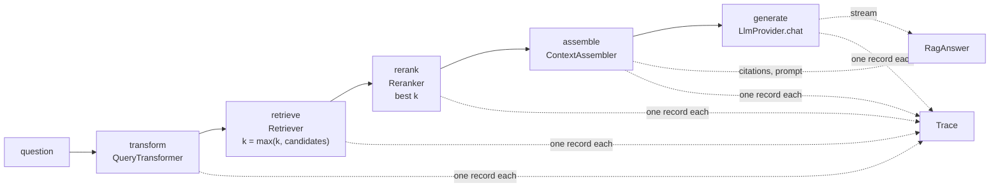
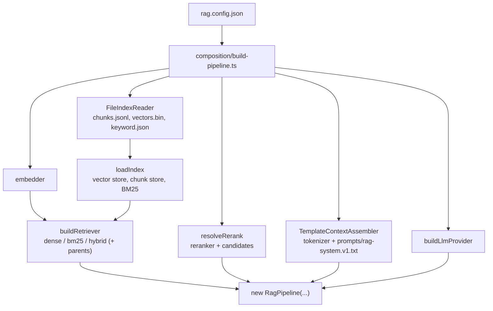

# RAG-072 design: RAG pipeline orchestrator

**Ticket:** M7, architecture, 3 points. Depends on RAG-060 (reranker), RAG-070 (LLM provider) and
RAG-071 (context assembler).
**Status:** **built** (2026-10-19).

## 1. What this ticket delivers

The one object that answers a question: it runs every stage in order, knows only ports, and is built
from configuration in one place.

| Piece                              | Where                                             |
| ---------------------------------- | ------------------------------------------------- |
| `RagPipeline`                      | `src/pipeline/rag-pipeline.ts`                    |
| `QueryTransformer` port            | `src/core/ports/query-transformer.ts`             |
| `IdentityQueryTransformer`         | `src/strategies/query-transform/`                 |
| `buildPipeline` (the only builder) | `src/composition/build-pipeline.ts`               |
| `buildRetriever`                   | `src/composition/build-retriever.ts`              |
| `loadIndex`                        | `src/composition/load-index.ts`                   |
| `FileIndexReader`                  | `src/adapters/index-writers/file-index-reader.ts` |

| Acceptance criterion                                        | Met by                                                                 |
| ----------------------------------------------------------- | ---------------------------------------------------------------------- |
| `RagPipeline` receives its stages through its constructor   | `RagPipelineDeps`: ports only                                          |
| query → transform → retrieve → rerank → assemble → generate | `ask`, one trace stage each                                            |
| Returns the answer stream, citations and trace              | `RagAnswer { stream, citations, prompt, trace }`                       |
| Constructed only in `composition/build-pipeline.ts`         | `buildPipeline`; a test fails if `new RagPipeline(` is found elsewhere |

**Not in this ticket:** the chat REPL (073), real query transformers and conversation memory (074),
grounding guardrails (075), a search CLI (055).

## 2. The flow

`ask` finishes the first four stages before it returns, so the sources are known before the first
word of the answer. `generate` runs as the caller reads the stream.

## 3. How the pieces are wired

## 4. Decisions

| #   | Decision                                                                           | Why                                                                                                                                                                                                  |
| --- | ---------------------------------------------------------------------------------- | ---------------------------------------------------------------------------------------------------------------------------------------------------------------------------------------------------- |
| D1  | `RagPipeline` is in `pipeline/` and imports only `core` and `shared`               | The layer rules already forbid concrete classes there. The class cannot name one even by mistake.                                                                                                    |
| D2  | `ask` returns after assembly; the stream is lazy                                   | The caller can show sources at once, and a failure before generation is a rejected `ask`, not a half-started answer. The model is not called for a stream nobody reads.                              |
| D3  | The pipeline takes the retriever and the reranker separately                       | The ticket and RAG-063 want `retrieve` and `rerank` as separate trace stages. `RerankingRetriever` (RAG-060) hides the second inside the first, so it stays for callers that do not trace.           |
| D4  | `rerankCandidates` is a number in the deps; 0 means reranking is off               | The pipeline fetches `max(k, rerankCandidates)`. That is arithmetic, not a flag check: `resolveRerank` is the only reader of `rerank.enabled`.                                                       |
| D5  | The `generate` stage is closed by the stream itself                                | Done, abandoned (`break`) and failed are three different records, and the duration covers the whole reply, not just the first token.                                                                 |
| D6  | A minimal `QueryTransformer` port plus `IdentityQueryTransformer`                  | The transform stage needs something to run. It is the same null-object idea as `NoopReranker`. RAG-074 adds transformers (and the conversation they need) as an additive change to this port.        |
| D7  | The pipeline does not answer "not found" itself                                    | With no sources the assembler tells the model so. A threshold on the best score is RAG-075, a decorator around generation.                                                                           |
| D8  | `FileIndexReader` is an adapter, `loadIndex` takes what it read                    | `loadIndex` is then testable without files, and a different reader (a database) can feed it. The writer's own comment had left "loading it again with validation" for later; this is its first form. |
| D9  | `buildRetriever` wraps in `ParentExpandingRetriever` only if the index has parents | The manifest says whether there are any. It is data, not a flag, and wrapping an index with no parents would only rename the retriever.                                                              |
| D10 | `retrieval.fusion: weighted` gives both retrievers weight 1                        | The config has no weights yet. It is listed so the name works; real weights are a config change when an experiment needs them.                                                                       |
| D11 | The prompt is `prompts/rag-system.v1.txt`, a constant in `build-pipeline.ts`       | Changing the wording is a new file and a one-line change here, and `promptVersion` in every answer says which one ran.                                                                               |
| D12 | The assembler counts tokens with `chunking.tokenizer`                              | The config has one tokenizer. If the generation model needs another count, that is a new setting later.                                                                                              |

## 5. Testing

- `RagPipeline` with fake stages: stage order, the transformed question reaching retrieval and the
  prompt, `max(k, candidates)`, the filter, the messages sent to the model, citations, the lazy stream,
  the trace of every stage, `generate` closed as not completed after a `break` and as an error when the
  model fails, a failing stage rejecting `ask`, bad `k` and blank question, an aborted signal.
- `FileIndexReader` against what `FileIndexWriter` saved (including `parentId`, which an earlier version
  of the reader dropped), and a truncated vector file, a bad chunk line, a count that disagrees with the
  manifest, a missing file.
- `buildPipeline` from a real saved index in a temp folder, with a fake embedder and model: the default
  configuration, each retriever, parents, reranking on and off, and every misconfiguration with the
  message that tells what to do.
- The architecture test: `new RagPipeline(` appears only in `composition/build-pipeline.ts`.
