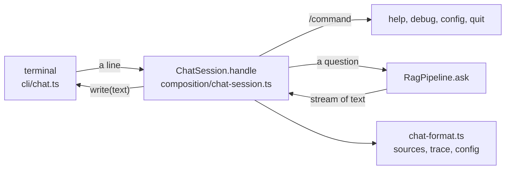

# RAG-073 design: CLI chatbot

**Ticket:** M7, feature, 3 points. Depends on RAG-072 (pipeline orchestrator).
**Status:** **built** (2026-10-19).

## 1. What this ticket delivers

`pnpm chat`: ask the book a question at a prompt and watch the answer being written, followed by the
sources it used, with page numbers. The first end-to-end experience of the whole system.

```
$ pnpm chat
Ask the book a question. Type /help for commands, /quit to leave.
Index recursive__ollama-all-minilm, model ollama:llama3.2
> What is cosine similarity?
Cosine similarity measures the angle between two vectors, not their length [1]. ...

Sources:
  ● [1] p.40  Chapter 3 > 3.1 Similarity
      "Cosine similarity compares the direction of two vectors. ..."
  ○ [2] p.12-13  Chapter 3 > 3.2 Embeddings
      "Embeddings are lists of numbers that stand for the meaning of a passage."
  (● cited in the answer, ○ retrieved but not cited)
>
```

| Piece                         | Where                               |
| ----------------------------- | ----------------------------------- |
| Terminal shell                | `src/cli/chat.ts`                   |
| Argument parser               | `src/cli/chat-args.ts`              |
| `ChatSession` (all the logic) | `src/composition/chat-session.ts`   |
| Text formatting               | `src/composition/chat-format.ts`    |
| `buildChat`                   | `src/composition/build-chat.ts`     |
| `variant` for the pipeline    | `src/composition/build-pipeline.ts` |

**Not in this ticket:** conversation memory and follow-up questions (RAG-074: each question stands
alone here), and the grounding guardrails (RAG-075).

| Acceptance criterion                               | Met by                                                                          |
| -------------------------------------------------- | ------------------------------------------------------------------------------- |
| `pnpm chat` starts a REPL                          | `cli/chat.ts` over `node:readline`                                              |
| Answers stream token by token                      | `ChatSession` writes each `text` delta as it arrives                            |
| Sources printed with page numbers                  | `describeSources`: page range, section and the start of the text of each source |
| `/debug` toggles the trace                         | `ChatSession`; `describeTrace` prints stages, prompt use and what was dropped   |
| `/config` shows the active variant                 | `describeChatConfig`; `--variant` is now an option of the pipeline builder      |
| A thin shell over the pipeline; no logic in `cli/` | see section 2                                                                   |

## 2. Where the logic lives



`cli/chat.ts` does three things: parse the command line, connect `stdin` and `stdout` to a session, and
turn Ctrl+C into `session.interrupt()`. It decides nothing. Everything else is in `ChatSession`, which
takes a line and a `ChatOutput` (`write` for answers, `error` for problems) and has no idea a terminal
exists. That is what lets every rule be tested with plain strings and a scripted pipeline, the same
split `pnpm search` uses (`cli/search.ts` + `composition/search-summary.ts`).

**One line, three kinds.** A blank line is ignored. A line starting with `/` is a command (`/help`,
`/debug`, `/config`, `/quit`, `/exit`; anything else is "Unknown command" on `error`). Anything else
is a question for `pipeline.ask`.

## 3. Decisions

| #   | Decision                                                             | Why                                                                                                                                                                                                                                    |
| --- | -------------------------------------------------------------------- | -------------------------------------------------------------------------------------------------------------------------------------------------------------------------------------------------------------------------------------- |
| D1  | `ChatSession` is in `composition/`, not `cli/`                       | The board says "no logic in cli/". `cli/` may import only `composition/`, and the session has no I/O of its own: it writes through an interface. A reviewer can read `cli/chat.ts` in one screen and find nothing to argue with.       |
| D2  | All sources are printed, the cited ones marked `●`                   | You see what the model was given and what it used. Printing only cited sources would show nothing when the model answers without citing (or says "not found"), and you could not tell a retrieval problem from a generation problem.   |
| D3  | A failed question is printed to `error`; the session continues       | The model may be loading or Ollama may have just restarted; the next question may work. Only a failure to start (bad config, no index) ends the program, with exit code 1.                                                             |
| D4  | Ctrl+C stops the answer; at an empty prompt it leaves                | `pipeline.ask` already takes an `AbortSignal`. `session.interrupt()` aborts the answer in progress and returns whether there was one, which is all the shell needs to choose between "stop" and "leave".                               |
| D5  | With piped input there is no greeting and no prompt                  | `echo "question" \| pnpm chat` prints the answer and its sources and nothing else, so it can be scripted. At a terminal (`stdin.isTTY`) there is a greeting and a `>` prompt. The integration test uses this.                          |
| D6  | `/debug` also works after a failed answer                            | The trace says which stage failed (`generate  FAILED: model not found`), which is exactly when you reach for it.                                                                                                                       |
| D7  | Progress logs are at `warn` level                                    | "index loaded" lines would interleave with the answers. The greeting says which index and model are in use; `/config` says the rest.                                                                                                   |
| D8  | Only `/help`, `/debug`, `/config`, `/quit`                           | What the ticket asks for plus the minimum a REPL needs. `k` and filters can be set with flags when starting; memory is RAG-074.                                                                                                        |
| D9  | `buildPipeline` gets `variant` and a version that returns the config | `/config` must show what the pipeline was built from, so the config is read once and returned (`buildPipelineWithConfig`). `buildPipeline` keeps its signature. The variant lookup is shared with `buildSearcher` (`argvWithVariant`). |

## 4. Failure cases

| Situation                                | What happens                                                                                    |
| ---------------------------------------- | ----------------------------------------------------------------------------------------------- |
| No index yet                             | Exit 1, "No index ... Build it with `pnpm index`" on standard error                             |
| Bad option, or a question as an argument | Exit 2 with the usage; `--help` prints the usage and exits 0                                    |
| Ollama not running at a question         | The message on standard error, the session goes on                                              |
| The model fails half way                 | The text already written stays, the message follows, no sources are printed                     |
| Ctrl+C during an answer                  | `[stopped]`, back to the prompt                                                                 |
| Ctrl+C or Ctrl+D at the prompt           | Leaves, exit 0                                                                                  |
| No sources found                         | The model's reply (it was told there are none), then "No sources were found for this question." |

## 5. Testing

- **`ChatSession`, with a scripted pipeline:** each text piece is its own write, in order, before
  the sources; the question, `k` and an abort signal reach the pipeline; blank lines ask nothing;
  several questions in turn; no sources; a failed question and a failure half way both leave the session
  usable; `interrupt` stops a held answer and says so; every command, in any case; `/debug` on, off,
  from the start, and after a failure; unknown commands; the greeting.
- **Formatting:** `[1]`, `[1][3]` and `[1, 2]` count as citations and `[a]` does not; markers; page
  ranges and sections; long text cut to a line; the trace with stage summaries, failed stages, prompt
  use and left-out chunks; `/config` for a variant, the default, and a reranker.
- **Arguments:** every option with a space or `=`, config overrides skipped with their values, missing
  values, an invalid `k`, unknown options, a question given as an argument, `--variant` with `--config`.
- **Pipeline builder:** a variant is used as the config file, the command line overrides it, an unknown
  variant lists the ones that exist, and `buildPipeline` and `buildPipelineWithConfig` agree.
- **The real command** (`tests/integration/chat.test.ts`), with a small HTTP server that speaks
  Ollama's streaming `/api/chat`: the server sends the first half of an answer and **holds the rest
  until the test has seen the first half on the command's output**, so the test would hang if the command
  waited for the whole answer. Also: piped input prints only answers and ends with the input; `/config`
  and `/debug`; an unreachable Ollama; no index; a bad option and `--help`.
