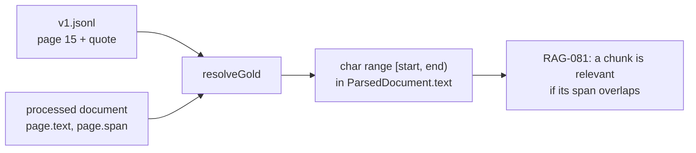

# RAG-080 design: Evaluation dataset v1

**Ticket:** M8, docs, 3 points. Depends on RAG-015 (ingest, for the processed document).
**Status:** **built** (2026-10-19).

## 1. What this ticket delivers

The set of questions every variant is judged on, plus the small amount of code that keeps it honest.

| Piece                                 | Where                              |
| ------------------------------------- | ---------------------------------- |
| 61 questions with answers and gold    | `evals/datasets/v1.jsonl`          |
| Source description (title, SHA-256)   | `evals/datasets/v1.meta.json`      |
| How it was written and labelled       | `evals/datasets/README.md`         |
| Schema, parser, `resolveGold`, checks | `src/eval/dataset/`                |
| `pnpm eval:validate`                  | `scripts/validate-eval-dataset.ts` |

| Acceptance criterion                                            | Met by                                                 |
| --------------------------------------------------------------- | ------------------------------------------------------ |
| 40+ questions with question, reference answer, gold pages/spans | 61 questions; `gold` = page + quote, resolved to spans |
| Factual, multi-part, and at least 5 unanswerable                | 40 / 15 / 6, enforced by `checkDatasetShape`           |
| README on how questions were written and labelled               | `evals/datasets/README.md`                             |

## 2. Gold labels: a page and a quote, resolved to a span

## 3. Decisions

| #   | Decision                                                      | Why                                                                                                                                                                 |
| --- | ------------------------------------------------------------- | ------------------------------------------------------------------------------------------------------------------------------------------------------------------- |
| D1  | Gold is `{ page, quote }`, not offsets and not chunk ids      | Chunk ids change with every chunker setting. Raw offsets are unreadable and break if cleaning changes. A quote is written and checked by a person.                  |
| D2  | Offsets are computed, never stored                            | One source of truth. `resolveGold` re-derives them from the processed document, so a cleaner change is caught by the validator instead of silently shifting labels. |
| D3  | A quote must appear exactly once on its page                  | Otherwise the label does not say which occurrence holds the answer.                                                                                                 |
| D4  | Whitespace is matched loosely, everything else exactly        | PDF line breaks are not meaningful, wording is.                                                                                                                     |
| D5  | The dataset is pinned to the book's SHA-256 in `v1.meta.json` | Labels are only valid for the text they were written against. A different PDF fails with `wrong-document`.                                                          |
| D6  | The PDF is not committed                                      | `data/` is ignored, as for every book. Shape checks run in CI on the committed file; the quote check is `pnpm eval:validate` with the book present.                 |
| D7  | Source is Lecture_3_RAG.pdf                                   | The repository's only book is a 4-page sample, too small for 40 questions. The lecture covers the project's own subject and has prose, tables and code.             |
| D8  | v1 is frozen once results exist                               | Scores across experiments must stay comparable. Changes go in v2.                                                                                                   |

## 4. Not in this ticket

Metrics that read the dataset (RAG-081), the answer judge (RAG-082), the runner (RAG-083). The
10-question smoke subset for RAG-085 can be chosen from this file by id.

## 5. Testing

- Parsing: line numbers in errors, blank lines, and each schema rule (unanswerable has no gold,
  answerable has some, short quotes, unknown fields).
- `resolveGold`: exact range, quote across a line break, quotes treated as text and not as a pattern,
  missing page, missing quote, ambiguous quote, other pages ignored.
- Shape and document checks, including a different book and the committed `v1.jsonl`.
- By hand: `pnpm eval:validate` on the ingested lecture finds all 73 quotes exactly once.
