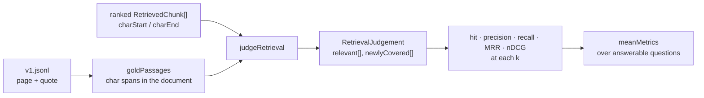

# RAG-081 design: Retrieval metrics, written by hand

**Ticket:** M8, feature, 3 points. Depends on RAG-080 (dataset) and RAG-055 (search CLI).
**Status:** **built** (2026-10-19).

## 1. What this ticket delivers

Five numbers that say whether the right passages were found, as pure functions with no I/O.

| Piece                                                                                | Where                           |
| ------------------------------------------------------------------------------------ | ------------------------------- |
| Overlap test, gold spans, `judgeRetrieval`                                           | `src/eval/metrics/judge.ts`     |
| `hitAtK`, `precisionAtK`, `recallAtK`, `reciprocalRank`, `ndcgAtK`, `scoreRetrieval` | `src/eval/metrics/metrics.ts`   |
| `meanMetrics`                                                                        | `src/eval/metrics/aggregate.ts` |

| Acceptance criterion                              | Met by                                                             |
| ------------------------------------------------- | ------------------------------------------------------------------ |
| hit@k, recall@k, precision@k, MRR and nDCG@k      | the five functions above                                           |
| Relevant if the chunk's span overlaps a gold span | `spansOverlap`, used by `judgeRetrieval`                           |
| Unit tests with hand-computed values              | `metrics.test.ts`: every expected value is worked out in a comment |

**Not in this ticket:** running the pipeline over the dataset and writing results (RAG-083), the
answer-quality metrics (RAG-082), and the report (RAG-084). The runner will call `scoreRetrieval`.

## 2. From a result list to five numbers

## 3. What each metric asks and rewards

For a question with gold passages **A** and **B**, and results at ranks 1 to 5 where rank 1 overlaps A,
rank 3 overlaps B, and ranks 2, 4 and 5 overlap nothing:

| Metric      | Question it asks                                    | Value at k = 5                  | Rewards                                   |
| ----------- | --------------------------------------------------- | ------------------------------- | ----------------------------------------- |
| hit@k       | Is anything relevant in the top k?                  | 1                               | Finding at least one passage              |
| precision@k | What share of the top k is relevant?                | 2 / 5 = 0.4                     | A clean top k with no filler              |
| recall@k    | What share of the gold passages did the top k find? | 2 / 2 = 1                       | Finding every part of a multi-part answer |
| MRR         | How early is the first relevant result?             | 1 / 1 = 1                       | Putting the answer first                  |
| nDCG@k      | Are the passages found, and found high up?          | (1 + 0.5) / (1 + 0.631) = 0.920 | The whole ordering                        |

nDCG discounts rank `r` by `1 / log2(r + 1)`: 1, 0.631, 0.5, 0.431. Finding B at rank 3 earns 0.5;
had it been at rank 2 it would have earned 0.631 and the score would be 1.

## 4. Decisions

| #   | Decision                                                                   | Why                                                                                                                                                                                                                                                            |
| --- | -------------------------------------------------------------------------- | -------------------------------------------------------------------------------------------------------------------------------------------------------------------------------------------------------------------------------------------------------------- |
| D1  | Relevance is span overlap, within the same document                        | The ticket's rule, and the reason RAG-080 labels pages and quotes: any chunker can be scored. Ranges are half-open, so touching at an edge is not overlap, and an empty range overlaps nothing.                                                                |
| D2  | Recall counts gold passages, not relevant chunks                           | The number of chunks that could be relevant depends on the chunker (small chunks split one passage into several). The passages are fixed by the dataset, so recall stays comparable across chunkers.                                                           |
| D3  | nDCG gains 1 for the first result over each gold passage, 0 for later ones | If every overlapping chunk gained 1, overlapping chunks over one passage could push nDCG above 1. This keeps it between 0 and 1, makes the ideal ranking well defined (each passage found at ranks 1, 2, ...), and counts a duplicate as the redundancy it is. |
| D4  | Precision still counts every overlapping chunk, and divides by `k`         | Precision asks how much of the top k is useful, so a second chunk over a passage is still relevant text. Dividing by `k` means returning fewer than `k` results is not rewarded.                                                                               |
| D5  | MRR takes a cutoff                                                         | `reciprocalRank(j, k)` is MRR@k, so a table of metrics at one `k` is consistent. Without a cutoff it looks at all results.                                                                                                                                     |
| D6  | A question with no gold is an error, not a zero                            | Retrieval cannot find what is not in the book. A silent 0 would pull the mean down for the wrong reason. Whether the system should answer such a question is RAG-082's job. `meanMetrics` is given answerable questions only.                                  |
| D7  | The mean is a macro average, and refuses mixed cutoffs or no questions     | Every question counts the same however many passages it has. Averaging k = 3 with k = 5, or averaging nothing, is a mistake that should not produce a number.                                                                                                  |
| D8  | `judgeRetrieval` builds the per-rank flags once                            | Each metric is then a few lines over two boolean lists, easy to check by hand and by property test.                                                                                                                                                            |

## 5. Testing

- `spansOverlap`: shared characters, touching ranges, empty ranges.
- `judgeRetrieval`: relevant and newly-covered flags, a chunk from another document, no gold.
- Each metric at k = 1, 2 and 5 on the example above, a first hit at rank 3, nothing found, an empty
  result, fewer results than k, two chunks over one passage, 2 of 3 passages found. Every expected value is
  written as arithmetic in the test.
- A property test over 200 random rankings: every metric stays within 0 and 1, and hit and recall never
  fall as k grows.
- `meanMetrics` on two hand-worked questions, no questions, mixed cutoffs. `goldPassages` against a small
  document, and its error naming the question.
