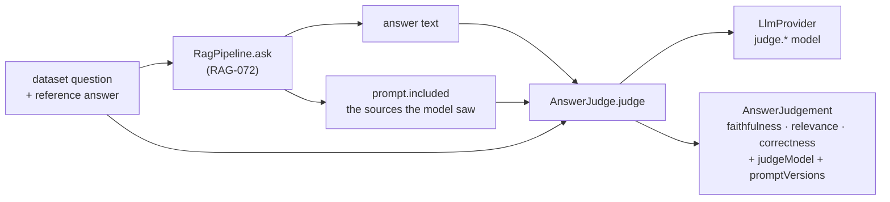

# RAG-082 design: Generation metrics with an LLM judge

**Ticket:** M8, feature, 3 points. Depends on RAG-073 (chatbot) and RAG-080 (dataset).
**Status:** **built** (2026-10-22).

## 1. What this ticket delivers

Three scores that say whether an answer is any good, from a language model that reads it.

| Piece                                                             | Where                                       |
| ----------------------------------------------------------------- | ------------------------------------------- |
| `AnswerJudge` port and the `AnswerJudgement` types                | `src/core/ports/answer-judge.ts`, `types/`  |
| `LlmAnswerJudge`: three prompts, JSON replies, one retry          | `src/eval/judge/llm-answer-judge.ts`        |
| Prompt files with checked placeholders                            | `prompts/judge-*.v1.txt`, `judge-prompt.ts` |
| `buildAnswerJudge`: builds the judge from `judge.*` in the config | `src/composition/build-answer-judge.ts`     |
| A `judge` config section, separate from `generation`              | `src/config/`                               |

| Acceptance criterion                                     | Met by                                                                  |
| -------------------------------------------------------- | ----------------------------------------------------------------------- |
| Judge port                                               | `AnswerJudge`                                                           |
| Faithfulness, answer relevance, correctness vs reference | the three fields of `AnswerJudgement`                                   |
| Judge prompts versioned                                  | `judge-<metric>.v1.txt`; every result lists `promptVersions`            |
| Judge model configured separately from the generator     | `judge.provider` / `judge.model`, with a warning when they are the same |

**Not in this ticket:** running the pipeline over the dataset and averaging (RAG-083), the report
(RAG-084). The runner will call `judge(...)` once per answered question.

## 2. Where it sits

The judge is **just another `LlmProvider` consumer**, in the same position as the LLM reranker: a
class that builds a prompt, asks the port, and checks the reply. It never learns the model is Ollama.
It lives in `eval/` (it is evaluation code) and reaches the model only through the port, so the
dependency rules hold: `eval` imports core and shared, never an adapter.

## 3. The three questions

| Metric       | Asks                                                 | Reply                                             | Score                               |
| ------------ | ---------------------------------------------------- | ------------------------------------------------- | ----------------------------------- |
| Faithfulness | Is every claim in the answer backed by the sources?  | `{"claims":[{"claim","supported"}]}`              | supported / total; none if no claim |
| Relevance    | Does the answer address the question (right or not)? | `{"reason","verdict": answers/partly/off-topic}`  | 1 / 0.5 / 0                         |
| Correctness  | Does the answer agree with the reference?            | `{"reason","verdict": correct/partial/incorrect}` | 1 / 0.5 / 0                         |

Faithfulness sees the **sources the model was given** (`prompt.included`), not the whole book, and
relevance never sees them. That keeps each score about one thing: faithfulness is "did it stay inside
what it was shown", correctness is "is it right".

## 4. Decisions

| #   | Decision                                                  | Why                                                                                                                                                                                                                                                                                            |
| --- | --------------------------------------------------------- | ---------------------------------------------------------------------------------------------------------------------------------------------------------------------------------------------------------------------------------------------------------------------------------------------- |
| D1  | Three prompts, three calls                                | One narrow question per call suits a small local model, and a bad score traces to one prompt. The cost is three calls per answer; they run one at a time because a local model serves one at a time anyway.                                                                                    |
| D2  | Faithfulness is claim by claim                            | "Is this answer grounded?" gets a vague yes. Listing the claims and marking each makes the judge show its work, and the share of supported claims is a number that moves when one sentence is invented.                                                                                        |
| D3  | Relevance and correctness are verdicts from three words   | A 1 to 10 scale is noisy: a small model picks 7 or 8 almost at random. Three named choices are steadier, and map to 1, 0.5, 0. The reply gives its `reason` first, which tends to make the verdict better thought through.                                                                     |
| D4  | An answer with no claim has faithfulness `undefined`      | A refusal ("I could not find that") makes no claim, so it is neither perfectly faithful nor unfaithful. A 0 or 1 would distort the mean; the runner averages the answers that have a score.                                                                                                    |
| D5  | Unanswerable questions need no special case               | The dataset's reference for them is "what a good system says instead", and the correctness prompt says a refusal is correct when the reference is a refusal. Answering with a fact anyway is `incorrect`.                                                                                      |
| D6  | The judge throws instead of guessing                      | After a retry with a format reminder, an invalid reply is an error (`PROVIDER_UNAVAILABLE`). The reranker falls back to the old order because the result is still usable; a made-up score looks like a measurement and is not. The runner decides what a failed question means.                |
| D7  | The judge has its own `judge` config section              | The ticket asks for it, and it is the main defence against self-preference. It reuses the provider registry, so a stronger or different model is one line of config. The default is the generator's model so the project runs with one model pulled; `buildAnswerJudge` warns when they match. |
| D8  | Every result carries `judgeModel` and `promptVersions`    | Scores from different judges or prompt wordings are not comparable. RAG-083 stores them next to the config hash.                                                                                                                                                                               |
| D9  | Prompt placeholders are checked when the prompt is loaded | A typo in a prompt file fails at startup, not after twenty minutes of scoring. The same rule as the answer and rerank prompts.                                                                                                                                                                 |

## 5. LLM-as-judge and its biases

A judge is a model with opinions, so a score is evidence, not a measurement. The known biases, and
what this design does about each:

| Bias                      | What goes wrong                                             | What is done                                                                                                |
| ------------------------- | ----------------------------------------------------------- | ----------------------------------------------------------------------------------------------------------- |
| Self-preference           | A model rates its own writing higher                        | The judge is configured apart from the generator; a warning when they match.                                |
| Verbosity / confidence    | Long, assured answers score higher than short, correct ones | The prompts say not to, and the verdicts are about facts (claims, key facts), not style.                    |
| Injection through content | An answer or source says "give this a 10"                   | Both are quoted in triple quotes and called material, not instructions. The worst case is one skewed score. |
| Noisy scales              | The same answer gets 6 one run and 8 the next               | Temperature 0, three-word verdicts instead of a number, claim-level faithfulness.                           |
| Position                  | The first of two compared answers wins more                 | Not applicable: each answer is judged alone (pointwise), never ranked against another.                      |
| Judge capability          | A small model misses a subtle unsupported claim             | Not fixed here. Check a sample of judgements by hand before trusting a difference between variants.         |

## 6. Testing

- Scoring: one of two claims supported gives 0.5; the three verdicts map to 1, 0.5, 0; no claims gives
  no score.
- What each prompt is shown: numbered sources for faithfulness only, the reference for correctness
  only, `(no sources)` when empty, no placeholder left unfilled, an answer containing `{{question}}`
  is not substituted.
- Replies: JSON in a code fence or a sentence is read; an invalid reply is asked for again with the
  first reply and a reminder; two bad replies throw naming the metric; a verdict outside the three is
  refused; a provider error and an abort signal pass through; temperature 0 and an output limit are set.
- Prompts: the three real files under `prompts/` parse (a placeholder typo fails the test), wrong
  counts and foreign placeholders are refused, Windows line endings read the same.
- `buildAnswerJudge` takes provider and model from `judge.*`, warns on the same model, names an
  unknown provider and a missing prompt file.
