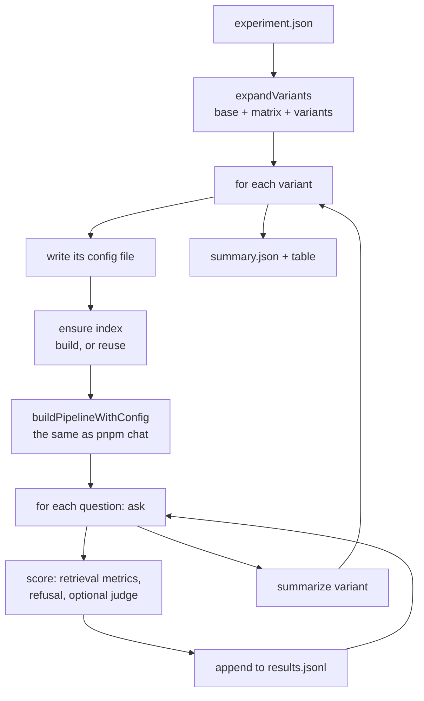

# RAG-083 design: experiment runner

**Ticket:** M8, feature, 5 points. Depends on RAG-081 (retrieval metrics), RAG-082 (LLM judge) and
RAG-034 (indexing pipeline).
**Status:** **built** (2026-10-22).

## 1. What this ticket delivers

One command that runs many variants of the system over the evaluation dataset and saves numbers
that can be compared: `pnpm experiment evals/experiments/retrievers.json`.

| Piece                                                                  | Where                                                        |
| ---------------------------------------------------------------------- | ------------------------------------------------------------ |
| Experiment file format and its matrix expansion                        | `src/eval/experiment/schema.ts`, `expand-variants.ts`        |
| `VariantFactory` / `VariantSystem` (what the runner asks of a variant) | `src/eval/experiment/system.ts`                              |
| The runner and the summaries                                           | `run-experiment.ts`, `summarize.ts`                          |
| Result records and the `ExperimentStore` port                          | `src/core/types/experiment.ts`, `ports/experiment-store.ts`  |
| `FileExperimentStore` (`results.jsonl`, `summary.json`)                | `src/adapters/experiment-stores/`                            |
| Building each variant from a config file                               | `src/composition/build-experiment.ts`                        |
| The command and its table                                              | `src/cli/experiment.ts`, `composition/experiment-summary.ts` |
| Three experiments that ship with the project                           | `evals/experiments/*.json`                                   |

| Acceptance criterion                                                                     | Met by                                                                   |
| ---------------------------------------------------------------------------------------- | ------------------------------------------------------------------------ |
| `evals/experiments/*.json` define variants (chunker × embedder × retriever × rerank × k) | `matrix` and `variants` over any config key (section 3, D1)              |
| Builds or reuses namespaced indexes                                                      | `indexDirFor`: one index per chunking and embedding setting, reused (D4) |
| Raw results as JSONL plus a summary                                                      | `results.jsonl` (one line per variant and question), `summary.json`      |
| Every result records config hash, git commit, dataset version, model names               | `ResultProvenance`, repeated on every line (D6)                          |

**Not in this ticket:** the Markdown report with per-question wins and losses and the first ADR
(RAG-084), and the regression check (RAG-085). Both read the files this writes.

## 2. How a run goes

The layers: `eval/` holds the runner and knows only ports and its own two small interfaces.
`composition/` is the only place that builds real things (indexer, pipeline, judge, store). The
runner could be tested without a model, a disk or a book.

## 3. Decisions

| #   | Decision                                                            | Why                                                                                                                                                                                                                                                            |
| --- | ------------------------------------------------------------------- | -------------------------------------------------------------------------------------------------------------------------------------------------------------------------------------------------------------------------------------------------------------- |
| D1  | A variant is a partial config object; the runner never reads a key  | "The runner never special-cases a strategy." Adding a chunker or a retriever needs no change here. The experiment lists dotted paths (`retrieval.k`); only the config loader knows what they mean, and it rejects a typo with the variant's name.              |
| D2  | `matrix` plus explicit `variants`, on top of `base`                 | A matrix gives every combination without writing 12 files; explicit variants cover the cases that are not a grid. Precedence is base, then matrix, then a variant's own config. Names come from the values, so a result says what changed.                     |
| D3  | Each variant's config is saved as a file and loaded like any config | The variant is built by `loadConfig` and `buildPipelineWithConfig`, the same path as `pnpm chat`, so what is measured is the real system. The saved `configs/<name>.json` reproduces the run.                                                                  |
| D4  | Index folder keyed on chunking and embedding settings               | The namespace names only the chunker and the embedder, so two chunk sizes would overwrite each other. Keying the folder on the settings gives each its own index and lets variants that differ only in retrieval, rerank or `k` share one.                     |
| D5  | Retrieval-only unless `generation: true`                            | The pipeline reads the model lazily, so skipping the stream costs no model call. Generating and judging every question of every variant is slow, so it is opt in. Metrics are taken on the chunks the reranker kept, including ones the prompt budget dropped. |
| D6  | Provenance on every line                                            | A line copied out of the file must still say which config, commit, dataset and models made it. The config hash is of the effective config (file, environment and defaults).                                                                                    |
| D7  | Failures are results                                                | A variant that cannot be built is recorded with its error and the others run; a question that fails is saved with its error and left out of the means, so one failure does not look like a zero. The command exits 1 if anything failed.                       |
| D8  | Unanswerable questions measure refusal, not retrieval               | They have nothing to find, so retrieval metrics do not apply. `refusals` counts how often the system declined: the unanswerable ones should be refused, the answerable ones should not.                                                                        |
| D9  | One question at a time, one variant at a time                       | The models are local and serve one request at a time. Parallel requests would only distort the latency numbers.                                                                                                                                                |
| D10 | JSONL written as each result finishes                               | A run that takes an hour and is stopped (Ctrl+C) keeps what it finished. Each line stands alone, so `jq` and RAG-084 can read it a line at a time.                                                                                                             |
| D11 | A fresh folder per run, never reused                                | Runs are named by the second. If that name exists, `-2`, `-3` is added, so two runs cannot write into one `results.jsonl`.                                                                                                                                     |
| D12 | `evals/results/` is not committed                                   | Results are generated. A result worth keeping is copied somewhere deliberate (the ADR of RAG-084).                                                                                                                                                             |

## 4. What is measured

- **Per question** (`results.jsonl`): the retrieved chunks with rank, score, pages and whether they
  overlap a gold passage; hit, precision, recall, MRR and nDCG at the variant's `k`; whether the system
  answered or refused; with `generation`: the answer, faithfulness, relevance, correctness, tokens;
  latency of retrieval, generation and judging.
- **Per variant** (`summary.json`): the means of the above over the questions that have them, the
  refusal counts, latency p50 and p95, token totals, the index (built or reused), and the config file.

## 5. Known limits

- Latency is wall time on one machine while other things may run. Compare variants of one run with
  each other; do not compare across machines.
- The index fingerprint does not cover the code (RAG-034). After changing a chunker, delete the
  `exp-*` folder or use a different `--index-dir`.
- Only one book: the dataset names the file it was written for and the runner needs it ingested.
- The judge is a small local model. Its scores rank variants; they are not absolute quality.

## 6. Testing

- `expandVariants`: base, matrix and variants precedence, naming, duplicates, size limit, bad input.
- `runExperiment` with a fake system: result order, provenance, hand-computed retrieval scores,
  cutting to `k`, unanswerable questions, failures of variants, questions and the judge, generation
  and refusals, the clock, abort.
- `summarizeVariant`, `percentile`: means, failed questions left out, refusals, latency, tokens.
- `buildExperiment` end to end with a real pipeline over a small on-disk index: the right chunk is
  found, provenance, config files, index sharing, a bad variant, generation with a fake judge,
  and every way the setup can be wrong.
- `FileExperimentStore`, the argument parser, the table, and a guard that every shipped experiment
  file expands into configs the loader accepts.
