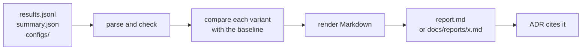

# RAG-084 design: A/B report and first decision

**Ticket:** M8, feature, 3 points. Depends on RAG-083 (experiment runner).
**Status:** the report is **built** (2026-10-22). The decision is **proposed**: ADR-0005 holds its
rule, but the experiments have not been run (see section 5).

## 1. What this ticket delivers

`pnpm report retrievers` turns a finished experiment run into a Markdown document that says which
variant is better, by how much, whether to believe it, and what it cost.

| Piece                                                     | Where                                            |
| --------------------------------------------------------- | ------------------------------------------------ |
| Reading and checking `results.jsonl` and `summary.json`   | `src/eval/report/parse-results.ts`               |
| Comparing a variant with a baseline, question by question | `src/eval/report/compare.ts`                     |
| The Markdown                                              | `src/eval/report/render-report.ts`               |
| Finding a run and writing the report                      | `src/composition/build-report.ts`                |
| The command                                               | `src/cli/report.ts`, `report-args.ts`            |
| The first decision                                        | `docs/adr/0005-default-chunker-and-retriever.md` |
| Where cited reports are kept                              | `docs/reports/`                                  |

| Acceptance criterion                                               | Met by                                                                                                              |
| ------------------------------------------------------------------ | ------------------------------------------------------------------------------------------------------------------- |
| Report: metrics per variant                                        | "Metrics per variant", best in each column in bold                                                                  |
| Report: per-question wins and losses                               | "Against the baseline": counts, interval, the biggest wins and losses with question ids                             |
| Report: latency and token cost                                     | "Latency and token cost": p50 and p95, token totals, tokens per question, index built or reused                     |
| First ADR choosing default chunker and retriever from the evidence | ADR-0005: the rule is fixed and the default is confirmed provisionally; the evidence section is pending (section 5) |

## 2. How it works

`eval/` does the work on plain data and never touches a file. `composition/build-report.ts` finds the
run (a folder, or an experiment name meaning its latest run), reads the files and the run's own
`configs/`, and writes the result.

## 3. Decisions

| #   | Decision                                                                        | Why                                                                                                                                                                                                                                                                                        |
| --- | ------------------------------------------------------------------------------- | ------------------------------------------------------------------------------------------------------------------------------------------------------------------------------------------------------------------------------------------------------------------------------------------ |
| D1  | Verdicts come from a bootstrap interval of the paired difference, not the means | "The fancy option loses" is only visible if luck is ruled out. With about 40 questions, the best of several variants is the best by chance often. "Better" or "worse" needs the 95% interval to exclude 0; otherwise the report says "no clear difference" and advises not choosing on it. |
| D2  | The comparison is paired, by question                                           | Both variants answer the same questions, so the difference per question removes how hard each question is. A table of means cannot show that one variant wins on 3 questions and loses on 3.                                                                                               |
| D3  | The bootstrap is seeded and has no assumptions                                  | The same results give the same report every time. Scores are bounded and lumpy (0, 0.5, 1), so a normal approximation would be wrong; resampling needs none.                                                                                                                               |
| D4  | Only questions both variants scored are compared                                | A question that failed for one side, or has no score (unanswerable has no retrieval score, a refusal has no faithfulness), is left out of both, so the two sides always see the same questions.                                                                                            |
| D5  | The caveats are generated from the data                                         | A hand-written caveat is skipped. The report warns by itself about few questions, different `k`, failed questions and variants that could not run.                                                                                                                                         |
| D6  | The report embeds every variant's config                                        | A report saved with a decision must still say what was compared after `evals/results/` is gone. Configs are read from the run's own `configs/` folder, so they are what was run.                                                                                                           |
| D7  | The files are validated on read                                                 | They may be old, edited or cut short. A damaged line is an error with its line number; a report that quietly left results out would mislead. A run stopped half-way is fine.                                                                                                               |
| D8  | The rule for the decision is written before the results                         | See ADR-0005. Choosing the rule after seeing the numbers lets it be tuned to a winner.                                                                                                                                                                                                     |
| D9  | Reports are committed only when a decision cites them                           | `evals/results/` is a working folder and grows. A cited report goes in `docs/reports/` and is never edited.                                                                                                                                                                                |

## 4. Testing

- `compareVariants`: wins, losses and ties, hand-computed means, float ties, questions left out,
  generation metrics, "better" and "worse" for a consistent gap, "unclear" for noise and for one question.
- `bootstrapInterval`: deterministic, brackets the mean, a point when all differences agree, narrows
  with more data, depends on the seed.
- `renderReport`: sections and order, header, ranking and bold, the summary sentences, the warning
  when nothing is clear, biggest wins and losses, baseline and metric options, latency and tokens,
  generation columns, each caveat, embedded configs, refusals, pipes in names, one variant, errors.
- `parseResults`, `parseSummary`: what the store writes, stopped runs, the failing line and field.
- `buildReport`: a folder, an experiment name, latest run, options, missing configs, unfinished runs,
  damaged files.
- **Real output**: `buildExperiment` runs for real over a small index, with and without generation,
  and `buildReport` reads what it wrote.

Writing the tests found one bug: `isMetricName` accepted inherited names such as `toString`, so
`pnpm report --metric toString` would have passed validation.

## 5. What is not done, and why

The ticket asks for an ADR "choosing the default from the evidence". The evidence needs experiments,
and those need Ollama (embeddings, and the judge for generated answers) and the ingested book. Neither
was available when this was built, and numbers are not made up. So:

- ADR-0005 is **Proposed**. It fixes the rule and keeps the current default (`recursive` + `hybrid`)
  provisionally, which is what the rule gives when nothing has been shown to beat it.
- Its "Evidence" section lists the exact commands and a table of the four conditions marked pending.
  Running them, committing the two reports to `docs/reports/`, and filling in the table turns it into
  an Accepted decision, in the same pull request that changes any default.
