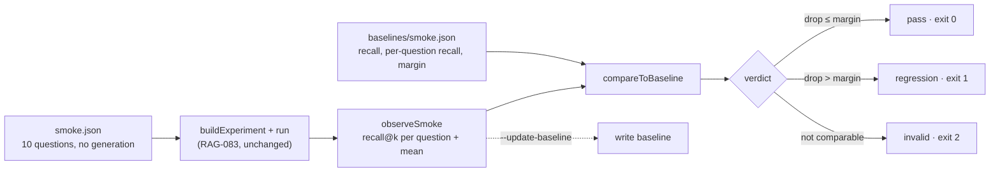

# RAG-085 design: Retrieval regression check

**Ticket:** M8, chore, 2 points. Depends on RAG-083 (experiment runner).
**Status:** **built** (2026-10-22). The first baseline is recorded on a machine with Ollama and the book (section 6).

## 1. What this ticket delivers

One command, `pnpm eval:smoke`, that says whether a change made retrieval worse.

| Piece                                         | Where                                    |
| --------------------------------------------- | ---------------------------------------- |
| 10-question subset of the dataset             | `evals/datasets/v1-smoke.jsonl`          |
| The experiment: default setup, retrieval only | `evals/experiments/smoke.json`           |
| The stored result to compare with             | `evals/baselines/smoke.json`             |
| Compare, observe, report: pure functions      | `src/eval/regression/`                   |
| Run and compare, or record: wiring            | `src/composition/build-smoke.ts`         |
| The command                                   | `src/cli/eval-smoke.ts`, `smoke-args.ts` |
| The PR checklist                              | `.github/pull_request_template.md`       |

| Acceptance criterion                                              | Met by                                                           |
| ----------------------------------------------------------------- | ---------------------------------------------------------------- |
| `pnpm eval:smoke` runs 10 questions, retrieval only               | `smoke.json` has `generation: false` and the 10-question dataset |
| Fails if recall@5 drops more than a set margin below the baseline | `compareToBaseline`; the margin is stored in the baseline (0.05) |
| Required locally before merging retrieval changes                 | the PR template checklist and a README section                   |

## 2. How it fits together



The check is a **thin layer over the experiment runner**. It runs `smoke.json` exactly as
`pnpm experiment` would, so what is measured is the real pipeline built from the real config. It
adds only three things: a fixed small question set, a stored number, and a rule that compares them.

## 3. The rule

```
regression  if  baselineRecall − recall  >  margin          (margin 0.05 by default)
```

Recall here is the mean of recall@5 over the 10 questions. With 10 questions one lost question moves
the mean by about 0.1 (less if it has several gold passages), so a margin of 0.05 fails on any real
loss. A change that finds one more passage for one question is a pass, and is reported as "better".

## 4. Decisions

| #   | Decision                                                             | Why                                                                                                                                                                                                                                                                        |
| --- | -------------------------------------------------------------------- | -------------------------------------------------------------------------------------------------------------------------------------------------------------------------------------------------------------------------------------------------------------------------- |
| D1  | The smoke set is a copy of 10 lines of `v1.jsonl`, not a list of ids | The runner reads a dataset file and the experiment's `dataset` field points at one, so a subset needs no change to RAG-083, which is being built in parallel. A test checks that every smoke question equals the `v1` question with the same id, so the copy cannot drift. |
| D2  | 8 factual and 2 multi-part questions, no unanswerable ones           | Recall needs a gold passage; an unanswerable question has none. Spread over pages 2 to 22, mixing questions that need exact words (names, numbers) and questions that need meaning, so a change that hurts keyword or dense retrieval shows up.                            |
| D3  | The baseline stores per-question recall as well as the mean          | The mean decides, but "recall fell 0.1" does not say where to look. Listing the questions that got worse turns a failure into a place to start.                                                                                                                            |
| D4  | The margin lives in the baseline file                                | The tolerance is a decision about the project, so it is committed and reviewed with the number it applies to. `--margin` overrides it for one run; recording a new baseline keeps the old margin unless `--margin` is given.                                               |
| D5  | The comparison allows a rounding error of 1e-9                       | `0.9 - 0.85` is `0.05000000000000004`. Without the allowance a drop of exactly the margin would fail, which is not what "more than" means.                                                                                                                                 |
| D6  | A run that cannot be compared is `invalid` (exit 2), never a pass    | Another dataset, another `k`, or different questions means the numbers measure different things. A check that quietly passes because it compared the wrong things is worse than no check.                                                                                  |
| D7  | A question that errors stops the check; it is not scored as 0        | If Ollama is down, every question fails. Reading that as recall 0 would report a regression that is really an outage. The error says which question failed and why.                                                                                                        |
| D8  | A changed config hash is a note, not a failure                       | Changing the default retrieval on purpose changes the hash. What matters is whether recall got worse. The note tells the reader the two runs are not the same setup.                                                                                                       |
| D9  | The baseline is read before the run                                  | A missing baseline fails in a second, not after the models have worked.                                                                                                                                                                                                    |
| D10 | Exit codes: 0 pass, 1 regression, 2 could not run                    | A script or a git hook can tell "retrieval got worse" from "the check did not work". Exit 130 for Ctrl+C.                                                                                                                                                                  |
| D11 | A checklist item, not a hook or CI job                               | The check needs Ollama and the book, which CI does not have. The ticket says "required locally", and a checklist in the PR template is the place a reviewer looks. A pre-push hook would also run it on changes that never touch retrieval.                                |
| D12 | The baseline is recorded by a command, never edited by hand          | `--update-baseline` writes the numbers, the commit and the config hash together, so they cannot disagree. The file is committed, so a change to it shows up in review.                                                                                                     |

## 5. Testing

- `compareToBaseline`: unchanged, a real drop with the worse questions named, exactly at the margin
  (rounding), just beyond it, margin from the call versus the baseline, better questions with a
  suggestion to re-record, another dataset or cutoff, different questions, a changed config.
- `observeSmoke`: per-question recall and the mean computed from them, unanswerable questions left out,
  a failed question, a variant that did not run, no or two variants, nothing answerable.
- `runSmoke` against a small fixture book with a fake embedder: no baseline (fails before any index
  work), recording, margin kept or changed, an unchanged run passes, an embedder that sends one
  question to the wrong chunk fails and names it, a wide margin tolerates the same drop, an invalid
  baseline file.
- The smoke dataset: 10 answerable questions, each identical to its `v1` question, same source book.
- Command-line parsing.

## 6. Recording the first baseline

The baseline depends on the real book and the real embedding model, so it is recorded once on a
machine that has them:

```sh
pnpm run doctor                      # Ollama running, models pulled
pnpm ingest data/raw/Lecture_3_RAG.pdf
pnpm eval:smoke --update-baseline    # writes evals/baselines/smoke.json
```

Commit that file. Until it exists, `pnpm eval:smoke` stops with a message saying exactly this.
Record it again, and say why in the PR, when a change is meant to move recall.

## 7. Not in this ticket

The A/B report and the ADR that picks defaults (RAG-084). Generation metrics in the check: answers
are slow to produce and judge, and judging is noisy, so the smoke check stays retrieval only.
