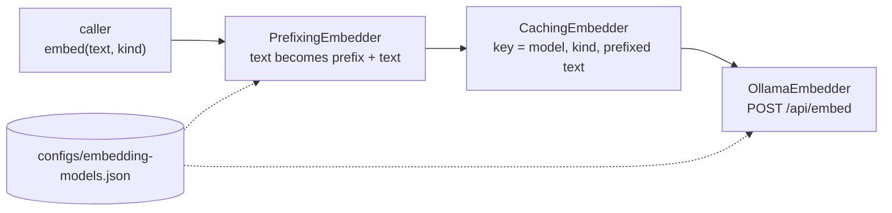

# RAG-090 design: embedding model A/B

**Ticket:** M9, feature, 3 points. Depends on RAG-083 (experiment runner) and RAG-031 (Ollama embedder).
**Status:** **built**; the measured run is still to do (section 5).

## 1. What this ticket delivers

Two more embedding models, the prefix handling they need, and an experiment that compares all three
on the evaluation dataset.

| Acceptance criterion                                        | Met by                                                                         |
| ----------------------------------------------------------- | ------------------------------------------------------------------------------ |
| Add nomic-embed-text and mxbai-embed-large via Ollama       | Two entries in `configs/embedding-models.json`; no new adapter (D1)            |
| Per-model query/document prefixes in a model-profile config | `configs/embedding-models.json` and `PrefixingEmbedder` (D2, D3)               |
| Experiment comparing three embedders; report and ADR        | `evals/experiments/embedders.json`; [ADR-0005](../adr/0005-embedding-model.md) |

| Piece                                                        | Where                                                                  |
| ------------------------------------------------------------ | ---------------------------------------------------------------------- |
| Model profiles: vector length, query prefix, document prefix | `configs/embedding-models.json`, `adapters/embedders/model-profile.ts` |
| Adds the prefix that matches `kind`                          | `adapters/embedders/prefixing-embedder.ts`                             |
| Loads the profiles and stacks the decorators                 | `composition/build-embedder.ts`                                        |
| The experiment                                               | `evals/experiments/embedders.json`                                     |

## 2. The idea: `kind` finally has a job

RAG-030 put `kind: "query" | "document"` on `Embedder.embed` although `all-minilm` ignores it. Some
models are **asymmetric**: they were trained to see a marker in front of the text, and a different
one for a question than for a passage. Leave the marker out and nothing fails; retrieval is just
quietly worse. That is why it must be a tested, configured part of the system, not a string in a
caller.

| Model               | Vector length | Query prefix                                                | Document prefix     |
| ------------------- | ------------- | ----------------------------------------------------------- | ------------------- |
| `all-minilm`        | 384           | none                                                        | none                |
| `nomic-embed-text`  | 768           | `search_query: `                                            | `search_document: ` |
| `mxbai-embed-large` | 1024          | `Represent this sentence for searching relevant passages: ` | none                |

## 3. How an embedder is built



Callers (indexer, retrievers, the experiment runner) are unchanged: they pass plain text and `kind`
and get unit vectors back. `buildEmbedder` is the only place that knows the stack.

## 4. Decisions

| #   | Decision                                        | Why                                                                                                                                                                                                                                                              |
| --- | ----------------------------------------------- | ---------------------------------------------------------------------------------------------------------------------------------------------------------------------------------------------------------------------------------------------------------------- |
| D1  | No new embedder class                           | Both models are served by the same `/api/embed`. Only the vector length and the prefixes differ, and those are data.                                                                                                                                             |
| D2  | Profiles are a JSON file, not a table in code   | The ticket asks for config. A new model is one entry; the schema rejects a zero length or a misspelled field (`strictObject`) with the file and field named. This replaces the `OLLAMA_DIMENSIONS` table in `build-embedder.ts`.                                 |
| D3  | A decorator adds the prefix, outside the cache  | Cross-cutting, so not inside the Ollama client (the RAG-092 rule). Outside the cache, the key is made from the text the model really saw, so editing a prefix can never serve a vector made with the old one (tested). Cache keys of `all-minilm` do not change. |
| D4  | `buildEmbedder` became async                    | It now reads the profile file. All three callers were already async.                                                                                                                                                                                             |
| D5  | The experiment uses dense retrieval only        | BM25 does not use the embedder. In a hybrid run it would dilute the difference we are trying to see.                                                                                                                                                             |
| D6  | The experiment sets `chunking.maxTokens` to 300 | `mxbai-embed-large` reads about 512 tokens, and Ollama cuts longer input without an error. Our token count is approximate, so 400 might be cut. 300 keeps all three models inside their limit. All variants share the same chunks, so the comparison is fair.    |

## 5. Running the comparison

```sh
ollama pull nomic-embed-text
ollama pull mxbai-embed-large
pnpm experiment evals/experiments/embedders.json
```

The first run embeds the book three times (once per model; later runs hit the vector cache). The
numbers and the decision go in [ADR-0005](../adr/0005-embedding-model.md), which stays **Proposed**
until they are filled in. The full A/B report with per-question wins and losses is RAG-084's job.

## 6. Known limits

- An index records only the model's name. If you edit a prefix in the profile file, re-run
  `pnpm index`: the old index was built with the old prefix and the question is now embedded with
  the new one. (The vector cache is safe, as in D3.)
- Truncation is silent on Ollama's side. A model with a short context needs smaller chunks (D6).
