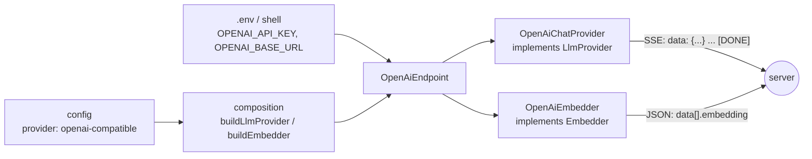

# RAG-091 design: OpenAI-compatible provider adapter

**Ticket:** M9, feature, 3 points. Depends on RAG-070 (LlmProvider port).
**Status:** **built** (2026-10-22).

## 1. What this ticket delivers

One adapter family that reaches any server speaking OpenAI's API: OpenAI itself, vLLM, LM Studio,
gateways, and Ollama's own `/v1`. It covers both ports that talk to a model: chat (`LlmProvider`) and
embeddings (`Embedder`).

| Piece                                                   | Where                                                        |
| ------------------------------------------------------- | ------------------------------------------------------------ |
| `OpenAiEndpoint` (base URL, key, redaction, error maps) | `src/adapters/openai-compatible/openai-endpoint.ts`          |
| `OpenAiChatProvider` (`POST /chat/completions`, SSE)    | `src/adapters/llm/openai-chat-provider.ts`                   |
| `OpenAiEmbedder` (`POST /embeddings`)                   | `src/adapters/embedders/openai-embedder.ts`                  |
| `openai-compatible` in both registries                  | `src/composition/build-llm-provider.ts`, `build-embedder.ts` |
| `LlmProvider` contract, shared by both chat providers   | `src/testing/llm-provider-contract.testing.ts`               |

| Acceptance criterion                              | Met by                                                                                                                               |
| ------------------------------------------------- | ------------------------------------------------------------------------------------------------------------------------------------ |
| Adapter for any OpenAI-compatible chat/embeddings | `OpenAiChatProvider`, `OpenAiEmbedder`; `generation.provider` / `embedding.provider` = `openai-compatible`                           |
| API keys from environment only, never logged      | `OPENAI_API_KEY` read by `OpenAiEndpoint.fromEnv`, held in a `#private` field, redacted from server text (section 3)                 |
| Shares contract tests with the Ollama provider    | `describeLlmProviderContract` runs against `OllamaProvider` and `OpenAiChatProvider`; the embedder contract runs on `OpenAiEmbedder` |

## 2. How it fits

The ports are unchanged. Pipeline and CLI code never learn which server is behind them.

## 3. Decisions

| #   | Decision                                                                                 | Why                                                                                                                                                                                                                                                                                                              |
| --- | ---------------------------------------------------------------------------------------- | ---------------------------------------------------------------------------------------------------------------------------------------------------------------------------------------------------------------------------------------------------------------------------------------------------------------- |
| D1  | Two classes plus a small shared `OpenAiEndpoint`                                         | The ports are separate and each adapter file is the only one that knows its wire format. What they share (URL, key, error mapping) is the part that must not drift apart.                                                                                                                                        |
| D2  | Chat streams server-sent events; `end` is sent at `[DONE]`                               | Token counts arrive in a chunk _after_ the finish reason, so ending at the finish reason would lose them. A server that omits `[DONE]` still ends cleanly if it sent a finish reason; otherwise it is an error.                                                                                                  |
| D3  | Everything else of 070 is kept: no retries, idle timeout, abort rules                    | Same reasons as 070 D4, D5, D7. Retry, timeout and rate limit are RAG-092's decorators.                                                                                                                                                                                                                          |
| D4  | Key and base URL come from `OPENAI_API_KEY` and `OPENAI_BASE_URL` only                   | The ticket says env only. They are not config fields, so a key can never end up in `rag.config.json` or a committed experiment file. No config schema change.                                                                                                                                                    |
| D5  | The key is optional                                                                      | Local servers (LM Studio, vLLM) need none. Without a key no `Authorization` header is sent, and a 401 tells the user to set `OPENAI_API_KEY`.                                                                                                                                                                    |
| D6  | The key sits in a `#private` field and is redacted from server text                      | A private field is not a property, so `JSON.stringify`, `console.log` and structured logs of an adapter cannot show it. Servers often echo a rejected key in the error body; `redact` removes it before it reaches a message. A base URL with a password in it is refused, and the refused text is not repeated. |
| D7  | Embedding vector lengths: a table of OpenAI's models, else `OPENAI_EMBEDDING_DIMENSIONS` | The port needs `dimensions` before the first call, and a local server can serve any model, so it cannot be listed. Every returned vector is checked against it, as in the Ollama embedder.                                                                                                                       |
| D8  | Vectors are put back in order by their `index` field                                     | The API does not promise the order of `data`.                                                                                                                                                                                                                                                                    |
| D9  | The `LlmProvider` contract is written now                                                | 070 left it out ("revisit when a second provider exists"). Providers speak different wire formats, so the contract describes a reply as a `Script` and each provider's test encodes it; the contract serves it through a fake `fetch`.                                                                           |
| D10 | `modelId` is `openai-compatible:<model>`                                                 | Matches `ollama:<model>`. It does not include the base URL, so the embedding cache treats the same model name on two servers as one model. Use one model name per server, or clear `data/cache/embeddings`.                                                                                                      |

## 4. Not in this ticket

- Retries, timeouts and rate limits around any provider: RAG-092.
- Embedding models that need a query/document prefix: RAG-090.
- Tool calls, JSON mode, vision, or Azure's `api-version` query parameter and `api-key` header.
- A live integration test: it needs a paid key or a second server. The unit tests use a fake `fetch`.

## 5. Testing

- Contract (both chat providers): text events then one end, output-limit reason, empty conversation,
  unreachable server, HTTP error, failure mid-reply after earlier text, stream closed early, already
  aborted signal, abort mid-reply closes the connection, `break` closes the connection.
- SSE: events cut one character at a time and inside a two-byte letter, CRLF, comments, `event:`
  lines, null content, usage after the finish reason, no `[DONE]`, nothing read after `[DONE]`.
- Request: URL, headers, JSON body, per-call overrides, no header without a key.
- Failures: 401 with and without a key, 404 names the model, other HTTP errors, not JSON, wrong shape,
  idle timeout.
- Secrets: a key echoed in an error body or a mid-reply error event is removed; a sentinel key does
  not appear in the message, stack or cause chain of any failure; serialising an adapter or an
  endpoint does not show it.
- Embedder: batching and order, shuffled `index`, count/length/zero-vector checks, the embedder contract.
- Builders: base URL, key and options reach the request; default points at OpenAI; dimensions table
  and `OPENAI_EMBEDDING_DIMENSIONS`.
