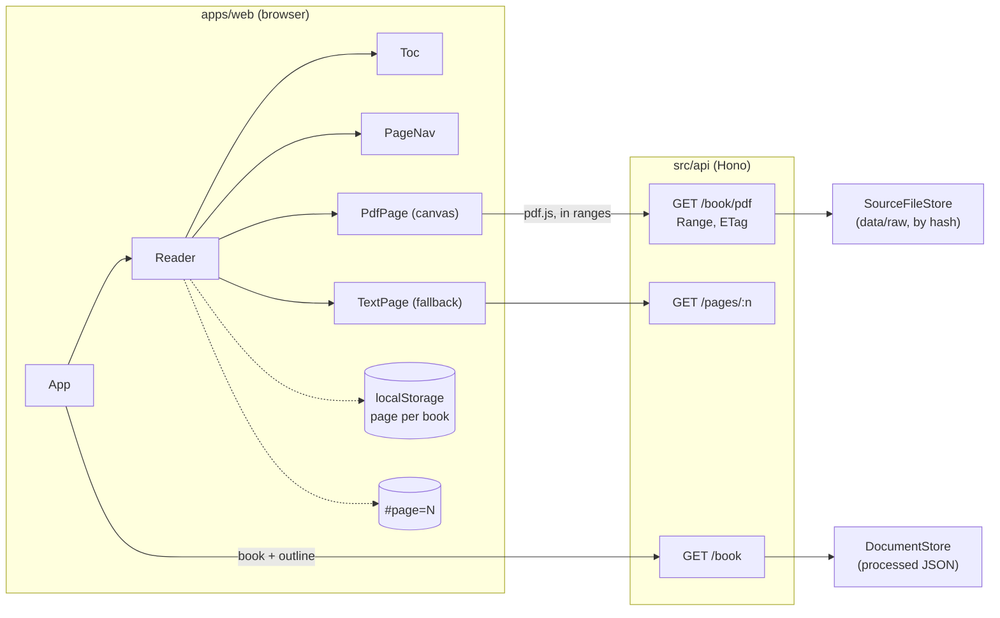
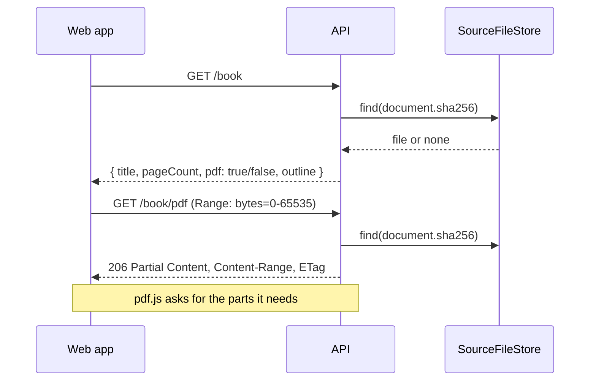

# RAG-102 design: Book reader

**Ticket:** M10, feature, 5 points. Depends on RAG-101 (the HTTP API) and, through it, RAG-014 (the section tree).
**Status:** **built** (2026-10-23).

## 1. What this ticket delivers

The first screen of the live book: open the PDF in a browser, move through it from the table of
contents, and come back to where you stopped. `pnpm api` in one terminal, `pnpm web` in another,
then http://localhost:5173.

| Piece                                                           | Where                                              |
| --------------------------------------------------------------- | -------------------------------------------------- |
| `GET /book` (title, pages, section tree) and `GET /book/pdf`    | `src/api/app.ts`, `mappers.ts`, `range.ts`         |
| The wire shapes for them                                        | `packages/api-contract/src/schemas.ts`             |
| A way to find the source PDF                                    | `SourceFileStore` port, `DirectorySourceFileStore` |
| The browser app: reader, contents, page controls, text fallback | `apps/web/`                                        |

| Acceptance criterion                            | Met by                                                                                    |
| ----------------------------------------------- | ----------------------------------------------------------------------------------------- |
| Renders PDF pages with pdf.js                   | `openPdf` draws a page onto a canvas; the API serves the file in byte ranges              |
| Table of contents from the section tree         | `GET /book` sends `ParsedDocument.sections`; `Toc` shows it and marks where the reader is |
| Page navigation and remembered reading position | buttons, a page box, ← → Home End; the page is kept in the address and in local storage   |

**Not in this ticket:** the chat panel and citation highlighting (RAG-103), asking about a selection
(RAG-104). The page is drawn without a text layer; RAG-103 adds one when it has something to highlight.

## 2. How it fits together



## 3. Finding the PDF

The processed document keeps the text and its structure, not the PDF. The reader needs the PDF to draw
pages, and ADR-0006 left open how it gets it. The API finds it **by the SHA-256 of its contents**:
`ParsedDocument.sha256` is already the hash the document is identified by, and `DirectorySourceFileStore`
looks through `data/raw` (or `--raw-dir`) for a PDF with that hash.

- A request never names a path, so there is no path to traverse or to get wrong.
- The file served is exactly the one the text, page numbers and character spans were taken from, so
  what the reader shows and what a citation points at agree. A different edition of the book with the
  same name is not mistaken for it.
- Hashing is the slow part, so each file is hashed once and again only if its size or modification time
  changes. The first request reads the PDFs in the folder; later ones read the directory listing.



## 4. Decisions

| #   | Decision                                                                | Why                                                                                                                                                                                                                                                                |
| --- | ----------------------------------------------------------------------- | ------------------------------------------------------------------------------------------------------------------------------------------------------------------------------------------------------------------------------------------------------------------ |
| D1  | The PDF is found by content hash in a folder, through a port            | See section 3. A port (`SourceFileStore`) keeps file access in an adapter, so the API stays an entry point and a test can pass a file held in memory.                                                                                                              |
| D2  | The API answers `Range` requests with 206                               | pdf.js asks for the parts it needs, so a large book shows its first page before the rest has arrived. One range is served; several ranges, another unit or nonsense are ignored and the whole file is sent (RFC 9110 allows it); a range past the end is 416.      |
| D3  | The file is sent with `ETag` = the hash and a one-hour private cache    | The document id is the hash of the file, so the file behind it never changes. Reopening the book costs nothing.                                                                                                                                                    |
| D4  | `GET /book` says whether a PDF exists (`pdf: true/false`)               | The reader can choose its view before asking for a file that is not there.                                                                                                                                                                                         |
| D5  | Without the PDF, the reader shows the extracted text and says why       | A reader that is blank because `data/raw` is empty is a bad first experience. The text is the same text the answers are built from. It is a fallback with a note, not a second reader: no zoom, no layout. The same fallback covers a PDF that will not open.      |
| D6  | One page at a time, drawn on a canvas                                   | "Page navigation" is the criterion, the highlighting of RAG-103 is per page, and one canvas is cheap. A scrolling column of all pages needs virtualisation, which nothing asks for yet.                                                                            |
| D7  | The page is kept in React state, the address and local storage          | The state is what is drawn. `#page=12` makes a reload, a bookmark and a pasted link land on the page, and the later citation chips can link to it. Storage brings you back tomorrow. The address wins over storage when both exist: it is what was just asked for. |
| D8  | The address is replaced, not pushed, when the page changes              | Turning 40 pages should not put 40 entries in the back button.                                                                                                                                                                                                     |
| D9  | A saved or bookmarked page outside the book is ignored, not clamped     | A stale bookmark to page 400 of a 25-page book is not a request for page 25. Typing a page into the box does clamp, because there the reader is asking.                                                                                                            |
| D10 | Everything that touches storage is guarded                              | Storage can be missing, blocked or full, and holds whatever anything wrote there. A bad value is no value; the reader works without it and only forgets.                                                                                                           |
| D11 | A typed page counts only when sent (Enter, or leaving the box)          | "1" on the way to "12" must not jump to page 1.                                                                                                                                                                                                                    |
| D12 | The contents show the chapter the reader is in and keep the rest closed | A book with hundreds of sections would be a very long list. The active chapter opens by itself; the others open when asked. Where two sections share a page, the one that starts on it is the current one.                                                         |
| D13 | pdf.js is loaded when a book is opened, not at start-up                 | It is large (430 kB, and a worker of 1.2 MB). The outline and the text fallback should not wait for it.                                                                                                                                                            |
| D14 | Drawing is cancelled when the page, zoom or width changes               | A reader who flips quickly must not wait behind pages they have left. A cancelled drawing is not an error.                                                                                                                                                         |
| D15 | In development Vite forwards `/api` to the API                          | The browser sees one origin, so there is no CORS to configure and `Range` needs no preflight. The `/api` prefix is dropped on the way. CORS (with `Range` allowed and `Content-Range` exposed) is also set, for a build served from elsewhere with `VITE_API_URL`. |
| D16 | The web app checks every answer against the contract's schemas          | A server that is not the API, or one of another version, gives a message that says so instead of a blank page or an error deep inside a component.                                                                                                                 |

## 5. Testing

- **Pure logic** (`reader-logic.test.ts`): the outline's active trail (including the shared page),
  `#page=N` parsing, `clampPage`, where to open (address, then storage, then page 1, and a page outside
  the book), reading position with broken, full or damaged storage.
- **API client** (`client.test.ts`): validation, a server that cannot be reached, the API's own error
  messages, an answer in the wrong shape, an HTML page, an aborted request.
- **The reader in jsdom** (`App.test.tsx`, a fake API and a fake PDF): opening, buttons and their ends,
  a typed page, the keys (and not while typing), the contents (go to a page, current section, open
  chapter, no headings), remembering across a new visit, the address winning, following a hand-edited
  address, no storage, zoom, no PDF, a PDF that will not open, a failed load with "Try again", the PDF
  closed when the reader goes away.
- **The API** (`book.test.ts`, `range.test.ts`): `GET /book` with a nested outline, with no PDF, with no
  headings, with several documents; `GET /book/pdf` whole, a range, open-ended and suffix ranges, 416,
  an ignored range, lookup by hash and never by a path in the request, 404 with a hint, the file closed
  when the client leaves, the CORS headers.
- **The adapter** (`directory-source-file-store.test.ts`): found by hash whatever the name, byte ranges,
  no match, no folder, non-PDFs, subfolders, a changed file, stopping early.
- **In a real browser.** A throwaway server fed the fixture PDF through the real routes, with Vite in
  front and headless Chrome driving the page: pdf.js drew page 2 from `#page=2`; clicking "Chapter 2"
  went to page 3 and updated the address and the current section; → went to page 4 and saved it;
  reloading with no page in the address reopened page 4; with no PDF the text fallback appeared.

## 6. Running it

```sh
pnpm ingest data/raw/book.pdf     # once: processes the book (the PDF stays in data/raw)
pnpm index                        # once: the index the API needs
pnpm api                          # terminal 1: http://127.0.0.1:8787
pnpm web                          # terminal 2: http://localhost:5173
```

The PDF is looked for in `data/raw`; `pnpm api --raw-dir <folder>` points elsewhere. `?doc=<id>` in the
address picks the book when the index holds several.

## 7. Not in this ticket

A text layer over the page (selection and highlighting: RAG-103 and RAG-104). A production server for
the built app: `pnpm web:build` makes `apps/web/dist`, but serving it is not decided here. Dark-mode
rendering of the page image: the page is drawn as the PDF is, on white.
