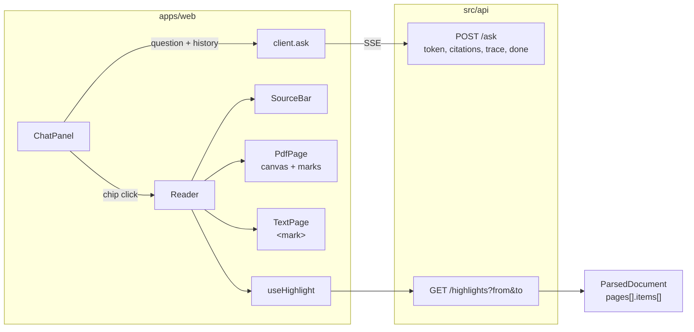
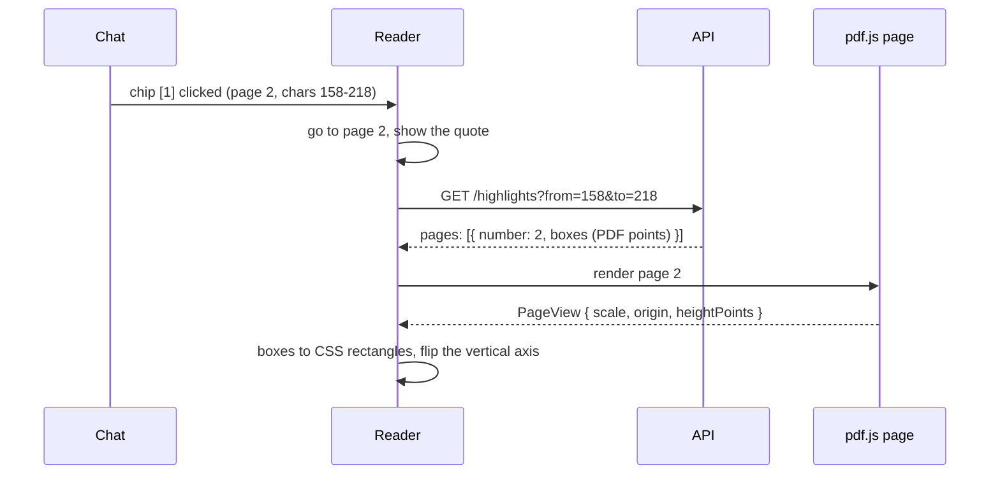

# RAG-103 design: Chat panel with clickable citations

**Ticket:** M10, feature, 3 points. Depends on RAG-102 (the book reader) and, through it, RAG-101 (the HTTP API).
**Status:** **built** (2026-10-28).

## 1. What this ticket delivers

Ask the book a question beside the page. The answer is written as it arrives; each `[n]` in it is a
button that takes you to the cited page and marks the passage there.

| Piece                                                             | Where                                                |
| ----------------------------------------------------------------- | ---------------------------------------------------- |
| The chat: conversation state, streaming from `POST /ask`, history | `apps/web/src/chat/`, `components/ChatPanel.tsx`     |
| Answers with `[n]` drawn as buttons; the list of sources          | `components/AnswerText.tsx`, `chat/answer-text.ts`   |
| Following a citation: go to the page, show the passage, mark it   | `components/Reader.tsx`, `SourceBar.tsx`             |
| The mark on the PDF page (rectangles over the canvas)             | `components/PdfPage.tsx`, `highlight/geometry.ts`    |
| The mark in the text fallback                                     | `components/TextPage.tsx`, `highlight/text-range.ts` |
| `GET /highlights`: where a passage is on its pages                | `src/api/highlights.ts`, `packages/api-contract/`    |

| Acceptance criterion                  | Met by                                                                                      |
| ------------------------------------- | ------------------------------------------------------------------------------------------- |
| Chat panel streams answers            | `client.ask` reads the events of `POST /ask`; `chatReducer` grows the answer token by token |
| Citation chips jump to the cited page | a chip calls `goTo(citation.pageStart)`                                                     |
| ...and highlight the chunk's text     | the citation's character range becomes boxes on the page (PDF) or a `<mark>` (text)         |

**Not in this ticket:** asking about a selected passage (RAG-104), showing the trace and prompt
(RAG-105; the trace is kept on each answer already), feedback (RAG-106).

## 2. How it fits together

The one thing that joins the chat and the page is a **citation**: `{ pageStart, charStart, charEnd,
quote }`. The chat hands it to the reader; the reader navigates, and asks the API where
`[charStart, charEnd)` is.

## 3. From a citation to a mark on the page

A citation says where its passage is in the text of the whole document, in characters. A PDF page is
pixels. The bridge is the text items the loader recorded for every page: each has its position (PDF
points, from the bottom-left), width and font size, and **the span of the cleaned text it became**.
Cleaning (dehyphenation, header removal) moves those spans along with the edits (RAG-012), so a range of
the cleaned text can be laid over the items directly. No pdf.js text layer is needed.

On the server (`toWireHighlights`) each item that overlaps the range gives a rectangle: the part of its
width that the part of its characters covers (an item is taken as evenly spaced), from a quarter of the
font size below the baseline to 0.95 above it. The rectangles of one line are joined into one band. In
the browser (`toCssRect`) a box is scaled by how large the page was drawn and flipped, because PDF
measures up from the bottom and a screen down from the top. Verified on a real PDF: the marks sit on
the two lines of the cited sentence and not on the next one.

## 4. Decisions

| #   | Decision                                                                  | Why                                                                                                                                                                                                                                                                                                   |
| --- | ------------------------------------------------------------------------- | ----------------------------------------------------------------------------------------------------------------------------------------------------------------------------------------------------------------------------------------------------------------------------------------------------- |
| D1  | The server turns a character range into boxes (`GET /highlights`)         | Only the server has the text positions, and sending every item of a page (hundreds, with fonts) on every page turn would cost far more than a handful of rectangles for one citation. The reader asks only when a chip is clicked.                                                                    |
| D2  | Boxes are in PDF points from the bottom-left; the viewer converts         | The API cannot know how large the viewer draws the page, at what zoom, or on what screen. The same boxes serve any zoom and any window size, and the contract describes the PDF, not one viewer.                                                                                                      |
| D3  | The marks are `div`s over the canvas, not a pdf.js text layer             | A text layer exists to select text, which RAG-104 will need, and it works from pdf.js's own text, which is not the cleaned text the citation points into. Mapping between the two is guesswork; the recorded items map exactly. A text layer can be added later for selection.                        |
| D4  | Boxes are estimates, and a line is one band                               | A PDF does not say how tall a glyph is or where inside a run a character sits. Evenly spaced text and font-size heights are close enough to show a reader where to look, and a band per line reads as a highlighter would.                                                                            |
| D5  | No mark rather than a wrong one for a rotated page                        | A rotated page is drawn turned while its text positions are not, so a box would land in the wrong place. The quote is still shown in the source bar.                                                                                                                                                  |
| D6  | The quote is always shown, in the source bar                              | It is the fallback for every case where the page cannot be marked: no positions recorded, a rotated page, a failed request. It also lets a reader check a citation without finding it on the page.                                                                                                    |
| D7  | Without the PDF, the passage is marked in the text                        | The text fallback (RAG-102) uses the same text the citation points into, so the mark is exact and needs no positions: the page's own start in the document turns the range into offsets in the page.                                                                                                  |
| D8  | A chip is a button only once its source is known                          | The sources come after the text. While the answer is arriving a `[1]` is shown as written, and becomes a button when the `citations` event arrives. A number with no source behind it (the model cited something it was not given) is marked, not hidden: a reader should know a claim has no source. |
| D9  | The chat is a reducer, and the stream is a loop that dispatches           | Every order of events (tokens, sources, a failure in the middle, Stop, a late event) is a plain function of state and can be tested without a screen. A late event after Stop is ignored, so a stopped answer cannot come back to life.                                                               |
| D10 | One answer at a time                                                      | A local model answers one question at a time, and two interleaved answers in one panel would be hard to read. Stop cancels the request, which stops the model on the server too.                                                                                                                      |
| D11 | The history sent is the last six answers that finished, cut to the limits | The server keeps no conversation (RAG-074), so this is its whole memory. Failed, stopped and refused turns carry nothing a follow-up could use.                                                                                                                                                       |
| D12 | The question is limited to this book (`filter.documents`)                 | When the index holds several books, an answer cited from another would be a chip to a page that is not on screen.                                                                                                                                                                                     |
| D13 | The mark stays until another source is chosen, cleared, or Esc is pressed | Reading the passage takes time and a reader may turn the page to look around. Away from the page the source bar offers "Go to the passage".                                                                                                                                                           |
| D14 | A failed request keeps the question and offers "Try again"                | The reader should not have to retype. The failed attempt is replaced, not left beside the new one.                                                                                                                                                                                                    |

## 5. Testing

- **Pure logic** (`chat-logic.test.ts`): splitting an answer into text and marks (several numbers, a mark
  still being written, things that look like marks and are not, and that joining the pieces gives the
  answer back); the reducer (tokens, sources, refusal, cut short, errors, Stop, late events, turns
  kept apart, remove, clear); the history sent; the vertical flip and the origin in `toCssRect` with
  hand-worked values; marking a passage on a page (inside, from an earlier page, onto the next, not on
  this page).
- **The client** (`client.test.ts`): `ask` posts JSON and reads the events in order, an error before the
  stream starts, an API that cannot be reached, an event of the wrong shape, a connection that breaks in
  the middle, an abort; `getHighlights` and a box that is not in the contract's shape.
- **The chat and the page in jsdom** (`Chat.test.tsx`, a stream fed one event at a time): the answer as
  it grows, the mark that is not a button until the sources arrive, Enter and Shift+Enter, history, one
  answer at a time, Stop, leaving the page, a failed request and Try again, an error in the middle, a
  refusal, an unknown number, a new conversation; following a citation (page, source bar, the box at a
  hand-worked position), the mark on the right pages only, clearing with the cross and Esc, choosing
  another source from a chip and from the list, a source over two pages, the text fallback, a passage that
  cannot be placed, a page that cannot be marked.
- **The API** (`highlights.test.ts`): boxes with hand-computed values (whole item, part of one by its
  share of the width, items joined into a line, separate lines and columns, a range over two pages, a page
  with no positions, items with no width, font scaling) and the route (validation, a passage past the
  end of the text, which document).
- **In a real browser.** A throwaway server over the fixture PDF with a stub pipeline that cites two
  real passages, Vite in front, headless Chrome: the answer streamed through the proxy, both chips
  appeared, clicking one put two boxes exactly over the two lines of the cited sentence, the other put one
  box over the other sentence, Esc cleared them; with no PDF the cited sentence was marked in the text.

## 6. Not in this ticket

Selecting text and asking about it (RAG-104). The trace is stored on every answer but not shown (RAG-105).
Boxes are not refined below the width of a line; selecting inside a source is not possible.
