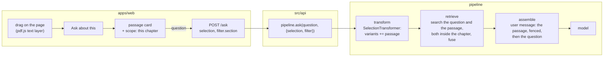

# RAG-104 design: Ask about a selected passage

**Ticket:** M10, feature, 3 points. Depends on RAG-103 (chat with citations) and RAG-043 (metadata filtering).
**Status:** **built** (2026-10-29).

## 1. What this ticket delivers

Select a passage on the page, press "Ask about this", and ask. The passage goes to the model as extra
context, and the search is limited to the chapter you are in unless you say otherwise.

| Piece                                                                   | Where                                                        |
| ----------------------------------------------------------------------- | ------------------------------------------------------------ |
| A selectable page: pdf.js's text layer over the canvas                  | `apps/web/src/pdf/open-pdf.ts`, `components/PdfPage.tsx`     |
| Reading the selection, the "Ask about this" button                      | `apps/web/src/selection/`, `components/SelectionPopover.tsx` |
| The passage and the scope in the chat                                   | `components/ChatPanel.tsx`, `components/Reader.tsx`, `chat/` |
| `selection` in the request                                              | `packages/api-contract/src/schemas.ts`, `src/api/app.ts`     |
| The passage through the pipeline: `Query.selection`, search, the prompt | `src/core/types/chat.ts`, `src/strategies/`, `src/pipeline/` |

| Acceptance criterion                                 | Met by                                                                                                          |
| ---------------------------------------------------- | --------------------------------------------------------------------------------------------------------------- |
| Selection sent as extra context                      | the passage is quoted in the question the model sees, and retrieval searches for it as well as for the question |
| Retrieval filtered to the current chapter by default | with a passage chosen, `filter.section` is the chapter of the page; the reader can switch to the whole book     |

**Not in this ticket:** the retrieval inspector (RAG-105), which will show the extra search; feedback (RAG-106).

## 2. The path of a selected passage

Three things happen to the passage:

1. **Retrieval searches for it.** "Explain this" says nothing a search can use; the meaning is in the
   passage. `SelectionTransformer` adds it to `Query.variants`, and the `MultiQueryRetriever` (already
   there for HyDE and multi-query) searches for the question and the passage and fuses the two with RRF.
   The passage's own chunk is usually among the best hits, so it reaches the model as an ordinary
   numbered source that can be cited and opened (RAG-103), along with passages close to it in meaning.
2. **The model is shown it.** The assembler puts it in the user message, fenced and labelled as quoted
   text, then the question. The system prompt is not touched.
3. **The chapter limits both searches.** `filter.section` is the chapter title; the same filter applies to
   the question's search and the passage's.

## 3. Making the page selectable

The page is a canvas, which cannot be selected. RAG-102 and RAG-103 left this out on purpose
(RAG-103 marks passages from recorded positions and needs no text layer). Selecting is what the layer
is for: pdf.js's `TextLayer` writes the page's text as invisible `span`s in the places the words are,
over the picture, and the browser's own selection does the rest. The styles are pdf.js's rules for that,
cut down to what is needed (`styles.css`). The marks of RAG-103 do not catch the pointer, so the two
layers coexist.

The selection is read when the mouse or finger is released, not while dragging (a button that follows the
drag jumps about under the pointer). `normalizeSelection` turns it into one clean passage: the line
breaks of the page become spaces, soft hyphens go, and a word the page split as `vec-` / `tors` is joined.

## 4. Decisions

| #   | Decision                                                                      | Why                                                                                                                                                                                                                                                                                        |
| --- | ----------------------------------------------------------------------------- | ------------------------------------------------------------------------------------------------------------------------------------------------------------------------------------------------------------------------------------------------------------------------------------------ |
| D1  | The browser sends the selected **text**, not a character range                | The text layer holds pdf.js's own text, which is not the cleaned text the index is built from (cleaning joins hyphenated words and drops headers). Mapping between the two would be guesswork. The words are enough: they are searched for and shown to the model.                         |
| D2  | The passage becomes a search variant, not part of the question                | The question is also what the model is asked, and it is shown in the transcript. A variant is searched as well as the question, with the existing multi-query machinery, so no new retrieval code exists and the filter applies to both searches.                                          |
| D3  | `SelectionTransformer` is a decorator that reports the name it wraps          | Traces, `/config` and experiment reports then read as they always did. Without a selection it returns exactly what the wrapped transformer did.                                                                                                                                            |
| D4  | The variant-search wrapper is always on, and reports the inner name           | A selection can arrive with any question, so the retriever must always be able to search variants. A query with none costs one search (the inner retriever's), and the result is unchanged. With HyDE and multi-query off the wrapper is invisible; with either on, it is named as before. |
| D5  | The passage is quoted in the **user message**; the system prompt is unchanged | The prompt version is recorded in every evaluation result, and a new version would change what the baselines were measured with. Only questions that carry a passage differ. It is fenced and described as quoted text, never instructions, like every source.                             |
| D6  | The passage is context, not a source                                          | Answers still cite the numbered sources. The model is told so. Because retrieval searches for the passage, its own chunk is normally source `[n]`, with a page and a highlight, so the answer can point at the very passage the reader chose.                                              |
| D7  | The passage is limited to 2000 characters, and the reader is told             | It sits in the prompt beside the sources, and a local model's window is small. Cut at a word, with "Only the start of the selection is sent." shown. The search text is cut further, to 1000, where an embedding model stops reading anyway.                                               |
| D8  | The scope is the chapter when a passage is chosen, the whole book otherwise   | A passage points at where to look, so a chapter is a good default for it; an open question ("what is this book about?") may need all of it. The reader sees the rule's result, and can switch. A reader's choice is kept.                                                                  |
| D9  | The chapter comes from the section tree, the page the reader is on            | The outline of RAG-102 already says which chapter holds the page. `filter.section` of RAG-043 and the contract already existed, so this needs no new server feature. No headings, or a page before the first heading: no chapter, so the whole book.                                       |
| D10 | A refusal inside a chapter offers "Ask the whole book instead"                | Limiting the search is a bet that the answer is nearby. When it loses, one click asks the same question, with the same passage, over everything. A question that already searched all of it does not offer it.                                                                             |
| D11 | A turn shows what it was about and where it looked                            | "About page 4: “…”" and "Searched in Chapter 2" under the question, so a surprising answer can be explained, and a retry (or the widening) repeats exactly the same thing.                                                                                                                 |
| D12 | The passage belongs to one question                                           | The next question starts without it, as the reader's attention has moved. The history still carries the answer.                                                                                                                                                                            |
| D13 | Quick questions "Explain" and "Summarize" for a passage                       | Nearly every use of a selected passage is one of the two. They send at once, with the passage and the scope in force.                                                                                                                                                                      |
| D14 | The button is a floating "Ask about this", not a menu or a drag target        | It appears where the reader's eyes are, costs nothing when ignored, and goes away with the selection. It does not take the selection away: pressing it must not move the focus first.                                                                                                      |

## 5. Testing

- **The library.** `SelectionTransformer`: adds the squeezed passage as a variant, keeps the variants
  other transformers added, leaves the question alone, is invisible without a selection and with a blank
  one, keeps the wrapped transformer's name, passes the signal and its failure on. The assembler: the
  question exactly as asked without a selection; with one, the passage fenced and labelled (page or not),
  the question last, a passage that gives orders kept inside its fence, and the system prompt, prompt
  version and citations unchanged. **Through the real pieces** (`selection-search.test.ts`): the question
  and the passage are both searched, with the same filter, the model gets the fenced passage, and
  without a selection there is one search and nothing extra in the trace.
- **The contract and the API.** `selection` accepted, trimmed, optional; blank, too long, a page of 0 and
  unknown fields refused before the pipeline is touched; the passage and its page reach `pipeline.ask`.
- **The browser** (jsdom, with a controllable stream). `normalizeSelection`: line breaks, hyphenated
  words (and the cases that must not be joined), soft hyphens, whitespace, a passage at the limit, one
  over it, a single huge word. The reader: the button appears after the selection and goes with it, a
  selection in the chat is ignored, the passage reaches the chat and the box takes the focus, the page
  it was on, the text view works too, lines are joined, a long selection is cut and says so; the request
  carries the passage, the page and the chapter; quick questions; what the turn shows; one question only;
  dropping the passage; a retry keeps both; the scope (whole book by default, chapter once a passage is
  chosen, the reader's choice, following the page, no headings, "Ask the whole book instead" only after a
  chapter search).
- **In a real browser.** The fixture PDF, the real routes, a stub pipeline that says what it received,
  and real mouse events over the DevTools protocol: pdf.js built a text layer exactly over the canvas, a
  drag selected the two lines, the hyphenated word was joined, the button appeared, pressing it filled the
  card and focused the box with "This chapter" chosen, "Explain" reached the pipeline with the passage,
  its page and `section: ["Chapter 1: Introduction"]`, and the turn showed what it was about. This found
  one thing the tests could not: the selected line breaks of the text layer painted a sliver at the
  corner of the page (pdf.js hides them with `br::selection`; so does `styles.css` now).

## 6. Not in this ticket

Showing, in the inspector, that a second search ran for the passage (RAG-105; the trace already says
`selected: true`). Selecting in the chat or the contents. Marking the selection again on a later visit.
