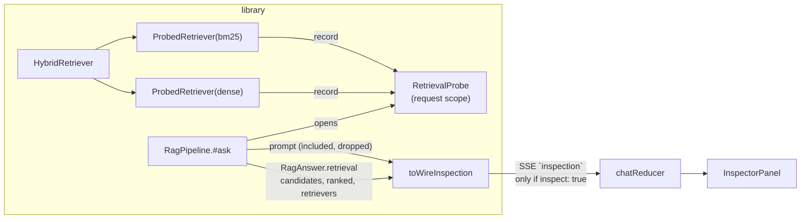

# RAG-105 design: Retrieval inspector panel

**Ticket:** M10, feature, 3 points. Depends on RAG-103 (the chat), and through it RAG-101 (the HTTP API).
**Status:** **built** (2026-10-28).

## 1. What this ticket delivers

Under any answer, a panel that explains it: which chunks retrieval found, which retriever found each,
how reranking moved them, what reached the prompt and what did not (and why), the prompt itself, and
how many tokens of its budget the sources took.

| Piece                                                       | Where                                                           |
| ----------------------------------------------------------- | --------------------------------------------------------------- |
| What each base retriever found, per question                | `src/shared/retrieval-probe.ts`, `ProbedRetriever`              |
| The pipeline keeps candidates, reranked list and retrievers | `RagAnswer.retrieval` in `src/pipeline/rag-pipeline.ts`         |
| `inspect: true` on `POST /ask`; the `inspection` event      | `packages/api-contract/src/schemas.ts`, `src/api/app.ts`        |
| From library types to the wire shape                        | `src/api/inspection.ts` (`toWireInspection`)                    |
| The toggle, the turn keeps the inspection                   | `chat/use-chat.ts`, `chat/chat-state.ts`                        |
| The panel, and its wording as pure functions                | `components/InspectorPanel.tsx`, `inspector/inspector-logic.ts` |

| Acceptance criterion                                              | Met by                                                                                         |
| ----------------------------------------------------------------- | ---------------------------------------------------------------------------------------------- |
| Toggle shows retrieved chunks, scores, which retriever found each | the **Inspect** toggle; one card per candidate with its score and `dense #1` / `bm25 #3` chips |
| ...and rerank changes                                             | each card's move chip (`▲ 5→2`, `▼`, `＝`, `✕`) and the reranked score                         |
| Shows the assembled prompt and token count                        | the Prompt section: system message, question, and a meter of `sourceTokens` against `budget`   |

## 2. How the data gets from the pipeline to the screen

The wire trace (`trace` event) already says what each stage did, but only as flat counts. It cannot say
which chunk a retriever found or what the prompt was, so the inspector needs data the pipeline had and
threw away. The ticket's line "no new pipeline code" was therefore not quite true: the pipeline now
**keeps references to three lists it already had** (see D1). It computes nothing new and no stage
changed.

## 3. Decisions

| #   | Decision                                                                 | Why                                                                                                                                                                                                                                                                                                       |
| --- | ------------------------------------------------------------------------ | --------------------------------------------------------------------------------------------------------------------------------------------------------------------------------------------------------------------------------------------------------------------------------------------------------- |
| D1  | `RagAnswer` gains `retrieval: { candidates, ranked, retrievers }`        | `candidates` was a local variable of `#ask` and is the only way to show what the reranker changed. It is required, not optional: an answer that cannot be inspected would be a silent gap, and the compiler finds every stub.                                                                             |
| D2  | A request-scoped `RetrievalProbe`, read through `AsyncLocalStorage`      | After fusion a chunk says `retriever: "hybrid"`; which of dense or bm25 found it is lost. The retrievers are built once for many questions, so `ObservedRetriever` (which takes its callback at construction, as the search CLI needs) does not fit. This is the same mechanism `withTrace` already uses. |
| D3  | The probe wraps the **base** retrievers through the existing `wrap` hook | `buildRetriever` already offered `wrap` for the search CLI. Nothing in `HybridRetriever` or the fusion changed.                                                                                                                                                                                           |
| D4  | `foundBy` is worked out on the server, per candidate                     | Sending the two raw lists and matching ids in the browser would put the rule about parent chunks (a parent was never found, its children were) in two places. The browser only draws.                                                                                                                     |
| D5  | The `inspection` event is opt-in (`inspect: true`)                       | It carries the whole prompt, which is far larger than anything else on the stream. A reader who is not looking at the inspector should not pay for it, and the API should not hand out its prompt by default.                                                                                             |
| D6  | The event is sent after the guardrails settle, with `prompt.sent`        | When the book refuses (nothing good enough) the prompt exists but the model was never called with it. Showing it as if it had been sent would be a lie; `sent: false` lets the panel say so.                                                                                                              |
| D7  | One `fate` per candidate: `used`, `duplicate`, `over-budget`, `cut`      | The assembler already guarantees every chunk it was given is included or dropped with a reason. A chunk missing from the reranked list is `cut`. A reader sees one answer to "why isn't this in the prompt?".                                                                                             |
| D8  | Snippets are cut to 240 characters                                       | Enough to recognise a passage. The full text of a cited chunk is already available from `GET /chunks/:id`, and a 20-candidate inspection stays small.                                                                                                                                                     |
| D9  | The toggle applies to questions asked from now on                        | An answer asked without it has nothing to show, and re-asking to get one would change the answer. The panel appears only where data exists; it does not pretend.                                                                                                                                          |
| D10 | A retriever that searched twice counts once, by its best rank            | Multi-query retrieval searches the same retriever once per variant. One chip per retriever is readable; the best rank is the honest summary of "found it".                                                                                                                                                |

## 4. Testing

- **The probe** (`retrieval-probe.test.ts`, `probed-retriever.test.ts`): calls kept in order and handed
  out as a copy, scope follows `await`, concurrent questions each keep their own, one instance serves
  many questions, works with no probe in scope, a failed search records nothing.
- **The pipeline** (`rag-pipeline.test.ts`): candidates and kept list, reporting retrievers, none for a
  retriever that does not report, two questions at once.
- **The mapper** (`inspection.test.ts`): hand-built scenario of four chunks (one moved up, one down, one
  over budget, one cut): ranks, scores, fates, source numbers, `foundBy` ordering, a parent credited to
  the retrievers that found its children, a retriever that searched twice, the prompt, `sent: false`,
  snippet folding and cutting, and that the result satisfies the contract.
- **The real wiring** (`inspection.integration.test.ts`): a real `HybridRetriever` with RRF fusion over
  two `ProbedRetriever`s inside a real `RagPipeline`; `foundBy` survives fusion with the right ranks.
- **The route** (`app.test.ts`): no event unless asked, the order `trace, inspection, done`, the content,
  `sent: false` on a refusal, a non-boolean rejected.
- **The contract** (`schemas.test.ts`, `sse.test.ts`): the request flag; candidates (cut, bad ranks, bad
  ids, unknown fields); the event decodes.
- **The web** (`inspector-logic.test.ts`, `chat-logic.test.ts`, `Inspector.test.tsx`): every wording as a
  function (moves, fates, scores, budget share, usage); the reducer keeps the inspection and ignores one
  after Stop; in jsdom the toggle sets the request flag, the panel appears only with data, and shows the
  chunks, who found them, the rerank moves, the prompt and meter, a refusal, and the stages.

## 5. Not in this ticket

Jumping from a candidate card to its page (it would need the character span on the candidate). Showing
per-retriever lists for chunks that fusion cut before the reranker saw them. Changing the retriever or
the reranker from the panel to compare (that is the experiment runner, RAG-083).
