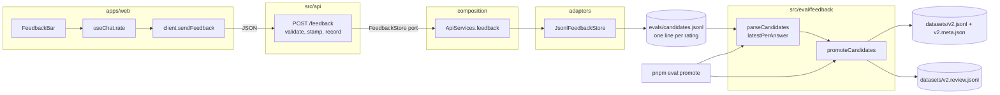
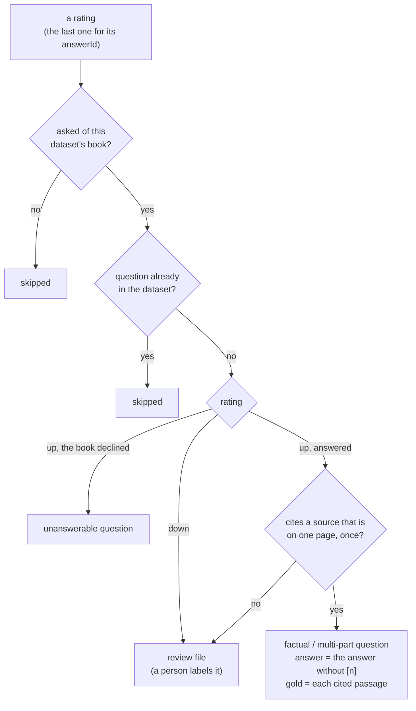

# RAG-106 design: Answer feedback loop

**Ticket:** M10, feature, 2 points. Depends on RAG-103 (the chat panel).
**Status:** **built** (2026-10-28).

## 1. What this ticket delivers

A reader rates an answer with a thumb and, if they like, a note. The rating is kept with everything
needed to judge the system on it later, and a script turns the ratings into the next version of the
evaluation dataset. What readers actually ask becomes what the system is measured on.

| Piece                                                        | Where                                                           |
| ------------------------------------------------------------ | --------------------------------------------------------------- |
| Thumbs and note under a finished answer                      | `apps/web/src/components/FeedbackBar.tsx`, `chat/use-chat.ts`   |
| `POST /feedback` and its wire shapes                         | `src/api/app.ts`, `packages/api-contract/src/schemas.ts`        |
| The `FeedbackStore` port, and the file it writes             | `src/core/ports/feedback-store.ts`, `adapters/feedback-stores/` |
| Reading the file; deciding what each rating can become       | `src/eval/feedback/`                                            |
| `pnpm eval:promote`: the next dataset version, a review file | `scripts/promote-feedback.ts`                                   |

| Acceptance criterion                                           | Met by                                                                                        |
| -------------------------------------------------------------- | --------------------------------------------------------------------------------------------- |
| Thumbs up or down with an optional note                        | `FeedbackBar`: the thumb is sent at once; the note is sent again with it                      |
| Saved to `evals/candidates.jsonl` with question, answer, trace | `JsonlFeedbackStore` adds one line per rating, with the sources and the system that answered  |
| Script to promote candidates into the next dataset version     | `promoteCandidates` (pure) and `pnpm eval:promote`, which refuses to write an invalid dataset |

## 2. How it fits together

The two halves never share code. They meet in the file, and a test
(`src/composition/feedback-file.test.ts`) writes it with the store and reads it with the promotion
code, so they cannot drift apart unnoticed.

## 3. From a thumb to a dataset question

An answer rated up says "this was right, and these were the right sources". That is what a dataset
question needs. An answer rated down says only that it was wrong: nobody knows what was right, so
nothing can be labelled from it.

## 4. Decisions

| #   | Decision                                                                    | Why                                                                                                                                                                                                                                                                                                |
| --- | --------------------------------------------------------------------------- | -------------------------------------------------------------------------------------------------------------------------------------------------------------------------------------------------------------------------------------------------------------------------------------------------- |
| D1  | The page sends the answer back with its rating; the server keeps nothing    | The server keeps no conversation (RAG-074), and an answer kept server-side would need an expiry, a size bound and a lookup that can miss. The page already holds the question, answer, sources and trace. The cost is that a client could send an answer the system never wrote; see D9.           |
| D2  | Feedback is an append-only log; the newest entry per `answerId` wins        | A thumb sent at once and a note sent later, or a changed mind, are all just more lines. No update in place, no lock, nothing to corrupt: a crash loses at most the line being written. Whoever reads the file takes the last line of each answer.                                                  |
| D3  | The page makes the `answerId` (a version 4 UUID), once per answer           | The server could hand one out in the `done` event, but then a rating could not be sent for an answer whose stream ended oddly, and the contract of `/ask` would change under RAG-104 and RAG-105 working in parallel. The page needs only `crypto`, with a fallback for pages not served securely. |
| D4  | `FeedbackStore` is a port in `core/`; the JSONL file is an adapter          | Same as the experiment store: the API and the composition root know the port, only the adapter knows the file. A different place for feedback (SQLite, a service) is one new class.                                                                                                                |
| D5  | The trace is stored as sent and not interpreted                             | It is for a person debugging a bad answer. Reading it in `core/` would make `core/` depend on the wire format; the schema checks its shape at the edge and the file keeps it whole.                                                                                                                |
| D6  | The server stamps the time and the system (`index`, `model`)                | A rating is only meaningful against the system that produced the answer, and the page cannot know which model the server had loaded. The clock is injectable, so the tests do not depend on it.                                                                                                    |
| D7  | The thumb is saved immediately; the note is optional and sent after         | A reader who clicks and leaves must not lose the rating because they did not write a note. The buttons are held while a request is in flight, so two ratings of one answer cannot arrive out of order.                                                                                             |
| D8  | A failed save is shown, with the reason, and the thumb can be pressed again | Silently dropping feedback would teach nobody anything. The thumb shows as pressed only when the API acknowledged it.                                                                                                                                                                              |
| D9  | The request is validated like `/ask`: JSON only, 256 KB, strict schema      | The API is local and has no login (ADR-0006), so the real risk is a web page on another origin posting to it. CORS already refuses the answer to other origins; requiring JSON makes the browser ask first (preflight), and it is refused there. Unknown fields are rejected.                      |
| D10 | A rating does not change the dataset by itself; promotion is a script       | A thumb is a weak, noisy signal and one wrong click should not reach the numbers every experiment is judged by. Promotion is run on purpose, writes a new version, and shows what it skipped and why.                                                                                              |
| D11 | Up becomes a question with its own citations as gold; down goes to review   | The citations are the best guess at where the answer is, and a reader who confirmed the answer confirmed them. For a down there is nothing to confirm. The labels are only as good as the thumbs, which `evals/datasets/README.md` says in plain words.                                            |
| D12 | A gold quote must be found once on one page, or the answer goes to review   | The same rule every gold quote already meets (`resolveGold`). A passage over two pages has no single page to be found on; a repeated sentence would not say which one holds the answer.                                                                                                            |
| D13 | The output must pass `checkDatasetShape` and `checkDatasetAgainstDocument`  | If the new version would not pass `pnpm eval:validate`, nothing is written. A half-valid dataset is worse than none: experiments would run on it.                                                                                                                                                  |
| D14 | An existing version is never overwritten; ids continue and are never reused | Results refer to question ids and a version's scores must stay comparable (the rule `v1` already follows). `v1-smoke` has no "next", so `--out` must be given.                                                                                                                                     |
| D15 | `candidates.jsonl` is not committed                                         | It holds real questions, possibly about private books. The promoted `v2.jsonl` is what is committed, after a person has read it.                                                                                                                                                                   |
| D16 | A line that cannot be read is reported and skipped, not fatal               | The file is added to while the API runs; a crash can leave a half line. One bad line must not make the rest of a reader's feedback unusable.                                                                                                                                                       |

## 5. Testing

- **The store** (`jsonl-feedback-store.test.ts`): creates the folder, one line per entry, keeps what was
  there, line breaks in a note stay on one line, forty simultaneous calls come out whole and in order,
  a failed write does not block the next.
- **The route** (`feedback.test.ts`): what is recorded (with time and system), a blank note left out, a
  changed mind as another entry, seven kinds of invalid body refused with nothing recorded, not-JSON,
  wrong content type, over the size limit, a store that fails (the reader is not told why), CORS
  preflight from the web app and from nowhere else. Plus the schema (`schemas.test.ts`) and the
  `--feedback-file` flag (`args.test.ts`).
- **The reading side** (`src/eval/feedback/feedback.test.ts`): lines read and bad lines reported; the last
  rating wins; up, up with several sources, up declined, down, another book, no book named, nothing
  cited, a question already there (however written), a source that is not found, ambiguous, over two
  pages or too short; ids continue and stop at 999; the base is untouched; the result passes the
  dataset's own check against the book.
- **Both sides together** (`feedback-file.test.ts`): what the store writes, the promotion code reads.
- **The page** (`chat-logic.test.ts`, `answer-id.test.ts`, `client.test.ts`, `Feedback.test.tsx`, in
  jsdom): a rating only on a finished answer; the exact request sent; the note sent again with the same
  id; a changed mind without the old note; the buttons held while saving; a failure shown and retried;
  a declined answer rated; two answers with two ids; the id without `crypto.randomUUID`.
- **The script, for real.** Run against a processed book and a made-up candidates file: seven ratings
  gave one factual, one multi-part and one unanswerable question, one entry to review and two skipped
  (a repeat, another book); the half-written last line was reported; `pnpm eval:validate` passed the
  result; a second run refused to overwrite.

## 6. Not in this ticket

Showing the trace behind an answer (RAG-105), asking about a selected passage (RAG-104). Reading the
ratings back in the web app, or any dashboard of them: the file is the interface. Promotion does not
call a model to write a better reference answer; a person edits `v2.jsonl` after reading it.
