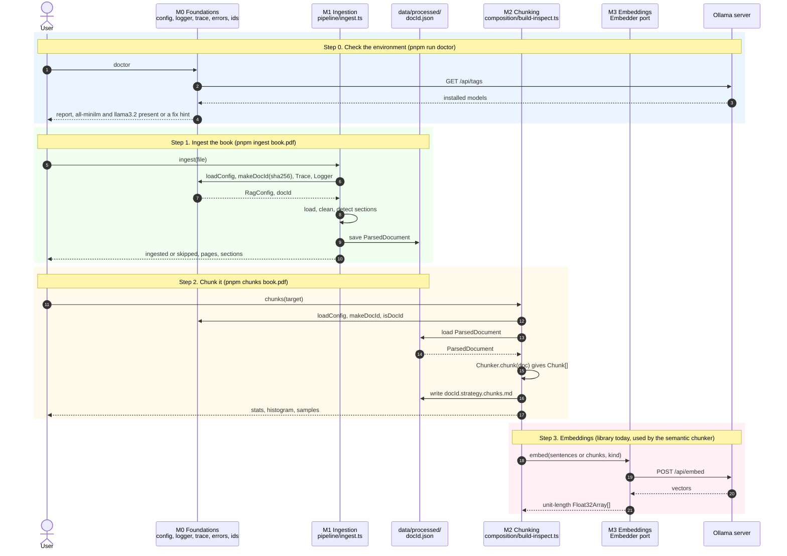
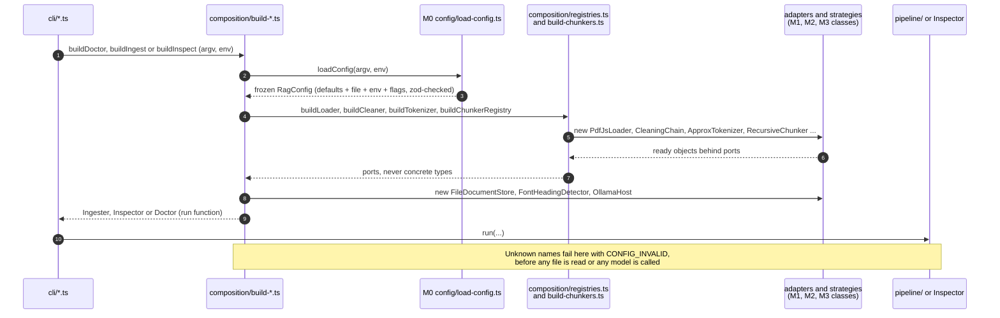
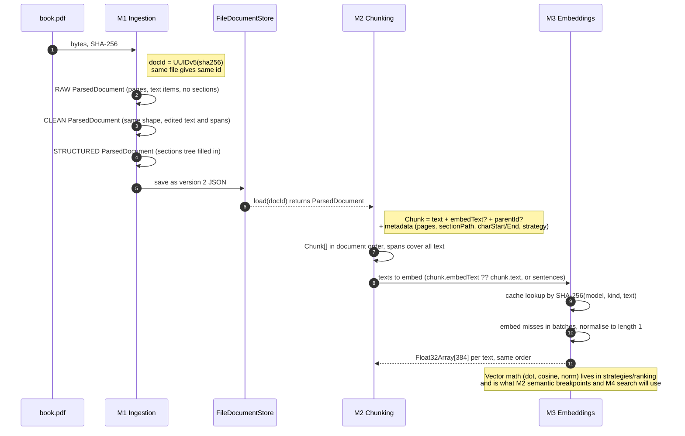
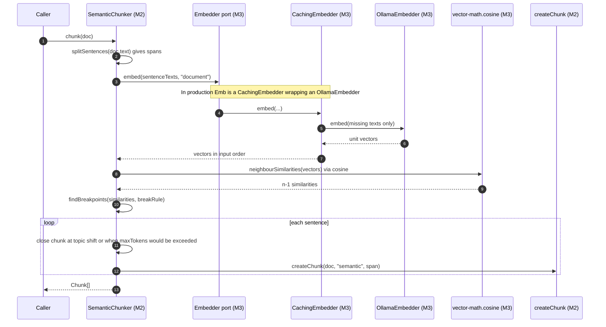
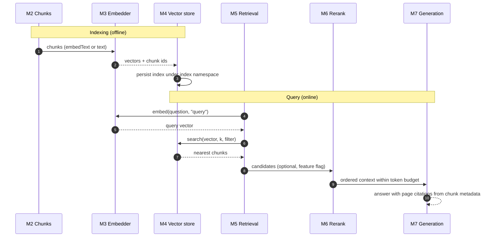

# Pipeline sequence diagrams: M0 → M1 → M2 → M3

How the four finished milestones connect. Each diagram shows **who hands what to whom**. The
function-level detail of every box lives in the per-module files:
[M0](m0-foundations.md) · [M1](m1-ingestion.md) · [M2](m2-chunking.md) · [M3](m3-embeddings.md).

| Milestone | Name        | What it hands to the next one                                    |
| --------- | ----------- | ---------------------------------------------------------------- |
| M0        | Foundations | `RagConfig`, `Logger`, `Trace`, `RagError`, ids, ports and types |
| M1        | Ingestion   | `ParsedDocument` (clean text, pages, sections) stored as JSON    |
| M2        | Chunking    | `Chunk[]` (text, page range, section path, char span, id)        |
| M3        | Embeddings  | `Float32Array[]` (unit-length vectors) and vector math           |

## 1. The whole pipeline, as it runs today

Three commands exist today (`doctor`, `ingest`, `chunks`). M3 has no command yet: it is a library
that the semantic chunker (an M2 strategy) already calls, and that M4 will call to index chunks.

## 2. Start-up wiring: how M0 feeds every other module

Nothing in `pipeline/` or `strategies/` reads files or environment variables. Each command goes
through one **composition root**, which turns M0's config into concrete objects (ADR-0001).

## 3. Data hand-off between milestones

The same flow seen from the data's side: what exists after each stage and who owns it.

## 4. The one place M2 and M3 touch: semantic chunking

`SemanticChunker` is an M2 strategy that needs an M3 `Embedder`. It receives the port through its
constructor, so `strategies/chunking` never imports `adapters/embedders` (rule 2 in
[architecture.md](../architecture.md)).

> **Not wired yet.** `build-chunkers.ts` registers only `fixed-size`, `recursive` and
> `structure-aware`. `semantic` and `parent-child` exist as classes with tests but have no
> registry line, and no `buildEmbedder` exists yet. So `chunking.strategy = "semantic"` is
> rejected with CONFIG_INVALID today.

## 5. Where the pipeline goes next (planned, not built)

M4 onward is on the Build Board only. This shows where it plugs into what exists.

