# M0 Foundations: function-level sequence diagrams

Back to the [pipeline view](00-pipeline.md). M0 is the layer every other milestone stands on:
config, logger, errors, trace, ids and the Ollama doctor.

Source map

| Area   | Files                                                                                                    |
| ------ | -------------------------------------------------------------------------------------------------------- |
| Config | `config/load-config.ts`, `overrides.ts`, `schema.ts`, `defaults.ts`, `config-hash.ts`, `config-error.ts` |
| Shared | `shared/errors.ts`, `logger.ts`, `trace.ts`, `doc-id.ts`, `file-hash.ts`                                 |
| Core   | `core/types/ids.ts` (`contentHash`, `makeChunkId`), `core/ports/model-host.ts`                           |
| Doctor | `cli/doctor.ts`, `composition/build-doctor.ts`, `pipeline/doctor.ts`, `adapters/ollama/ollama-host.ts`   |

Cases covered: [1 Config load](#1-loadconfig-happy-path) · [2 Config errors](#2-loadconfig-failure-cases) ·
[3 Override parsing](#3-override-parsing-env-and-cli) · [4 resolveConfig merge](#4-resolveconfig-merge-and-validate) ·
[5 Config hash](#5-hashconfig) · [6 Doctor happy](#6-doctor-everything-ok) ·
[7 Doctor failures](#7-doctor-failure-cases) · [8 OllamaHost.listModels](#8-ollamahostlistmodels-all-cases) ·
[9 normalizeOllamaHost](#9-normalizeollamahost) · [10 Ids](#10-ids-docid-and-chunkid) ·
[11 sha256OfFile](#11-sha256offile) · [12 Logger](#12-logger) · [13 Trace](#13-trace) · [14 Errors](#14-errors)

---

## 1. `loadConfig` happy path

Layers, lowest priority first: defaults → `rag.config.json` → `RAG_*` env → `--section.key` flags.

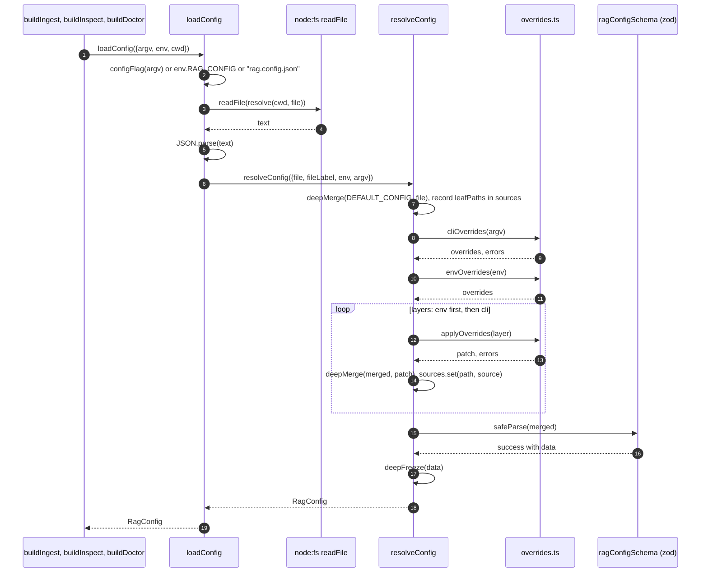

## 2. `loadConfig` failure cases

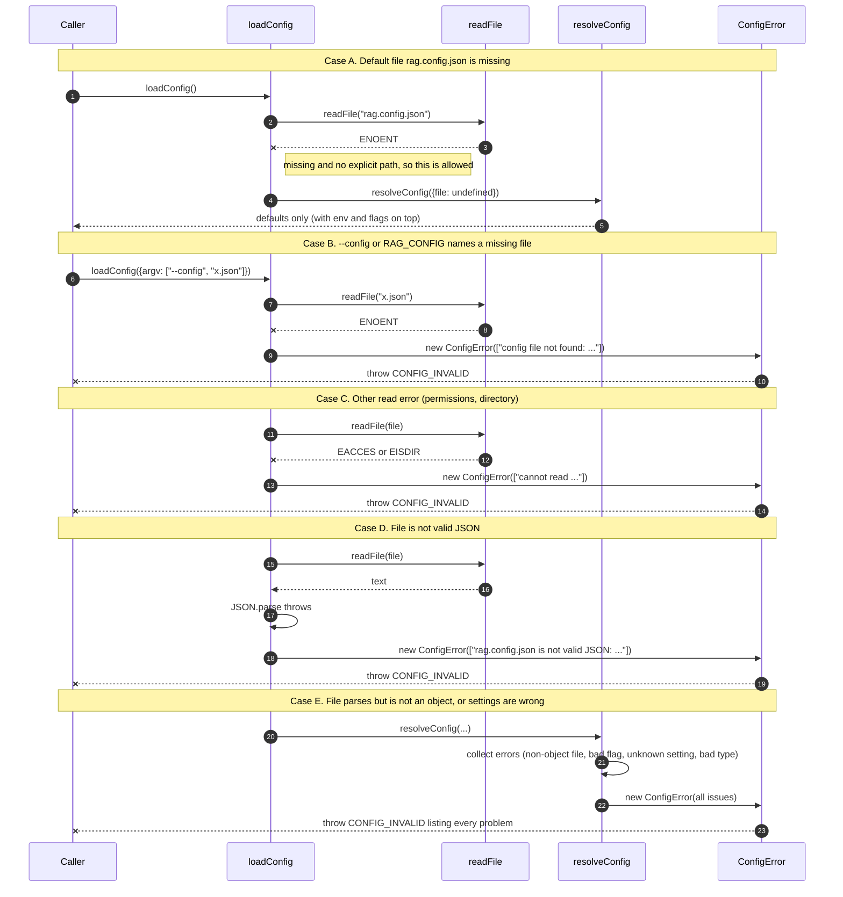

## 3. Override parsing (env and CLI)

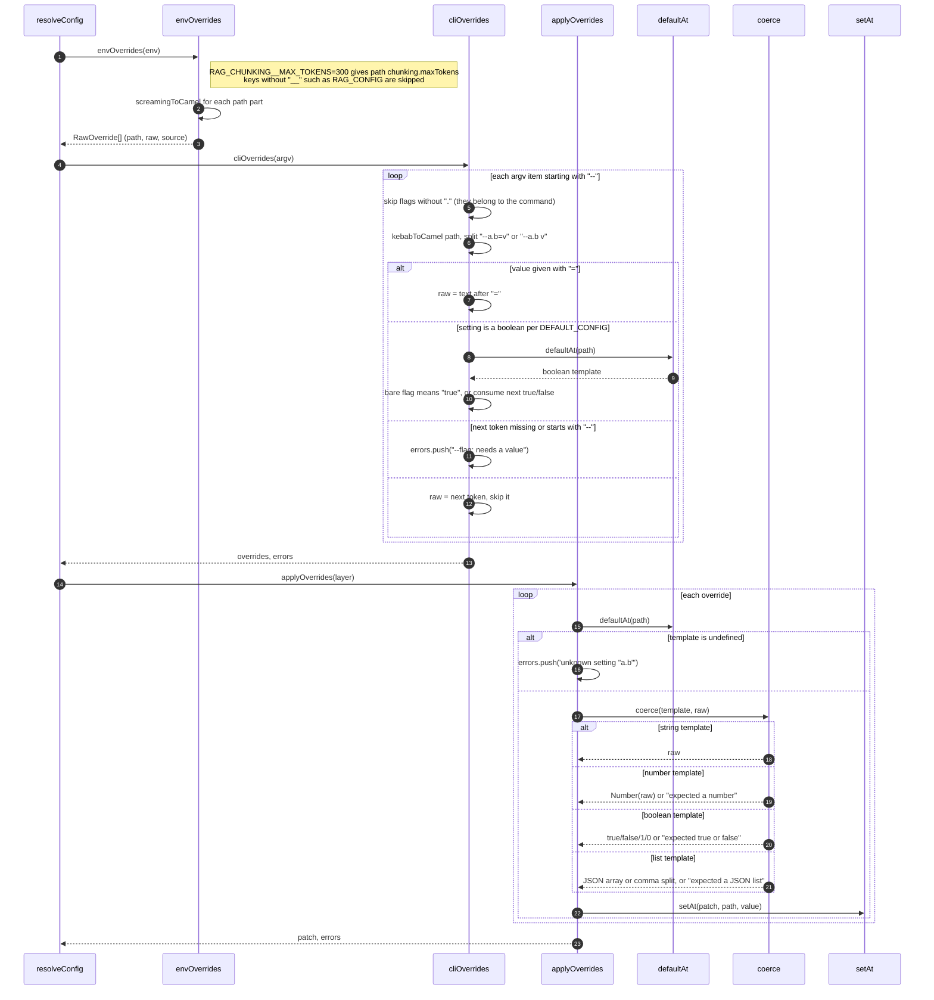

## 4. `resolveConfig` merge and validate

The schema is strict: unknown keys fail, and two cross-field rules run after the per-field checks.

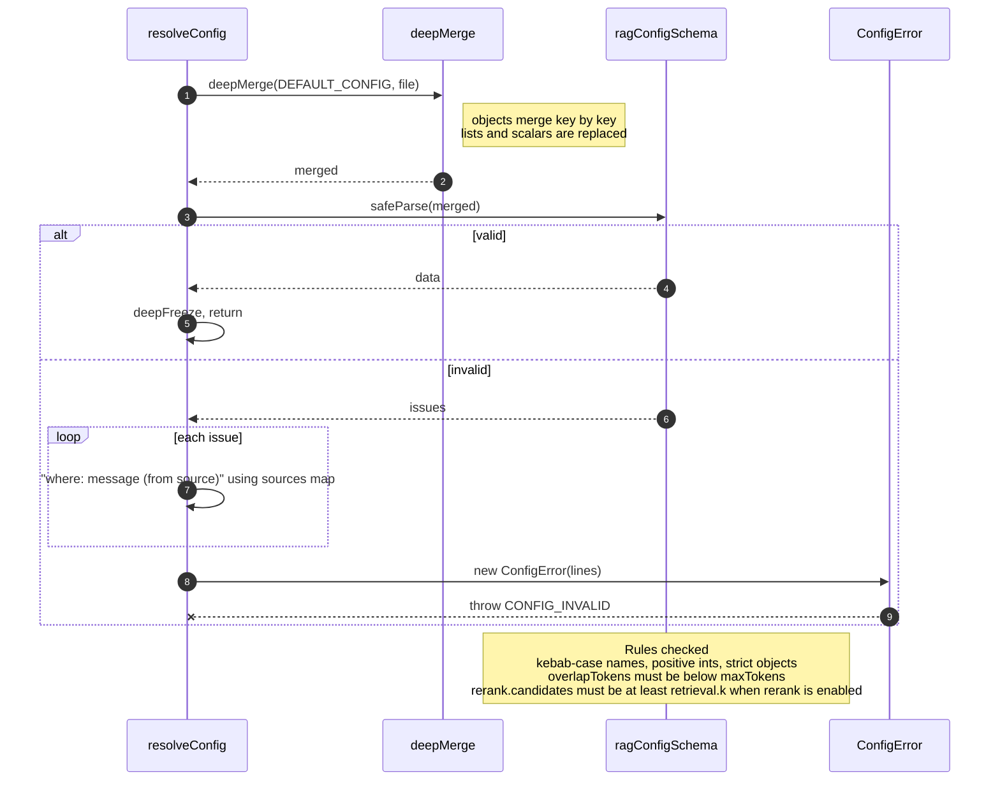

## 5. `hashConfig`

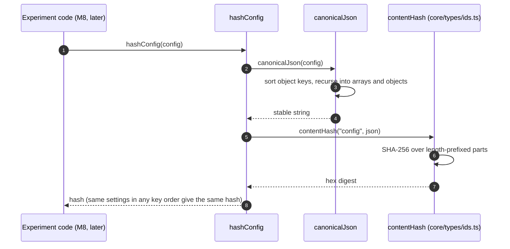

## 6. Doctor: everything OK

`pnpm run doctor` (`cli/doctor.ts`).

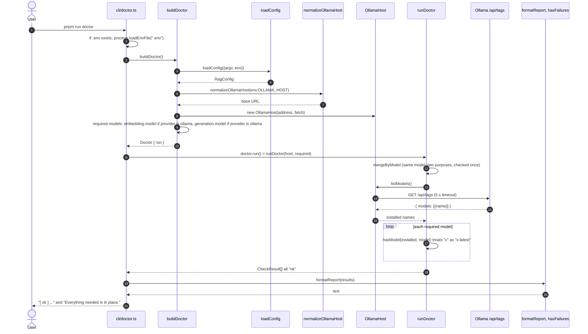

## 7. Doctor failure cases

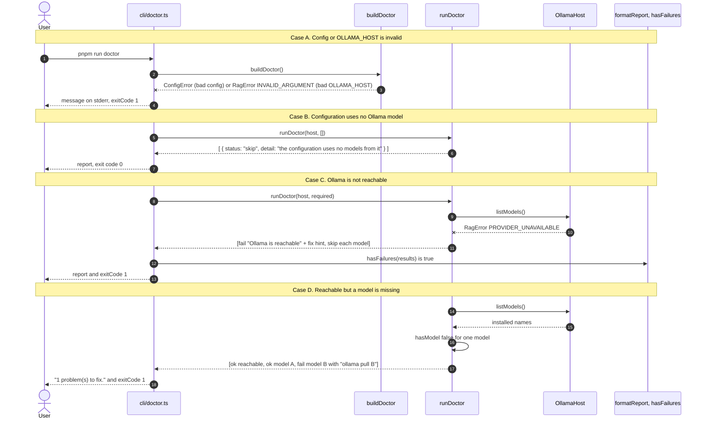

## 8. `OllamaHost.listModels` all cases

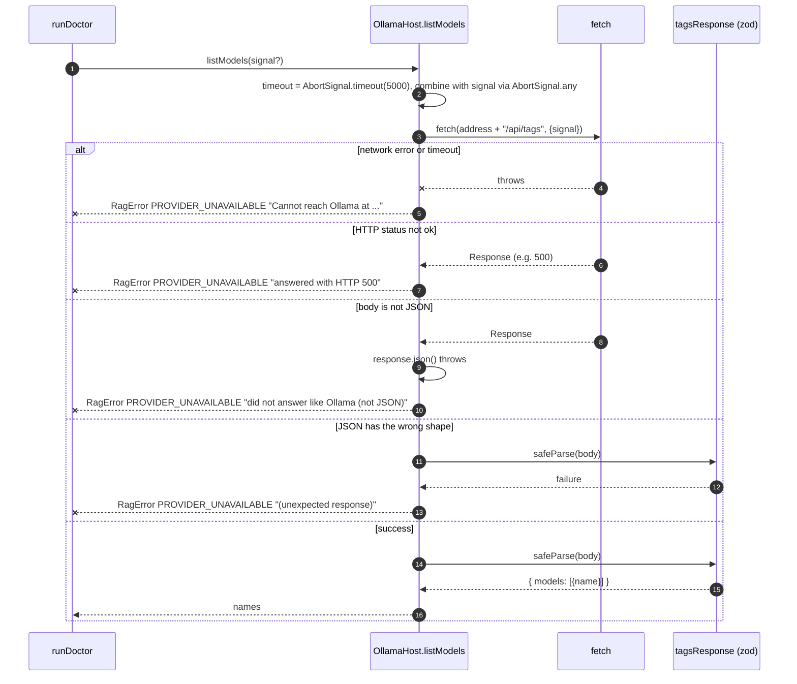

## 9. `normalizeOllamaHost`

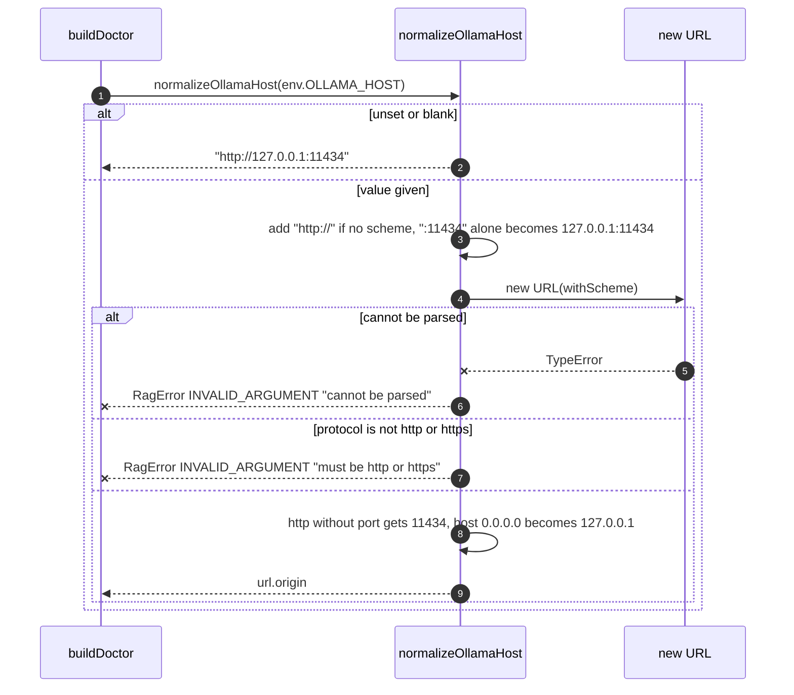

## 10. Ids: DocId and ChunkId

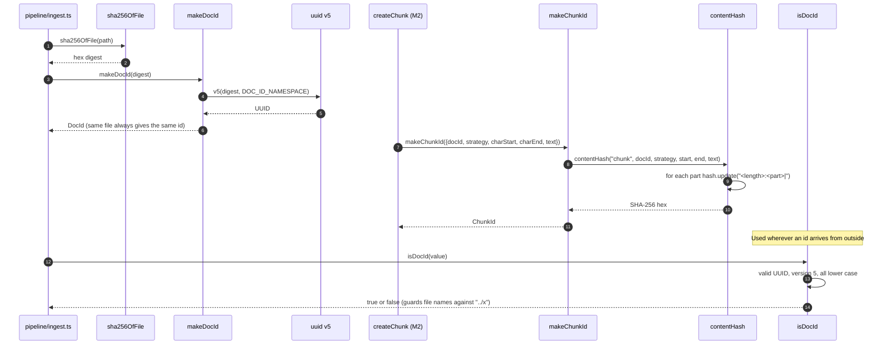

## 11. `sha256OfFile`

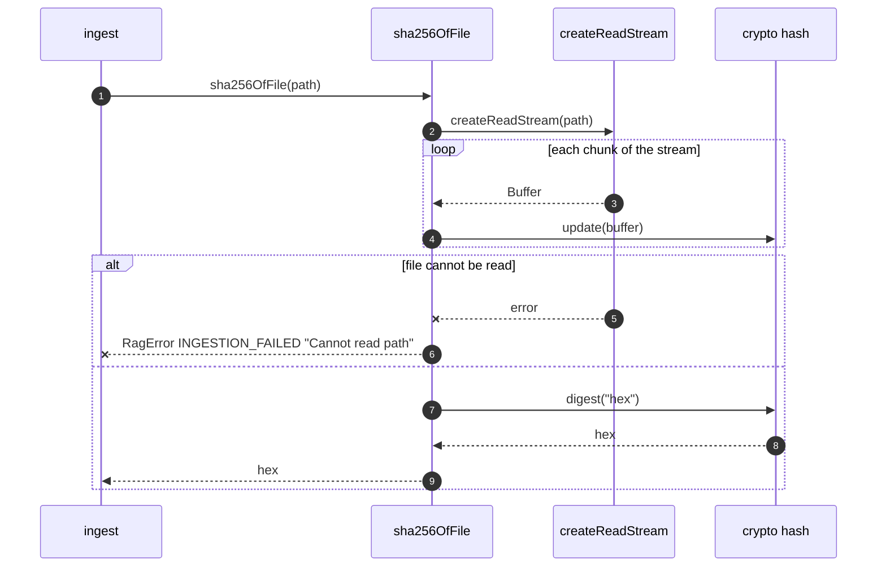

## 12. Logger

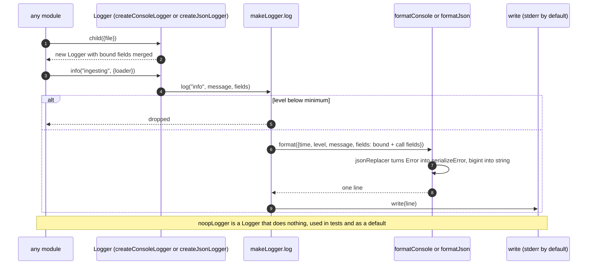

## 13. Trace

`Trace` times pipeline stages. Ingest uses `run`; `start` is for work that does not fit one function.

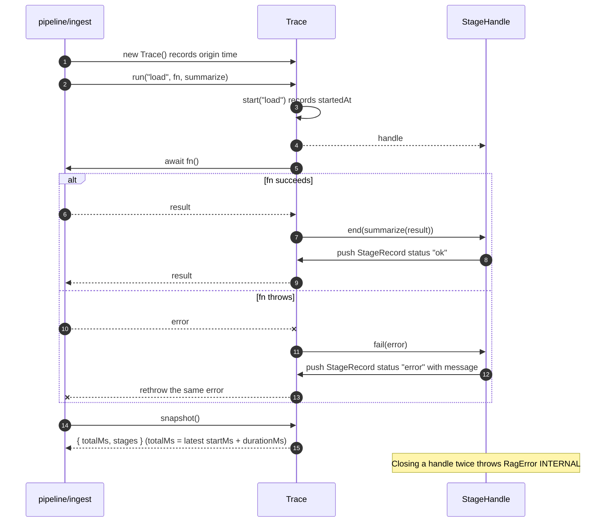

## 14. Errors

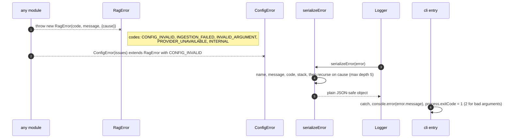
