# M3 Embeddings: function-level sequence diagrams

Back to the [pipeline view](00-pipeline.md). M3 turns text into unit-length vectors behind one
`Embedder` port, caches them, and provides hand-written vector math.

Source map

| Area        | Files                                                                                              |
| ----------- | -------------------------------------------------------------------------------------------------- |
| Port        | `core/ports/embedder.ts` (`Embedder`, `EmbedKind`)                                                 |
| Adapters    | `adapters/embedders/ollama-embedder.ts`, `caching-embedder.ts`, `file-embedding-cache.ts`          |
| Math        | `strategies/ranking/vector-math.ts` (`dot`, `norm`, `normalise`, `cosine`, `euclidean`)            |
| Consumer    | `strategies/chunking/semantic-chunker.ts` (see [M2 diagram 14](m2-chunking.md#14-semanticchunker)) |
| Test helper | `testing/embedder-contract.testing.ts`, `scripts/bench-similarity.ts`                              |

> **Status.** There is no command and no `buildEmbedder` in `composition/` yet, so these classes
> are exercised by tests and by the semantic chunker's constructor. The "production" stack shown
> below (`CachingEmbedder` around `OllamaEmbedder`, with `FileEmbeddingCache`) is how they are
> designed to be assembled.

Cases covered: [1 Assembly](#1-assembling-the-embedder-stack) · [2 OllamaEmbedder constructor](#2-ollamaembedder-constructor) ·
[3 OllamaEmbedder.embed](#3-ollamaembedderembed-batches-and-normalising) · [4 HTTP retry logic](#4-ollamaembedder-post-and-tryonce-retry-logic) ·
[5 CachingEmbedder.embed](#5-cachingembedderembed) · [6 Cache failure cases](#6-cachingembedder-cache-failure-cases) ·
[7 Cache key](#7-embeddingcachekey) · [8 FileEmbeddingCache](#8-fileembeddingcache) · [9 Vector math](#9-vector-math) ·
[10 Embedder contract](#10-the-embedder-contract-test) · [11 Similarity benchmark](#11-pnpm-benchsimilarity)

---

## 1. Assembling the embedder stack

The decorator pattern: callers see an ordinary `Embedder`, the wrapped one does not know it is cached.

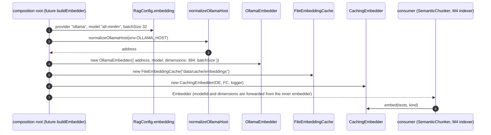

## 2. `OllamaEmbedder` constructor

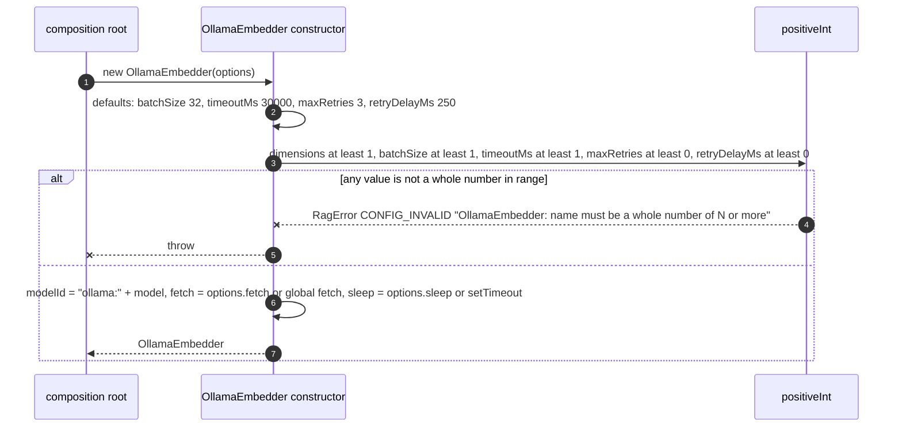

## 3. `OllamaEmbedder.embed`: batches and normalising

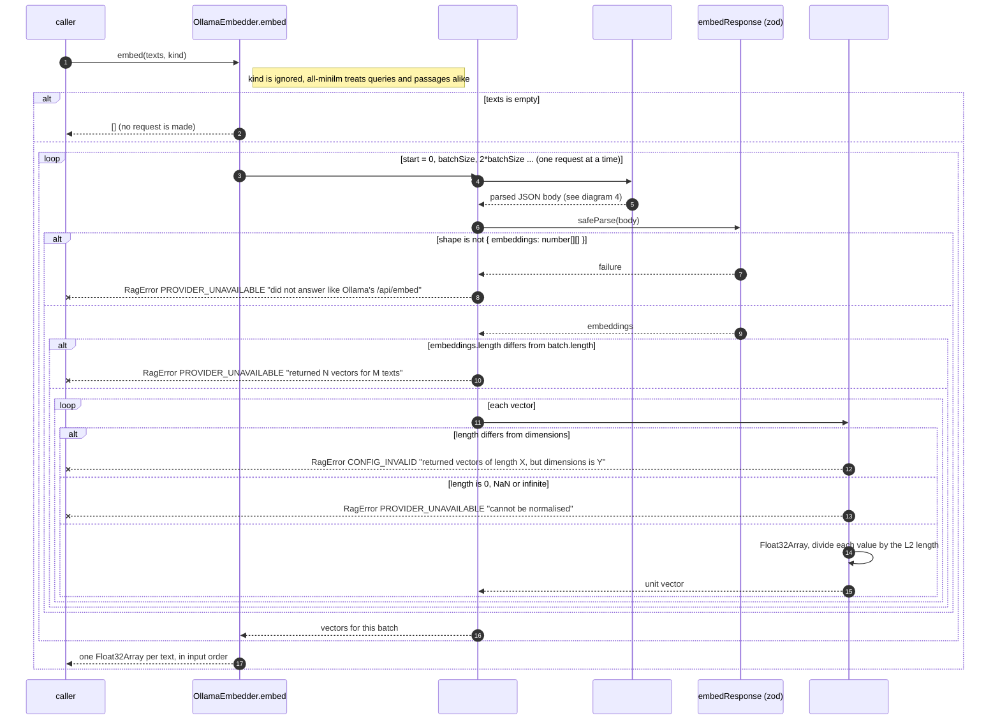

## 4. `OllamaEmbedder` `#post` and `#tryOnce` (retry logic)

Network errors, 5xx and 429 are retried with a doubling wait. Other errors fail at once.

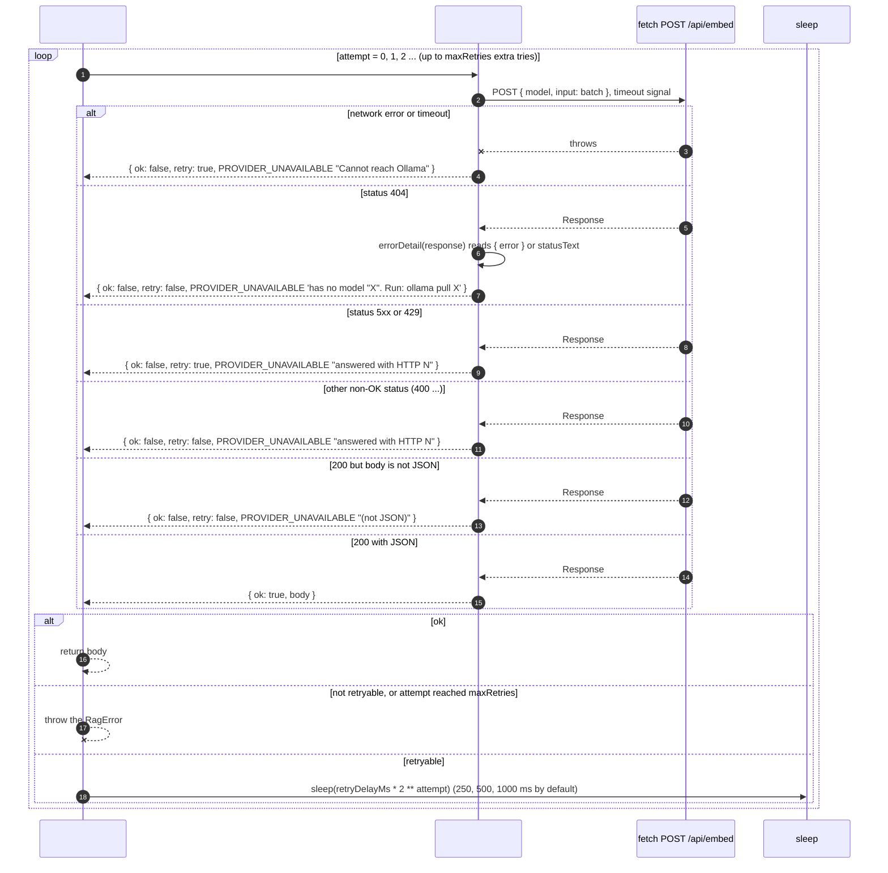

## 5. `CachingEmbedder.embed`

Only texts that were never seen go to the wrapped embedder, in one call. Duplicates are embedded once.

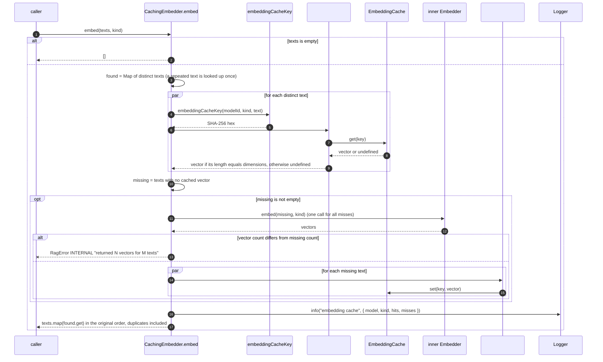

## 6. `CachingEmbedder` cache failure cases

The cache is an optimisation, never a source of truth.

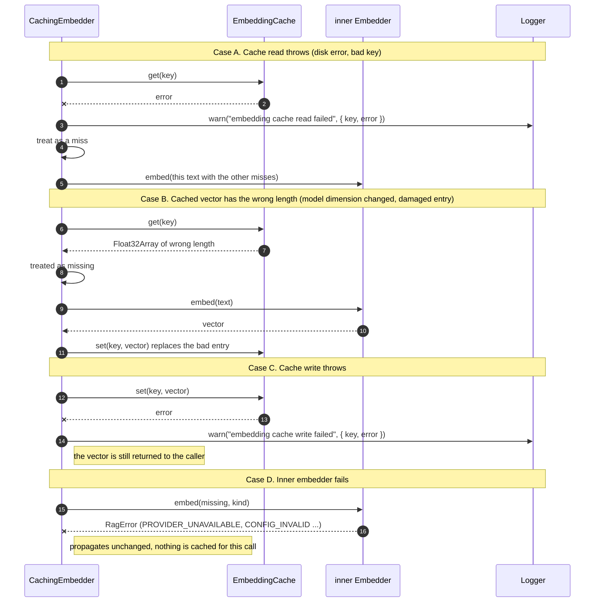

## 7. `embeddingCacheKey`

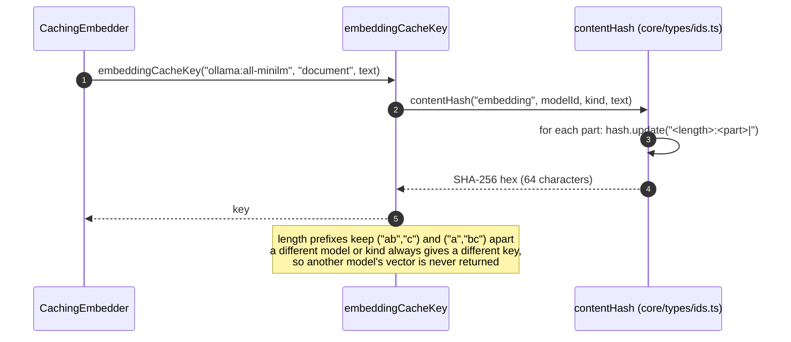

## 8. `FileEmbeddingCache`

One raw float file per vector at `folder/<first 2 hex>/<key>.bin`.

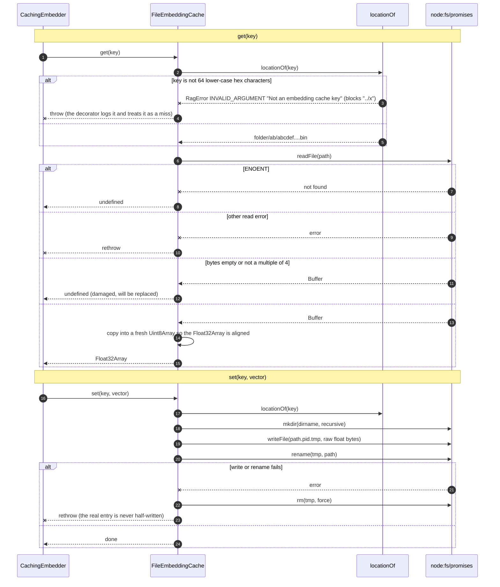

## 9. Vector math

Hand-written on purpose. For unit-length vectors `cosine(a, b)` equals `dot(a, b)`.

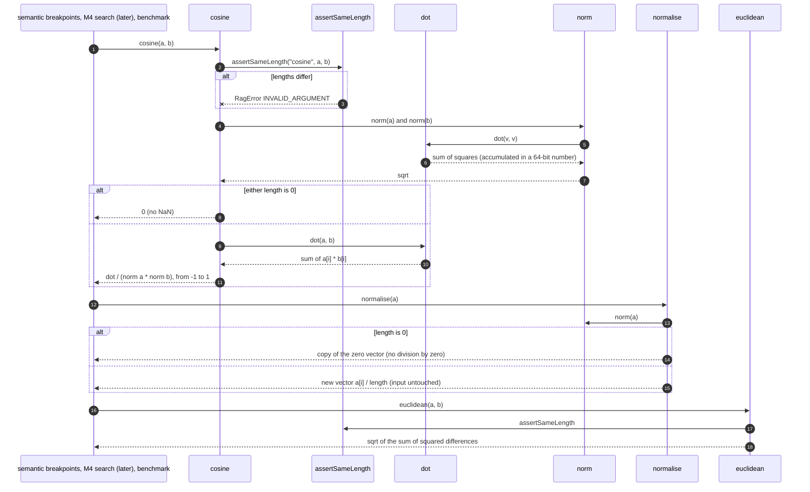

## 10. The embedder contract test

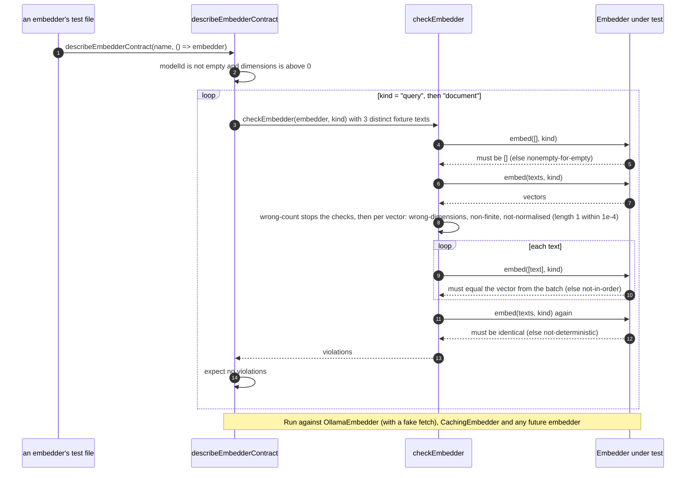

## 11. `pnpm bench:similarity`

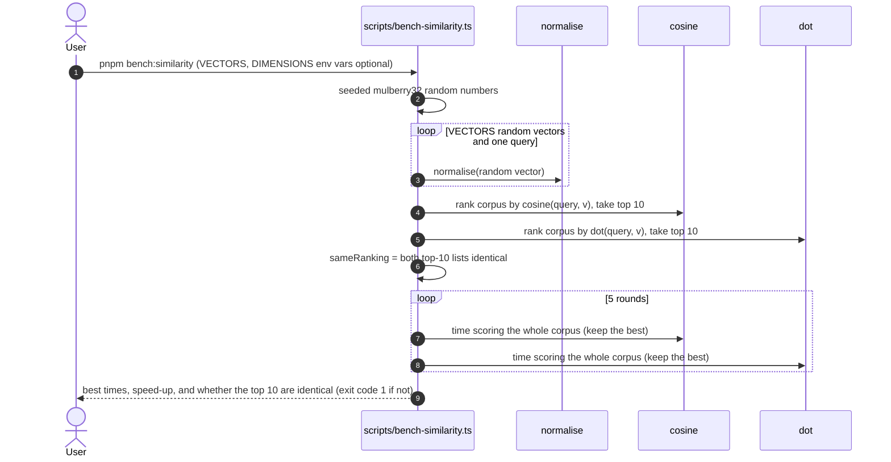
